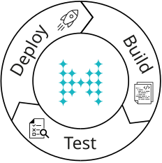

Cluster-side modules are Java classes that a cluster can execute or store in the cloud. You can write cluster-side modules to execute custom code or store custom objects. This guide describes the workflows and best practices for implementing cluster-side modules.

The basic workflow for any cluster-side module is the following:

1. **Build** the Java class and implement any required interfaces.
2. **Test** your implementation on a development cluster.
3. **Deploy** your Java classes to your cluster.

Then, you can use any client to interact with the cluster-side modules such as querying objects or triggering processes.

## What are Cluster-Side Modules

Cluster-side modules include any code that must be deployed as Java code to the cluster, including the following:

<table>
<colgroup>
<col style={{width:'33.3333%'}} />
<col style={{width:'66.6667%'}} />
</colgroup>
<thead>
<tr>
<th>Module</th>
<th>Description</th>
</tr>
</thead>
<tbody>
<tr>
<td>[MapStore](https://docs.hazelcast.org/docs/latest/javadoc/com/hazelcast/map/MapStore.html)</td>
<td>

Load additional and updated data from an external data source to your Hazelcast map, and propogate updates in your Hazelcast map to an external data source.

:::note

If you only need to ingest data, you can use the [MapLoader](https://docs.hazelcast.org/docs/latest/javadoc/com/hazelcast/map/MapLoader.html) module class.

:::

</td>
</tr>
<tr>
<td>[Entry processor](https://docs.hazelcast.org/docs/latest/javadoc/com/hazelcast/map/EntryProcessor.html)</td>
<td>

Atomically execute code on a map entry.

You cannot use a custom name for entry processors in <Variable name="hazelcast-cloud" />. You must use the one called `default`.

</td>
</tr>
<tr>
<td>[Executor](https://docs.hazelcast.org/docs/latest/javadoc/com/hazelcast/core/IExecutorService.html)</td>
<td>

Asynchronously execute tasks, such as database queries, complex calculations, and image rendering.

You cannot use a custom name for executors in <Variable name="hazelcast-cloud" />. You must use the one called `default`.

</td>
</tr>
<tr>
<td>Custom object class (domain objects)</td>
<td>Allow clusters to store or process domain objects that you use in your applications.</td>
</tr>
<tr>
<td>[Pipeline](https://docs.hazelcast.org/docs/latest/javadoc/com/hazelcast/jet/pipeline/Pipeline.html)</td>
<td>Process streaming or batch data in <Variable name="hazelcast-cloud" />, using one or more data sources and sinks.</td>
</tr>
</tbody>
</table>

## Supported Serializers {/* #serializers */}

Cluster-side modules must be serialized because they are sent to other members in the cluster and/or your client applications. <Variable name="hazelcast-cloud" /> supports the following serializers. Follow the links to learn more about these serializers in the Hazelcast Platform documentation.

<table>
<colgroup>
<col style={{width:'27.2727%'}} />
<col style={{width:'27.2727%'}} />
<col style={{width:'36.3636%'}} />
<col style={{width:'9.091%'}} />
</colgroup>
<thead>
<tr>
<th>Serializer</th>
<th>Advantages</th>
<th>Disadvantages</th>
<th>Client support</th>
</tr>
</thead>
<tbody>
<tr>
<td>[Compact Serialization](/hazelcast/latest/serialization/compact-serialization)</td>
<td>

- Convenient, flexible, and can be used with no configuration
- Does not require a class to implement an interface
- Supports schema evolution
- Partial deserialization is supported during queries and indexing

</td>
<td>

- Specific to Hazelcast
- Schema is not part of the data but schema distribution may incur costs on short-lived use cases.

</td>
<td>All clients</td>
</tr>
<tr>
<td>[Hazelcast JSON](/hazelcast/latest/serialization/serializing-json)</td>
<td>

- No member-side coding required

</td>
<td>

- Specific to Hazelcast
- Requires extra metadata to be stored on members.

</td>
<td>All clients</td>
</tr>
<tr>
<td>[Serializable](/hazelcast/latest/serialization/implementing-java-serializable)</td>
<td>

- A standard and basic Java interface
- Requires no implementation

</td>
<td>

- More time and CPU usage
- More space occupancy

</td>
<td>Java only</td>
</tr>
<tr>
<td>[Externalizable](/hazelcast/latest/serialization/implementing-java-serializable)</td>
<td>

- A standard Java interface
- More CPU and memory efficient than Serializable

</td>
<td>

- Serialization interface must be implemented

</td>
<td>Java only</td>
</tr>
</tbody>
</table>

## Requirements and Limitations {/* #prereqs */}

Any Java code in cluster-side modules must meet the following requirements.

### Java Version

<Variable name="hazelcast-cloud" /> supports only Java version 17 or later.

### System-Level APIs

No code in cluster-side modules is allowed to access system-level APIs. Hazelcast throws a Java security exception if any cluster-side modules try to access these APIs.

### Package Names

Your package names must not start with `com.hazelcast`. Hazelcast ignores these packages.

### Package Size

<Variable name="hazelcast-cloud" /> allows you to upload packaged files up to 500 MB. Larger files are rejected.

### Dependency Conflicts

The libraries in your project must not conflict with those that are built into <Variable name="hazelcast-cloud" />. If your project includes a library that's already available in <Variable name="hazelcast-cloud" />, you may experience conflicts that stop Hazelcast from processing your cluster-side modules. To avoid packaging conflicting libraries in your code, we recommend using one of the following options:

- **Shaded JARs:** When you shade JARs, the classes inside them are relocated and rewritten to create a private copy of them that is bundled alongside your code. To learn more about shaded JARs, see this [answer on Stack Overflow](https://softwareengineering.stackexchange.com/questions/297276/what-is-a-shaded-java-dependency).
- **Provided scope:** When you use the provided scope for a JAR, it is available in your classpath during compilation but will not be packaged with your project archive. To learn more about provided scope, see the docs for your build tool:

  - [Maven](https://maven.apache.org/guides/introduction/introduction-to-dependency-mechanism.html#Dependency_Scope)
  - [Gradle](https://docs.gradle.org/current/userguide/migrating_from_maven.html#migmvn:declaring_deps)

## Best Practices for Testing

Before you go into production with your cluster-side modules, it's best to test them on a development cluster to make sure that they work as expected. To test cluster-side modules, follow these best practices:

- Use a [development cluster](../../get-started/hazelcast-cloud/serverless-cluster.mdx): It's faster to test cluster-side modules in a development cluster.
- Use the <a href="/cloud/maven-plugin-hazelcast"><Variable name="hazelcast-cloud" /> Maven plugin</a>: The Maven plugin allows you to package and deploy your cluster-side modules in a single command from your IDE. You can also debug your cluster-side modules by streaming cluster logs after deployment.

## Moving to Production {/* #deploy */}

After testing your cluster-side modules, you need to deploy them to production.

For production, you can deploy your cluster-side modules to a production cluster on either <a href="/cloud/create-serverless-cluster"><Variable name="hazelcast-cloud" /> Standard</a> or <a href="/cloud/create-dedicated-cluster"><Variable name="hazelcast-cloud" /> Dedicated</a>.

:::note

You must provide a [payment card or other payment method](../../organizations-and-accounts/organization/payment-methods/overview.mdx) to run more than one <Variable name="hazelcast-cloud" /> cluster.

:::

## Tutorials

Get hands-on with cluster-side modules by following a tutorial:

- [Use Cloud Standard as a Write-Through Cache with MongoDB Atlas](/tutorials/write-through-cache-serverless-mapstore)
