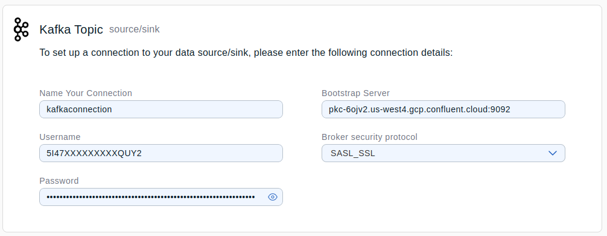
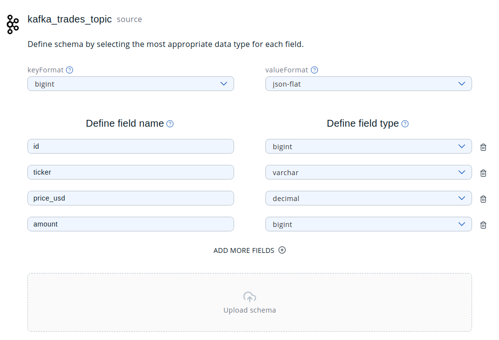

import PartialCreatePostgresConnection from '@site/cloud/_partials/create-postgres-connection.mdx';

You can create a data connection to a Kafka topic on any cloud-based Kafka cluster.

## Creating a New Data Connection

Once you have created the data connection, you cannot update it using the connector wizard. Instead, you must delete and recreate it. However, you can create additional mappings to query any data made available by the data connection.

### Start the Connector Wizard

<PartialCreatePostgresConnection/>

1. Sign into the <Variable href="{page-cloud-console}" text="{hazelcast-cloud} console"/>.
2. Select the cluster where you want to create the data connection.
3. In the left navigation, select **SQL** to open the SQL browser.
4. In the **Data Explorer**, click **Connector Wizard** and select the **Kafka Topic** connector.

### Set Up a Connection

Next, create and save the reusable connection to your Kafka cluster.

1. Enter all of the following connection details:

   - **Name Your Connection**: A short name to identify your data connection.
   - **Username**: The username for your Kafka cluster. In Confluent Cloud, this is the API key.
   - **Password**: The password for your Kafka cluster. In Confluent Cloud, this is the API secret.
   - **Bootstrap Server**: The connection string for the Kafka server where your Kafka broker is hosted. In Confluent Cloud, you can find this in your cluster settings. Otherwise, the connection string will have the format: `127.0.0.1:9092`.
   - **Broker Security Protocol**: The security protocol that you want to use to protect your message data whilst in transit. Choose from the following:

     - **PLAINTEXT**: Username and password authentication with no encryption.
     - **SSL**: Username and password authentication over SSL. All messages are encrypted with TLS.
     - **SASL\_PLAINTEXT**: Username and password authentication using Simple Authentication and Security Layer (SASL).
     - **SASL\_SSL**: Username and password authentication using SASL. All messages are encrypted with SSL. This is the default security option for Confluent Cloud.

   
2. Click **Test & Save Connection** and wait for the connector wizard to make a successful connection to the Kafka cluster. If an error is displayed, go to the [Troubleshooting section](#Troubleshooting).

   :::note

   Once the connection details are saved, you cannot view or update them.

   :::

### Choose Resources

Choose the Kafka topic that you want to read from or write to from your <Variable name="hazelcast-cloud"/> cluster and create a mapping to it.

1. Enter a unique name for your mapping.
2. From the **Choose Topic** list, select the Kafka topic that you want to query. All topics are listed using the following format: "topic name".
3. Click **Next Step**.

### Data Definition

For the topic selected in the previous step, specify the following.

1. Select the key/value format for the message data in your Kafka topic. These values tell Hazelcast how to serialize/deserialize keys and values when messages are processed by Hazelcast.
2. Enter the field names and associated data types that you might want to query. Choose the most appropriate data type if an exact match is not available.

   
3. Click **Generate Mapping Command** to generate the SQL that creates the data connection to your Kafka topic and a mapping to the selected data.

   ```sql
   CREATE MAPPING "trades_feed"
   EXTERNAL NAME "trades" (
       id bigint,
       ticker varchar,
       price_usd decimal,
       amount bigint
   )
   DATA CONNECTION "kafkaconnection"
   OPTIONS(
       'keyformat' = 'bigint',
       'valueFormat' = 'json-flat'
   );
   ```

   :::note

   This is a lazy connection. An actual connection to the source or sink is not made until the data is queried.

   :::
4. Click **Confirm & Run**. Both the data connection and mapping are added to the Data Explorer.

   :::tip

   If your Data Explorer remains empty, select the refresh symbol.

   :::

You're ready to start querying your data in the SQL browser.

## Troubleshooting {/* #Troubleshooting */}

If the connector wizard fails to make a connection to your Kafka cluster, check the following:

- Make sure that the database credentials are entered correctly.
- Check for error messages in the [cluster logs](/cloud/logging).

## Related Resources

- [SQL Statements](/hazelcast/latest/sql/sql-statements)
- [Get Started with SQL Over Kafka](/hazelcast/latest/sql/learn-sql)
- [Stream Processing in SQL](/hazelcast/latest/sql/querying-streams)
- [Adding a Mapping to a Kafka Data Connection](/cloud/add-kafka-mapping)
- [Deleting a Data Connection to Kafka](/cloud/delete-kafka-connection)
