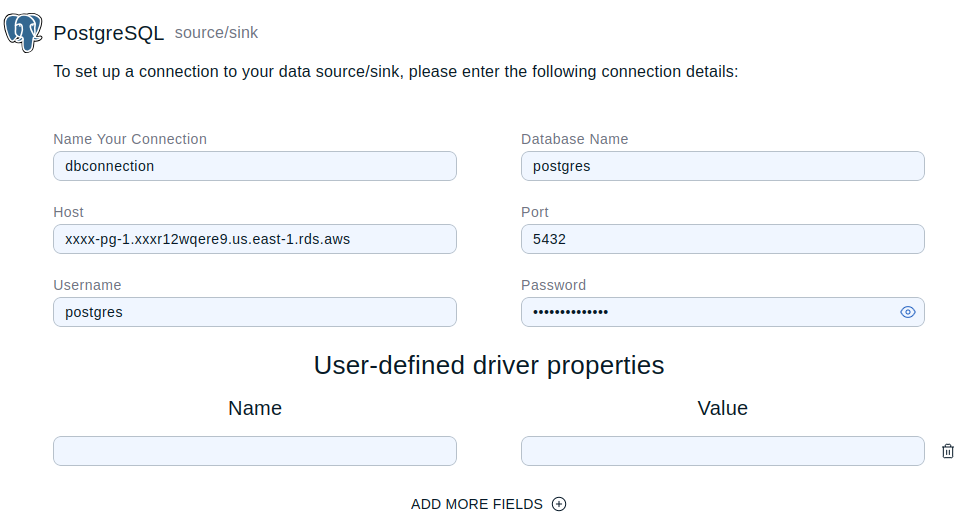
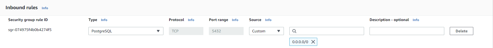

You can create a data connection to any cloud-based PostgreSQL database instance.

## Creating a New Data Connection

Once you have created the data connection, you cannot update it using the connector wizard. Instead, you must delete and recreate it. However, you can create additional mappings to query any data made available by the data connection.

### Start the Connector Wizard

To open the connector wizard do the following:

1. Sign into the <Variable href="{page-cloud-console}" text="{hazelcast-cloud} console"/>.
2. Select the cluster where you want to create the data connection.
3. In the left navigation, select **SQL** to open the SQL browser.
4. In the **Data Explorer**, click **Connector Wizard** and select the **PostgreSQL** connector.

### Set Up a Connection

Next, create and save the reusable data connection to your database instance.

1. Enter all of the following connection details:

   - **Name Your Connection**: A short name to identify your data connection.
   - **Database Name**: The exact name of your PostgreSQL database.
   - **Host**: The address of the PostgreSQL database server. For example, for AWS, enter the endpoint of the database instance. Refer to your cloud provider's documentation for more information.
   - **Port**: By default, this is 5432.
   - **Username**: The username for your database.
   - **Password**: The password for your database URL encoded.

   
2. Click **Test & Save Connection** and wait for the connector wizard to make a successful connection to your database. If an error is displayed, go to the [Troubleshooting section](#Troubleshooting).

   :::note

   Once the connection details are saved, you cannot view or update them.

   :::

### Choose Resources

Choose the database table that you want to read from or write to from your <Variable name="hazelcast-cloud"/> cluster and create a mapping to it.

1. Enter a unique name for your mapping.
2. From the **Choose Table** list, select the database table that you want to query. All table names are listed using the following format: "schema"."table name".
3. Click **Next Step**.

### Data Definition

For the database table selected in the previous step, specify the data resources that you might want to query.

1. Enter the field names and associated data types. Choose the most appropriate data type if an exact match is not available.
2. Click **Generate Mapping Command** to generate the SQL that creates the data connection to your database instance and a mapping to the selected data.

   ```sql
   CREATE MAPPING "transactions_data"
   EXTERNAL NAME "transactions"."price_data" (
       id integer,
       name varchar,
       ssn varchar
   )
   DATA CONNECTION "dbconnection"
   ```

   :::note

   This is a lazy connection. An actual connection to the source or sink is not made until the data is queried.

   :::
3. Click **Confirm & Run**. Both the data connection and mapping are added to the Data Explorer.

   :::tip

   If your Data Explorer remains empty, select the refresh symbol.

   :::

You're ready to start querying your data in the SQL browser.

## Troubleshooting {/* #Troubleshooting */}

If the connector wizard fails to make a connection to your database instance, check the following:

- Try to establish a connection using another tool. For example, DBeaver.
- Make sure that the database credentials are entered correctly.
- Check the host details required to connect to a PostgreSQL database instance for your cloud provider.
- In your cloud environment:

  - Check the rules for inbound requests to the PostgreSQL database instance. You may need to update the existing rules to allow access to PostgreSQL on port 5432. Here is an example configuration from AWS.

    
  - Make sure that the database instance is publicly accessible. This allows access to PostgreSQL using SSL without certificate verification. SSL in verification mode is not currently supported.
- Check for error messages in the [cluster logs](/cloud/logging).

## Related Resources

- [SQL Statements](/hazelcast/5.7/sql/sql-statements)
- [SQL Basics on Hazelcast Cloud](/tutorials/sql_stock_ticker_cloud)
- [Adding a Mapping to a PostgreSQL Data Connection](/cloud/add-postgres-mapping)
- [Deleting a Data Connection to PostgreSQL](/cloud/delete-postgres-connection)
