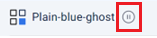

import PartialCreateServerlessCluster from '@site/cloud/_partials/create-serverless-cluster.mdx';
import Tabs from '@theme/Tabs';
import TabItem from '@theme/TabItem';

In this tutorial, you'll learn how to connect a client to a cluster and use SQL to query data in the cluster.

## Before you Begin

You need the following:

- A <a href="/cloud/create-account"><Variable name="hazelcast-cloud"/> account</a>.
- Access to a command prompt, such as Terminal for Mac or Powershell for Windows.

## Step 1. Start a Cluster on <Variable name="hazelcast-cloud"/> Standard or Trial {/* #step-1-start-a-cluster-on-cloud-standard-or-trial */}

If you already have a cluster.

1. Sign in to the <Variable href="{page-cloud-console}" text="{hazelcast-cloud} console"/>
2. Check that your cluster is running. If it is paused, you'll see the following at the top of the dashboard.

   
3. If you need to restart the cluster, in the **Cluster Details** panel, click **Resume**.
4. Next to **Connect Client**, click the client you want to try and go to [step 2](#step-2).

To create a new development cluster on <Variable name="hazelcast-cloud"/> Standard.

<PartialCreateServerlessCluster/>

## Step 2. Connect a Sample Client {/* #step-2 */}

To connect to your <Variable name="hazelcast-cloud"/> Standard or Trial cluster, you need a Hazelcast client. The cluster comes with sample clients that are preconfigured to connect to your cluster and add some sample data to a map. A map is an in-memory, key/value data structure that is often used as a cache.

Choose a client and follow the instructions.

<Tabs>
<TabItem value="java" label="Java">

Before you begin:

- Install Java 17 or later and set the `JAVA_HOME` environment variable to the location of your JRE.
- If you've followed the onscreen **Quick Connection Guide**, jump straight to [step 5](#step-5).

1. In the **Quick Connection Guide** on your cluster, click on the Java icon and then click **Download**.
2. Extract the ZIP file.
3. From a command prompt, change into the root directory of the extracted files.
4. Execute one of the following commands to run your client:

   1. If you use Linux or Mac, execute:

      ```bash
      ./mvnw clean compile exec:java@client-with-ssl
      ```
   2. If you use Windows, execute:

      ```bash
      mvnw.cmd clean compile exec:java@client-with-ssl
      ```

      When you see `Connection Successful!` in the output, the client is successfully connected to your cluster on <Variable name="hazelcast-cloud"/> and populates a `cities` map with data.

      :::note

      The functionality described in the following steps is not currently available in <Variable name="hazelcast-cloud"/> Trial.

      :::
5. <span id="step-5"></span>Continue to the [next step](#step-3) to query data in the `cities` map.

:::tip

Take a moment to read the code in the [`ClientWithSSL.java`](https://github.com/hazelcast/hazelcast-cloud-java-sample-client/blob/5.1/src/main/java/com/hazelcast/cloud/ClientWithSsl.java) file to understand how the client connected.

:::

</TabItem>
<TabItem value="python" label="Python">

Before you begin:

- [Install Python 3.6 or newer](https://www.python.org/downloads/).
- If you've followed the onscreen **Quick Connection Guide**, jump straight to [step 5](#step-5py).

1. In the **Quick Connection Guide**, click on the Python icon and then click **Download**.
2. Extract the ZIP file.
3. From a command prompt, change into the root directory of the extracted files.
4. Execute the following command to run your client:

   ```bash
   python3 -m pip install -r requirements.txt && python client_with_ssl.py
   ```

   When you see `Connection Successful!` in the output, the client is successfully connected to your cluster on <Variable name="hazelcast-cloud"/> and populates a `cities` map with data.

   :::note

   The functionality described in the following steps is not currently available in <Variable name="hazelcast-cloud"/> Trial.

   :::
5. <span id="step-5py"></span>Continue to the [next step](#step-3) to query data in the `cities` map.

:::tip

Take a moment to read the code in the [`client_with_ssl.py`](https://github.com/hazelcast/hazelcast-cloud-python-sample-client/blob/5.1/client_with_ssl.py) file to understand how the client connected.

:::

</TabItem>
<TabItem value="net" label=".NET">

Before you begin:

- [Install .NET](https://dotnet.microsoft.com/en-us/download/dotnet/6.0).
- If you've followed the onscreen **Quick Connection Guide**, jump straight to [step 5](#step-5net).

1. In the **Quick Connection Guide**, click on the .NET icon and then click **Download**.
2. Extract the ZIP file.
3. From a command prompt, change into the root directory of the extracted files.
4. Execute the following command to run your client:

   ```bash
   dotnet run --project ClientWithSsl
   ```

   When you see `Connection Successful!` in the output, the client is successfully connected to your cluster on <Variable name="hazelcast-cloud"/> and populates a `cities` map with data.

   :::note

   The functionality described in the following steps is not currently available in <Variable name="hazelcast-cloud"/> Trial.

   :::
5. <span id="step-5net"></span>Continue to the [next step](#step-3) to query data in the `cities` map.

:::tip

Take a moment to read the code in the [`program.cs`](https://github.com/hazelcast/hazelcast-cloud-csharp-sample-client/blob/5.1/ClientWithSsl/Program.cs) file to understand how the client connected.

:::

</TabItem>
<TabItem value="cli-clc" label="CLI (CLC)">

If you've followed the onscreen **Quick Connection Guide** in the <Variable href="{page-cloud-console}" text="{hazelcast-cloud} console"/>, jump straight to [step 6](#step-5clc).

1. [Install the Hazelcast CLC client](/clc/latest/install-clc) for your operating system.
2. Run the following command to check that the Hazelcast CLC client is installed.

   ```shell
   clc version
   ```

   If installed, the installed version of the Hazelcast CLC client displays.
3. In the **Quick Connection Guide**, go to step 2 and run the `clc config import` command to import the configuration of your <Variable name="hazelcast-cloud"/> cluster.
4. Now execute the following command to connect the Hazelcast CLC to your cluster. Replace the placeholder `$CLUSTER_NAME`. You can find the cluster ID on the dashboard of your cluster under **Cluster Details**.

   ```bash
   clc -c pr-$CLUSTER_NAME
   ```

   A CLC prompt is displayed:

   ```none
   pr-$CLUSTER_NAME>
   ```

   The Hazelcast CLC client is successfully connected to your cluster.
5. <span id="step-5clc"></span>Quit the Hazelcast CLC before you continue.

   ```none
   \exit
   ```
6. <span id="step-x"></span>Create a mapping to a new map called `cities`.

   ```bash
   clc sql -c pr-$CLUSTER_NAME "CREATE OR REPLACE MAPPING cities (
   __key INT,
   country VARCHAR,
   city VARCHAR,
   population INT)
   type IMap OPTIONS('keyFormat'='int', 'valueFormat'='json-flat');"
   ```
7. Add some data to the map.

   ```bash
   clc sql -c pr-$CLUSTER_NAME "INSERT INTO cities VALUES
   (1, 'United Kingdom','London', 9540576),
   (2, 'United Kingdom','Manchester', 2770434),
   (3, 'United States', 'New York', 19223191),
   (4, 'United States', 'Los Angeles', 3985520),
   (5, 'Turkey', 'Ankara', 5309690),
   (6, 'Turkey', 'Istanbul', 15636243),
   (7, 'Brazil', 'Sao Paulo', 22429800),
   (8, 'Brazil', 'Rio de Janeiro', 13634274);"
   ```
8. Continue to the [next step](#step-3) to query your sample data using SQL queries with CLC.

</TabItem>
</Tabs>

## Step 3. Query the Cache Using CLC {/* #step-3 */}

Now that you have some data in your cluster, you can query it using CLC. In the following instructions, we use interactive mode to run SQL queries directly.

:::note

Ensure that there is a semi-colon (;) at the end of each SQL query. If this is omitted, CLC assumes that you are entering a multi-line query.

:::

If CLC is not connected, enter the following command replacing the `$CLUSTER_NAME` placeholder with your cluster ID:

```bash
clc -c pr-$CLUSTER_NAME
```

A CLC prompt is displayed:

```none
pr-$CLUSTER_NAME>
```

:::note

You can find the cluster ID on the dashboard of your cluster under **Cluster Details**.

:::

In the following steps, you enter SQL queries at the CLC prompt to display data in your cluster.

1. Run the following `SELECT` statement to query all data in the map:

   ```sql
   SELECT * FROM cities;
   ```

   ```none
   +------------+--------------------+--------------------+--------------+
   |       __key|country             |city                |population    |
   +------------+--------------------+--------------------+--------------+
   |           2|United Kingdom      |Manchester          |2770434       |
   |           6|Turkey              |Ankara              |5309690       |
   |           1|United Kingdom      |London              |9540576       |
   |           7|Brazil              |Sao Paulo           |22429800      |
   |           8|Brazil              |Rio de Janeiro      |13634274      |
   |           5|Turkey              |Istanbul            |15636243      |
   |           4|United States       |Los Angeles         |3985520       |
   |           3|United States       |New York            |19223191      |
   +------------+--------------------+--------------------+--------------+
   ```

   The results are in a random order because the data is distributed across the cluster. Whenever a cluster member has the result, it returns it to the client.
2. Run the following `SELECT` statement to order the results by the key:

   ```sql
   SELECT * FROM cities ORDER BY __key;
   ```

   Now, you see the results ordered from key 1 to key 8.
3. Run the following `SELECT` statement to query only the countries using a filter on the `countries` column:

   ```sql
   SELECT country FROM cities;
   ```

   ```none
   +--------------------+
   |country             |
   +--------------------+
   |United Kingdom      |
   |Turkey              |
   |United Kingdom      |
   |Brazil              |
   |Brazil              |
   |Turkey              |
   |United States       |
   |United States       |
   +--------------------+
   ```
4. Run the following `SELECT` statement to query only the cities using a filter on the `cities` column:

   ```sql
   SELECT city FROM cities;
   ```

   ```none
   +--------------------+
   |city                |
   +--------------------+
   |Manchester          |
   |Ankara              |
   |London              |
   |Sao Paulo           |
   |Rio de Janeiro      |
   |Istanbul            |
   |Los Angeles         |
   |New York            |
   +--------------------+
   ```
5. Run the following `SELECT` statement to display cities in alphabetical order at the start of the output:

   ```sql
   SELECT city, country
   FROM cities
   ORDER BY city;
   ```

   ```none
   +--------------------+--------------------+
   |city                |country             |
   +--------------------+--------------------+
   |Ankara              |Turkey              |
   |Istanbul            |Turkey              |
   |London              |United Kingdom      |
   |Los Angeles         |United States       |
   |Manchester          |United Kingdom      |
   |New York            |United States       |
   |Rio de Janeiro      |Brazil              |
   |Sao Paulo           |Brazil              |
   +--------------------+--------------------+
   ```
6. Run the following `SELECT` statement to apply a filter that displays only countries where the name of the city is at least 11 characters long:

   ```sql
   SELECT country FROM cities WHERE LENGTH(city) >= 11;
   ```

   ```none
   +--------------------+
   |country             |
   +--------------------+
   |Brazil              |
   |United States       |
   +--------------------+
   ```
7. Run the following `SELECT` statement to apply a filter that displays only cities that begin with the letter 'L' and have a length greater than 6:

   ```sql
   SELECT city
   FROM cities
   WHERE city LIKE 'L%' AND LENGTH(city) > 6;
   ```

   ```none
   +--------------------+
   |City                |
   +--------------------+
   |Los Angeles         |
   +--------------------+
   ```

## Summary

You learned how to connect to a cluster and use SQL in a CLC shell to query data in the cluster.

## Next Steps

Learn more about <Variable name="hazelcast-cloud"/>:

- [Cloud Standard Clusters](/cloud/serverless-cluster)
- [Developer Guide for Cloud](/cloud/developer-guide)

Try a [tutorial](/cloud/tutorials).

Find out more about the SQL statements used in this tutorial:

- [CREATE MAPPING](/hazelcast/latest/sql/create-mapping)
- [SELECT](/hazelcast/latest/sql/select)
- [Expressions, Functions and Operators](/hazelcast/latest/sql/functions-and-operators).
- [All SQL statements](/hazelcast/latest/sql/sql-statements).

Learn more about using clients:

- [Java client](/hazelcast/latest/clients/java#configuring-java-client)
- [Python client](https://hazelcast.readthedocs.io/en/stable/configuration_overview.html)
- [.NET client](http://hazelcast.github.io/hazelcast-csharp-client/latest/doc/index.html)
- [CLI (CLC) client](/clc/latest/overview)
- [SQL browser](/management-center/latest/tools/sql-browser).
