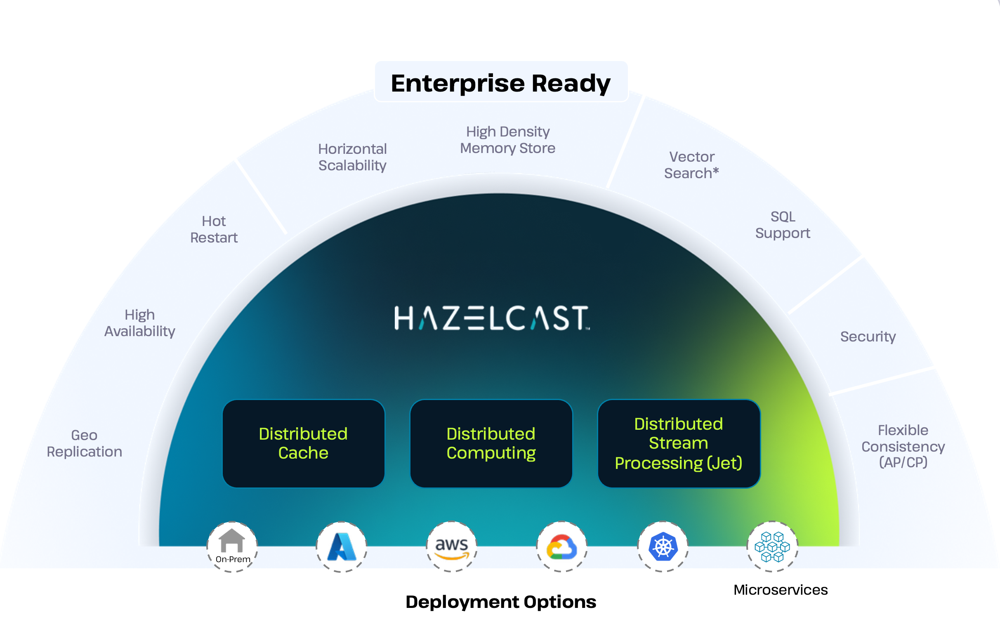

Welcome to the documentation for Hazelcast Platform, the leading in-memory data grid and compute platform for building real-time applications.

Hazelcast Platform combines a fast data store and powerful stream processing into a single platform, eliminating latency moving data between databases and processing.

Hazelcast offers [Enterprise Edition](./get-started-enterprise/overview.mdx) and [Community Edition](./start-a-local-cluster/get-started-docker.mdx) versions of Hazelcast Platform with a range of deployment options, including Docker and Kubernetes. You can get started with either version by following the quickstarts below.

Hazelcast Enterprise Edition is a licensed product that extends the Community Edition to provide many additional [features and benefits](./editions.mdx#key-features-and-benefits) for production environments, including regular patch releases and a [support](./support.mdx) subscription.

Hazelcast is implemented in Java (with choice of embedded or client/server mode) and has [clients](../clients-and-apis/client-overview.mdx) for Java, C++, .NET, REST, Python, Go and Node.js. Hazelcast also speaks Memcache and REST protocols.

## Get started

The best way to get started and understand Hazelcast is to dive in and create a Hello World application.

- [Get started with Community Edition](./start-a-local-cluster/get-started-docker.mdx)
- [Get started with Enterprise Edition](./get-started-enterprise/overview.mdx)
- [What is Hazelcast Platform?](./what-is-hazelcast.mdx)
- [Enterprise Edition vs. Community Edition](./editions.mdx)
- [Get started with clients](./hazelcast-clients/overview.mdx)

## Install and upgrade

If you're looking for more detailed information on what's new and how to install or upgrade existing Hazelcast deployments, check out the sections below.

- [What's new](./whats-new.mdx)
- [Release Notes](../install-and-upgrade/releases.mdx)
- [Install Enterprise Edition](../install-and-upgrade/enterprise-edition/install-enterprise.mdx)
- [Install Community Edition](../install-and-upgrade/community-edition/install-hazelcast.mdx)
- [Deploy in cloud environments](../install-and-upgrade/overview/deploying-in-cloud/overview.mdx)

## Deploy and build

Find out how Hazelcast works under the hood, and learn how to deploy and build applications with Hazelcast.

- [Available topologies](../install-and-upgrade/overview/choosing-a-deployment-option.mdx)
- [Architecture](../develop-and-build/architecture/architecture.mdx)
- [Deploy with Kubernetes](../develop-and-build/kubernetes/deploying-in-kubernetes.mdx)
- [Distributed data structures](../develop-and-build/distributed-data-structures/distributed-data-structures.mdx)
- [Serialization](../develop-and-build/serialization/serialization.mdx)

## Operate and manage

Discover how to operate and manage your Hazelcast clusters effectively.

- [Configuration](../operate-and-manage/configuration/understanding-configuration.mdx)
- [Security](../operate-and-manage/securing-a-cluster/overview.mdx)
- [Persistence](../operate-and-manage/fault-tolerance/persistence/persistence.mdx)
- [CP Subsystem](../operate-and-manage/cp-subsystem/cp-subsystem.mdx)
- [WAN / Geo replication](../operate-and-manage/synchronizing-data-across-clusters/wan-replication-tutorial.mdx)

## Integrate

Learn how to integrate Hazelcast with various frameworks and tools.

- [Connectors](../connectors/connectors.mdx)
- [Clients and APIs](../clients-and-apis/client-overview.mdx)
- [Integrate with Spring](../frameworks-and-plugins/overview/overview.mdx)
- [Integrate with Feast](../frameworks-and-plugins/integrate-with-feast/overview.mdx)
- [Integrate with Vert.x](../frameworks-and-plugins/integrate-with-vertx/overview.mdx)

## Tools

Hazelcast also provides tools for managing your Hazelcast clusters and Kubernetes/Openshift deployments.

- [Management Center](/management-center/5.12-snapshot/getting-started/overview)
- [Platform Operator for Kubernetes](/operator/latest-snapshot/)
- [Hazelcast Cloud](https://docs.hazelcast.com/cloud/)
- [Command Line Client (CLC)](/clc/latest/overview)
