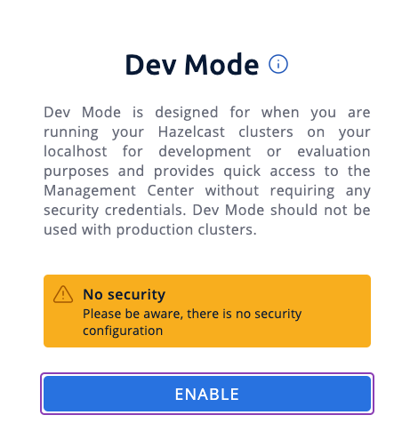
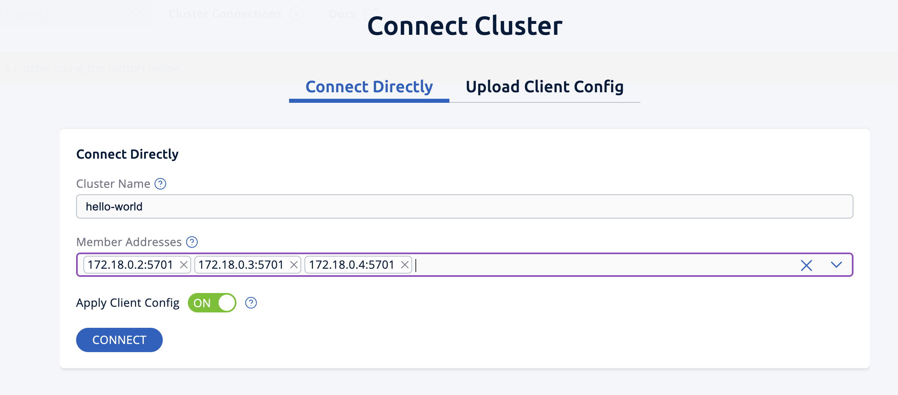
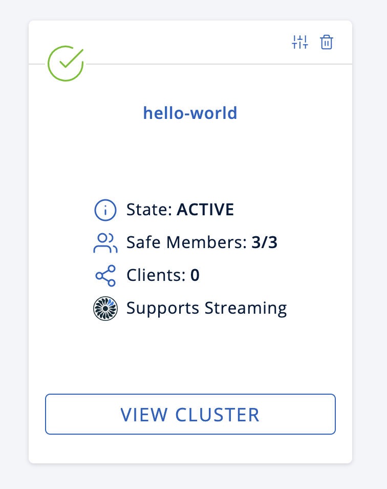
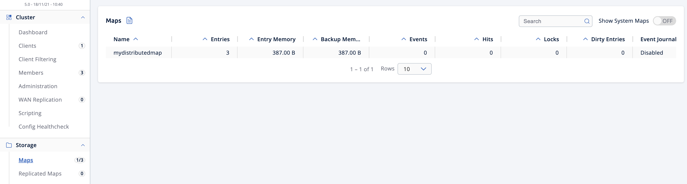
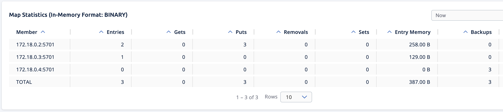
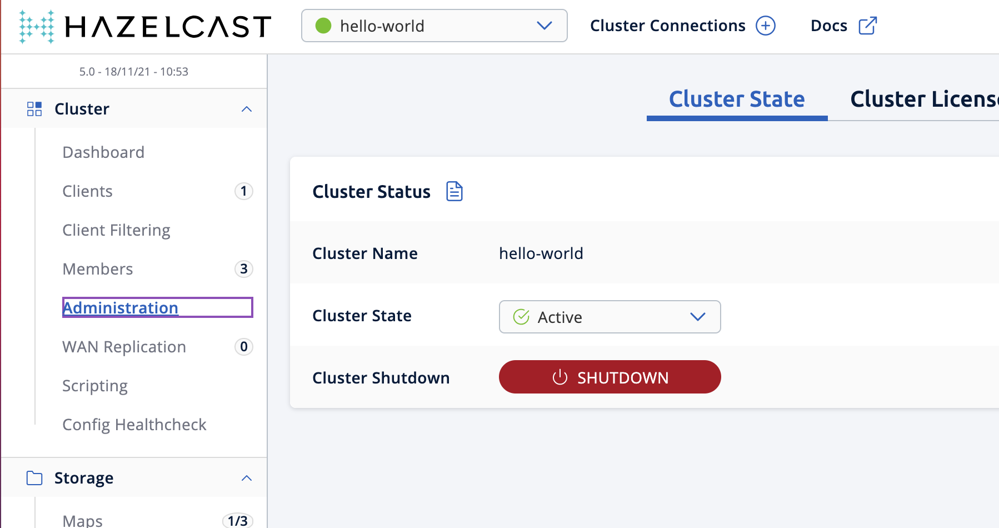

This tutorial introduces you to Hazelcast with Persistence enabled. At the end of this tutorial, you'll know how to enable Persistence for a map in your cluster and see the recovery of the map entries after a cluster shutdown.

Map entries in Hazelcast are usually stored in-memory (RAM) which makes it volatile, so any data in the map is lost when either too many members fail or the whole cluster is shut down. To recover data when the cluster is restarted, you can use Hazelcast's Persistence feature to persist data on disk.

In this tutorial, you will complete the following steps:

1. Start a Hazelcast Enterprise cluster with three members and Persistence enabled.
2. Create a map with data in it.
3. Shut down the whole cluster to simulate a graceful shutdown, such as for maintenance purposes.
4. Restart the cluster and see that the map entries are restored from disk and put back in memory.

## Before You Begin

To complete this tutorial, you need the following:

| Prerequisites | Useful resources |
| --- | --- |
| Docker image for Hazelcast Enterprise and an Enterprise license | [Get Started with Hazelcast Enterprise](./enterprise-overview.mdx) |
| Docker network with the name `hazelcast-network` | Use the `docker network create hazelcast-network` command |

## Step 1. Start a Member with Persistence Enabled

You'll start the first member in a cluster called `hello-world`. Run the following Docker command:

```shell conums vars
docker run \
    --name first-member --network hazelcast-network \
    --rm \
    -e HZ_NETWORK_PUBLICADDRESS=<host_ip>:5701 \ <1>
    -e HZ_CLUSTERNAME=hello-world \
    -e HZ_LICENSEKEY=<your license key> \ <2>
    -e HZ_PERSISTENCE_ENABLED=true \ <3>
    -e HZ_MAP_MYDISTRIBUTEDMAP_DATAPERSISTENCE_ENABLED=true \ <4>
    -v ~/persist:/opt/hazelcast/persistence \ <5>
    -p 5701:5701 hazelcast/hazelcast-enterprise:{full-version}
```

<CodeCallouts>

1. Replace the `<host_ip>` placeholder with the IP address of your Docker host.
2. Replace the `<your license key>` placeholder with your Hazelcast Enterprise license key.
3. The environment variable to enable the persistence feature for the member
4. The environment variable to enable the persistence feature for a map
5. By default, the persistence feature creates the `/opt/hazelcast/persistence` directory to store the persisted data. However, using a Docker image, you cannot create any files inside the container. This line of the command mounts a directory on your local to the container, which in this case is `persist` under the home directory. This way, the container will use this local directory to save the persisted data.

</CodeCallouts>

Note the `HZ_MAP_MYDISTRIBUTEDMAP_DATAPERSISTENCE_ENABLED=true` line which enables persistence for a map called `mydistributedmap`. It is a best practice to provide the configuration for a data structure, in this case a map, before it is created. This way, the map will have the already-provided configuration when it is created, which you'll perform in Step 3 below.

Your first member is started now, you can see from its terminal logs that persistence is enabled:

```shell vars
[ INFO] [main] [c.h.i.c.o.ExternalConfigurationOverride]: Detected external configuration entries in environment variables: [hazelcast.persistence.enabled=true,hazelcast.clustername=hello-world,hazelcast.licensekey=,hazelcast.map.mydistributedmap.datapersistence.enabled=true]
[ INFO] [main] [c.h.i.h.HotRestartIntegrationService]: [LOCAL] [hello-world] [{full-version}] Created new empty hot-restart directory: /opt/hazelcast/persistence/611ffa80-b653-44b9-8cf1-f9ffa5bfa1cb
[ INFO] [main] [c.h.s.logo]: [172.18.0.2]:5701 [hello-world] [{full-version}]
```

## Step 2. Start More Members

Run each of the following Docker commands in a separate terminal.

Replace the `<host_ip>` placeholders with the IP address of your Docker host.

Replace the `<your license key>` placeholders with your Hazelcast Enterprise license key.

```shell title="Command to start a second member." vars
docker run \
    --name second-member --network hazelcast-network \
    --rm \
    -e HZ_NETWORK_PUBLICADDRESS=<host_ip>:5702 \
    -e HZ_CLUSTERNAME=hello-world \
    -e HZ_LICENSEKEY=<your license key> \
    -e HZ_PERSISTENCE_ENABLED=true \
    -e HZ_MAP_MYDISTRIBUTEDMAP_DATAPERSISTENCE_ENABLED=true \
    -v ~/persist:/opt/hazelcast/persistence \
    -p 5702:5701 hazelcast/hazelcast-enterprise:{full-version}
```

```shell title="Command to start a third member." vars
docker run \
    --name third-member --network hazelcast-network \
    --rm \
    -e HZ_NETWORK_PUBLICADDRESS=<host_ip>:5703 \
    -e HZ_CLUSTERNAME=hello-world \
    -e HZ_LICENSEKEY=<your license key> \
    -e HZ_PERSISTENCE_ENABLED=true \
    -e HZ_MAP_MYDISTRIBUTEDMAP_DATAPERSISTENCE_ENABLED=true \
    -v ~/persist:/opt/hazelcast/persistence \
    -p 5703:5701 hazelcast/hazelcast-enterprise:{full-version}
```

You can now see all three members are started on the terminal forming a cluster:

```shell
Members {size:3, ver:3} [
	Member [172.18.0.2]:5701 - d1917f97-49b4-4e8e-b8df-ab541c6c681b this
	Member [172.18.0.3]:5701 - ed7d90a0-1819-40fc-a0fb-da64a43d9269
	Member [172.18.0.4]:5701 - a7f2f072-cb1f-4c15-88b3-6dbefa212bb0
]
```

Note the member IP addresses and ports since you will need them in the following steps.

## Step 3. Create a Map

In this step, you'll create a map called `mydistributedmap` with three entries.

1. In a new terminal window, start the SQL shell. Replace the `<IP address of one of the members>` placeholder with the IP address of one of your Hazelcast members.

   ```shell
   docker run --network hazelcast-network -it --rm hazelcast/hazelcast:{full-version} hz-cli --targets hello-world@<IP address of one of the members> sql
   ```
2. Create the map.

   ```sql
   CREATE MAPPING mydistributedmap TYPE IMap OPTIONS ('keyFormat'='varchar','valueFormat'='varchar');
   ```
3. Add data to the map.

   ```sql
   SINK INTO mydistributedmap VALUES
   ('1', 'John'),
   ('2', 'Mary'),
   ('3', 'Jane');
   ```
4. Exit the SQL shell using the `exit` command.

## Step 4. Monitor the Map

Now, check the map in Management Center.

1. Open a new terminal and start Management Center.

   ```shell vars
   docker run \
       --network hazelcast-network \
       -p 8080:8080 hazelcast/management-center:{page-latest-supported-mc}
   ```
2. In a web browser, go to `localhost:8080` and enable Dev Mode.

   
3. You will see a **Connect** box on the screen; click on it and enter your cluster's name (`hello-world`) and IP addresses/ports of three members.

   
4. Once you click on the **Connect** button, you should see that the cluster is in an active state and has three members.

   
5. Click on **View Cluster** and go to **Storage \> Maps**. You can confirm that the map you've created in Step 3 has data with three entries.

   
6. As an optional step, if you want to see the details of `mydistributedmap`, click on it on the screen shown above and check the "Map Statistics" box.

   

## Step 5. Shut Down the Cluster

Now, you'll shut down the whole cluster using Management Center.

1. While in Management Center, go to **Cluster** \> **Administration**, and select the **Cluster State** tab.

   
2. Click on the **Shutdown** button and confirm it on the dialog shown afterwards.

Management Center now shows that it is disconnected from the cluster. You can also confirm this by checking the terminals where you started the members; they are now exited to the shell, meaning all the members are gone.

## Step 6. Restart the Cluster

Restart the cluster by starting all the members; run the commands in Step 1 and Step 2 above.

## Step 7. Check the Map Data

Once all the members are started, go to Management Center, and you can see that it reconnects to the cluster. Check your map as instructed in Step 4 above; you will see the map and its data has been recovered. If the persistence was not enabled, the data would be lost in case of a cluster shutdown.

## Step 8. Shut Down the Cluster

Shut down the cluster you've created in this tutorial so that you can start a fresh one when you move to the other tutorials. To shutdown, close the terminals in which the members are running or press <kbd>Ctrl</kbd>+<kbd>C</kbd> in each terminal. You may also consider to delete the `persist` directory you've created while starting the members in Step 1 and 2.

## Next Steps

See [Persisting Data on a Cluster](../../configure-and-manage-clusters/configuring-for-fault-tolerance/persistence/persistence.mdx) if you're interested in learning more about the topics introduced in this tutorial along with the detailed configurations for the persistence feature.

Now that you've completed this tutorial, you can continue with [Authenticate Client Connections](./authenticate-clients.mdx).
