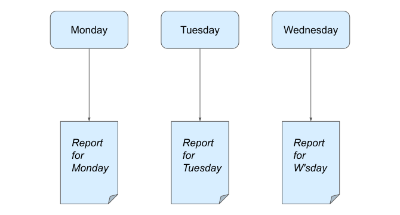
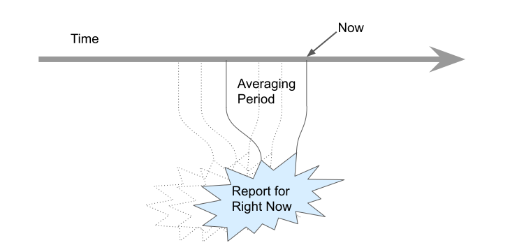
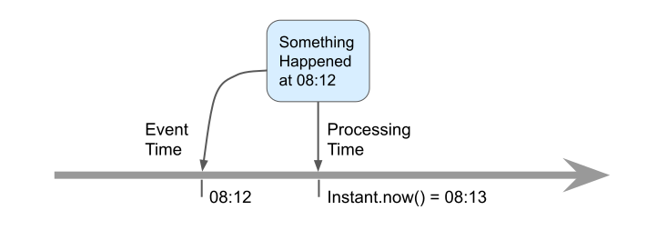
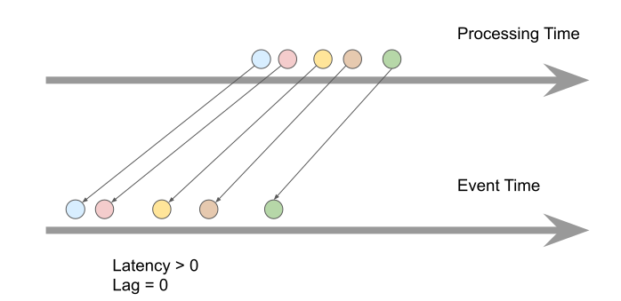
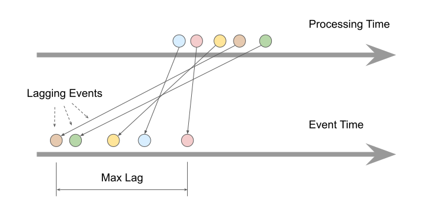
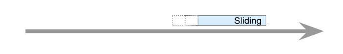
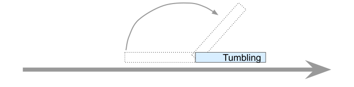
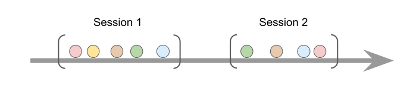

In an unbounded stream of events, the dimension of time is always there. To appreciate this, consider a bounded stream: it may represent a dataset labeled "Wednesday", but the computation itself doesn't have to know this. Its results will be understood from the outside to be "about Wednesday":

An endless stream, on the other hand, delivers information about the reality as it is unfolding, in near-real time, and the computation itself must deal with time explicitly:

## Event Time and Processing Time

We represent the reality in digital form as a stream of **events**. Most importantly, every data item has a **timestamp** that tells us when the event occurred. All the processing logic must rely on these timestamps and not whatever the current time happens to be when running the computation. This brings us to these two concepts:

- **Event time**: determined by the event's timestamp
- **Processing time**: the current time at the moment of processing an event

The difference between these two ways to account for time comes up often in the design of distributed streaming systems and to some extent you'll have to deal with it directly.

### Event Disorder

In an ideal world, event time and processing time would be the same and events would be processed immediately. In reality this is far from true and there can be a significant difference between the two. The difference is also highly variable and is affected by factors like network congestion, shared resource limitations and many more. This results in what we call **event disorder**: observing the events out of their true order of occurrence.

Here's what an ordered event stream looks like:

Notice that latency not only exists, but is variable. This has no major impact on stream processing.

And here's what event disorder looks like:

Latency is all over the place now and it has disordered the events. Of the five events shown, the second one processed is already the latest. After processing it Hazelcast has no idea how much longer to wait expecting events older than it. This is where you as the user are expected to provide the **maximum event lag**. Hazelcast can't emit the result of a windowed aggregation until it has received all the events belonging to the window, but the longer it waits, the later you'll see the results. So you must strike a balance and choose how much to wait. Notice that by "wait" we mean event time, not processing time: when we get an event with timestamp `t_a`, we are no longer waiting for events with timestamp `t_b <= t_a - maxLag`.

## Time Windowing

With unbounded streams you need a policy that selects bounded chunks whose aggregate results you are interested in. This is called **windowing**. You can imagine the window as a time interval laid over the time axis. A given window contains only the events that belong to that interval.

### Sliding Window

Sliding window is probably the most natural kind of window: it slides along the time axis, trailing just behind the current time. In Hazelcast, the window doesn't actually slide smoothly but in configured steps.

Sliding window aggregation is a great tool to discover the dynamic properties of your event stream. Quick example: say your event stream contains GPS location reports from millions of mobile users. With a few lines of code you can split the stream into groups by user ID and apply a sliding window with linear regression to retrieve a smoothened velocity vector of each user. Applying the same kind of window the second time will give you acceleration vectors, and so on.

### Tumbling Window

In Hazelcast, the tumbling window is a special case of the sliding window. Since the sliding step is configurable, you can set it equal to the window itself. You can imagine the window tumbling over from one position to the next. Since Hazelcast has an optimized computation scheme for the sliding window, there is little reason not to use a sliding step finer than the size of the window. A general recommendation is 10-100 steps per window.

### Session Window

While the sliding window has a fixed, predetermined length, the session window adapts to the data itself. When two consecutive events are separated by more than the configured timeout, that gap marks the boundary between the two windows. If there is no data, there is no session window, either.
