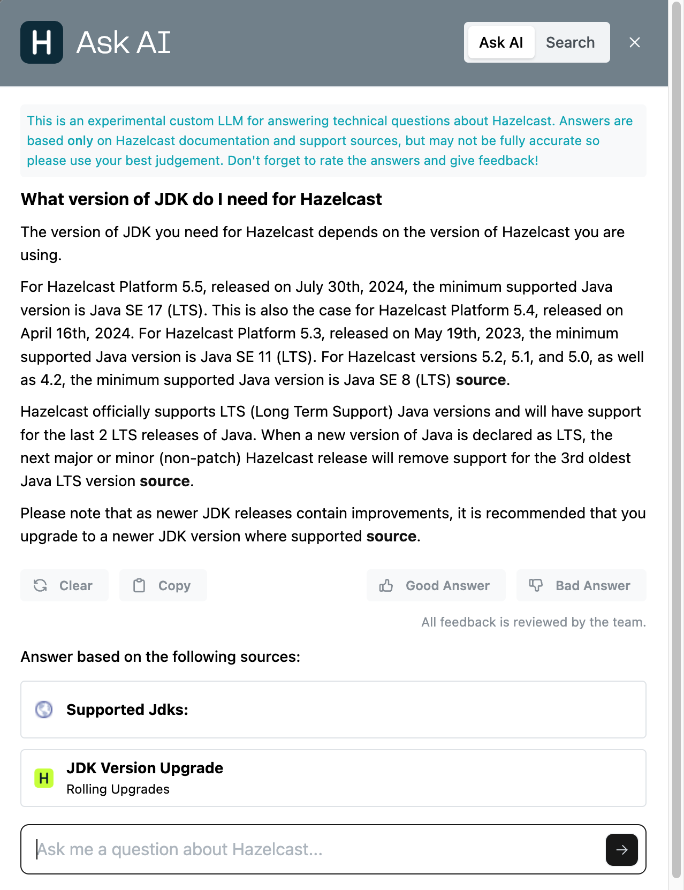
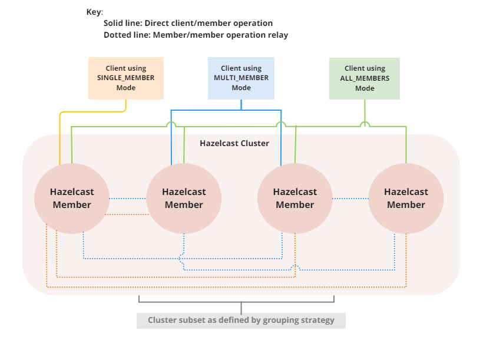

<Anchor id="whats-new" />

Here are the highlights of what's new and improved in Hazelcast Platform 5.5, including vector search, compute isolation, multi-member routing, and dynamic configuration using REST API.

## Get instant answers with new Hazelcast Ask AI

On every docs page you can now click the **Ask AI** button in the bottom right and get instant answers to all your questions about Hazelcast Platform, and our tools and clients. Ask AI is powered by the entire suite of Hazelcast documentation, including the latest docs from `docs.hazelcast.com`, the various API docs microsites, the latest official blogs, and a bunch of code samples and support knowledgebase articles.

Give it a try now - for more information, see [Ask AI](./ask-ai.mdx).

## New Vector Collection for building semantic search (BETA)

<Badge type="enterprise" />

With the introduction of a new data structure specifically designed for vector search, Hazelcast Platform 5.5 adds functionality to help you build and deliver vector search capabilities, and improve the quality and accuracy of search results. Indexes are based on the JVector library, which implements a DiskANN algorithm for similarity search and provides exceptional performance.

A Hazelcast vector database engine is a specialized type of database, which is optimized for storing, searching, and managing vector embeddings and additional metadata. You can include values in the metadata to provide filtering, additional processing, or analysis of vectors. The primary object for interacting with vector storage is a Vector Collection. A Vector Collection holds information about the vectors and associated metadata (user values). Use with Jet Job placement control (see below) to dedicate resources for vector embedding and optimizing search performance.

For more information on vector collections, see [Data Structure Design](../develop-and-build/distributed-data-structures/ai-ml-data-structures/vector-collections/vector-search-overview.mdx).

## Distribute your workload with Jet Job placement control

Compute Isolation drives greater efficiency and performance by moving the compute closer to the data to improve performance and reduce network overheads. With 5.5 your Jet processing jobs can now be distributed across a defined subset of the cluster, which means you can distribute your workload to meet your business and regulatory requirements. You can configure Jet processing jobs so that they run on lite members only, allowing you to split your computational and storage requirements without the need to configure each job separately. You control the members to use for your Jet job processing on a job-by-job basis.

For more information, including how to use the `JobBuilder` API, see [Jet Job Placement Control](../develop-and-build/building-data-pipelines/job-placement-control.mdx).

## Multi-member routing for Java clients

Geographically dispersed or 'stretched' clusters are not as resilient as standard HA clusters, and also suffer from lower throughput, longer recovery and longer operations. With the release of Hazelcast Platform 5.5, you can use multi-member routing to provide greater performance and stability for Java client applications connecting to geographically dispersed clusters. This means much faster transaction re-routing in the event of an outage. You can implement strong consistency on a stretch cluster and reduce connection overheads and improve overall performance. You can easily enable client multi-member routing using your existing client network configuration and get these benefits, all with zero downtime.

Before 5.5, Hazelcast clients could only have one of two types of connection to a cluster: single member (also known as unisocket) or all member (also known as smart). With a unisocket connection the client only connected to a single cluster member, which meant all communication was relayed via the connected cluster member and could therefore suffer from performance issues. With an all member connection the client connects to every member in the cluster and is partition-aware, which means that communications are sent directly to the cluster member holding the required data. If you're using partition groups to isolate data to specific cluster members, there was previously no way for the client to have visibility into this configuration and therefore was not connecting as efficiently as possible, or adapting to failovers. For example, CP Subsystem uses a group leader - clients would not be aware of this and there would an extra internal relay stage rather than sending directly to the group leader alone.

For more information, see [Client cluster routing modes](../clients-and-apis/clients/java.mdx#client-cluster-routing-modes).

## New Hazelcast Cluster Manager for Vert.x version 5 {/* #new-hazelcast-cluster-manager-for-vert-x-version-5 */}

<Badge type="enterprise" />

Vert.x is a reactive application toolkit for creating resource-efficient, concurrent, asynchronous and flexible applications on the JVM. The new `vertx-hazelcast-enterprise` module available for Hazelcast Platform 5.5 offers advanced features like strong consistency and enhanced fault tolerance. This integration reduces complexity, abstracts low-level management tasks, and ensures optimal resource efficiency, making it ideal for dynamic environments requiring high availability and minimal downtime. The open-source `vertx-hazelcast` module is still available directly from [Vert.x](https://vertx.io/docs/vertx-hazelcast/java/) but does not support strong consistency.

For more information, see [Integrate with Vert.x](../frameworks-and-plugins/integrate-with-vertx/overview.mdx).

## Feast feature store integration

Release 5.5 includes integration of Feast (**Fea**ture **St**ore), an open-source feature store that can be used on your existing infrastructure to manage and serve ML features to real-time models. A feature store is a central repository where features can be stored and processed for reuse or sharing. When integrated with Hazelcast, you can benefit from an online store that supports materializing feature values in a running Hazelcast cluster.

Feast can help to decouple ML from your data infrastructure. This can be useful in a number of ways; for example, to allow you to move between model types, such as training models to serving models, or from one data infrastructure system to another. With Feast you use the following in your ML models:

- Historical data to support predictions that allow scaling to improve model performance
- Real-time data to support data-driven insights
- Pre-computed features that can be served online

For more information, see [Integrate with Feast](../frameworks-and-plugins/integrate-with-feast/overview.mdx).

## Dynamic configuration using REST API

<Badge type="enterprise" />

Hazelcast now provides a REST API that allows you to access your data structures and cluster using HTTP/HTTPS protocols. You can interact with the API using various tools and platforms such as cURL, REST clients (like Postman and Insomnia), or programming languages with HTTP request libraries or built-in support. The new REST API comes with an integrated Swagger UI for learning about the API and trying out API calls.

For more information, including tutorials for Java and Docker, see [REST API](../clients-and-apis/apis/enterprise-rest-api/overview.mdx).

## Debezium support updated

Starting from Hazelcast Platform 5.5, with <Variable name="enterprise-product-name" /> you can now use Debezium 2.x sources. This connector is included in the full distribution of Hazelcast <Variable name="enterprise-product-name" /> and replaces the old Debezium 1.9 connector. For more information, see [CDC Connector](../connectors/database-connectors/cdc-connectors.mdx).

For <Variable name="open-source-product-name" /> users, Hazelcast still provides a generic Debezium 1.9 source that can handle CDC (Change Data Capture) events from [any database supported by Debezium](https://debezium.io/documentation/reference/stable/connectors/index.html). For more information, see [Legacy CDC Connector](../connectors/database-connectors/legacy-cdc-connectors.mdx).

## Release Notes

For detailed release notes that include new features and enhancements, breaking changes, deprecations and other fixes, see [Release Notes](../install-and-upgrade/releases.mdx).

To evaluate Hazelcast <Variable name="enterprise-product-name" /> features, you can [request a trial license key](https://hazelcast.com/trial-request/?utm_source=docs-website). To install Hazelcast <Variable name="enterprise-product-name" />, see [Install Hazelcast Community Edition](../install-and-upgrade/community-edition/install-hazelcast.mdx).

## Hazelcast Command Line Client (CLC)

Support added for `CPMap` data structures, including `cpmap` commands and advanced script functions.

For detailed release notes that include new features and fixes, see [Hazelcast CLC 5.5.0](/clc/latest/release-notes-5.5.0).

To get started with Hazelcast CLC, see [Installing the Hazelcast CLC](/clc/latest/install-clc).

## Hazelcast .NET Client

Support added for MultiMember routing mode, and CP requests redirected to CP leaders.

For detailed release notes that include new features and fixes, see [Hazelcast .NET 5.5.0](https://github.com/hazelcast/hazelcast-csharp-client/releases/tag/v5.5.0).

To get started with Hazelcast .NET Client, see [Hazelcast .NET documentation](https://hazelcast.github.io/hazelcast-csharp-client/latest/doc/download-install.html).
