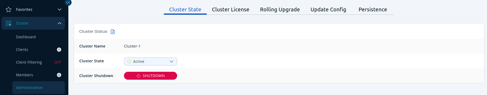

You can use the **Administration** menu item to manage Hazelcast clusters.

:::note

This menu item is available only to admin users.

:::

From this menu item, you can do the following:

- [Change the state of a cluster](./cluster-states/changing-cluster-state.mdx)
- [Shut down a cluster](./cluster-states/shutting-down-cluster.mdx)
- [Diagnostic logging](./diagnostic-logging.mdx)
- [View details about a cluster's license](./cluster-license.mdx)
- [Trigger a rolling upgrade](./triggering-rolling-upgrade.mdx)
- [Manage clusters that have persistence enabled](./persistence/persistence.mdx)
- [Update cluster configuration at runtime](./update-config.mdx)
