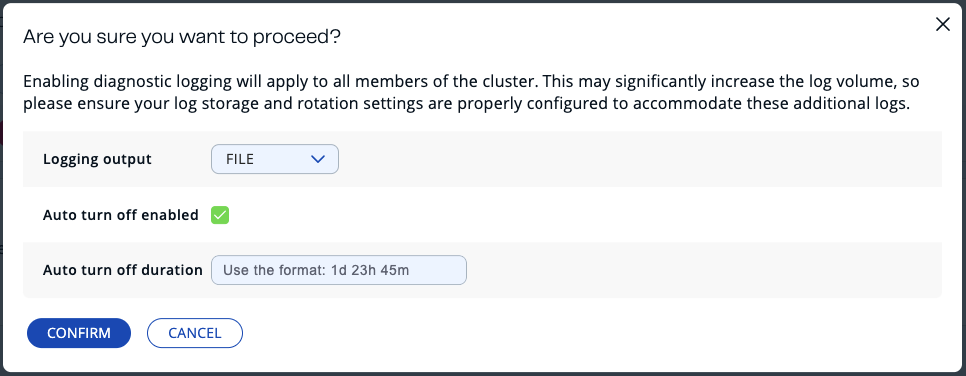
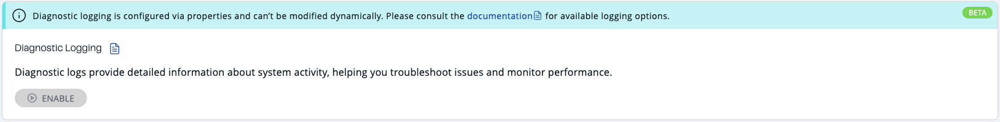
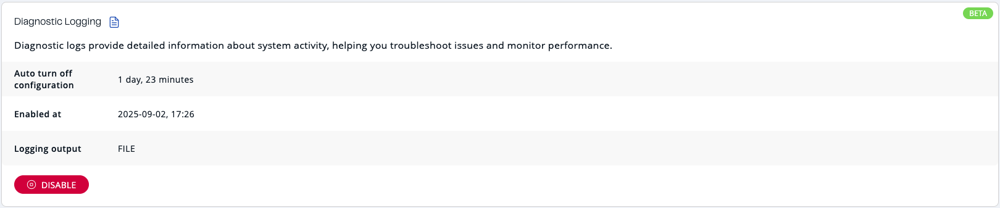
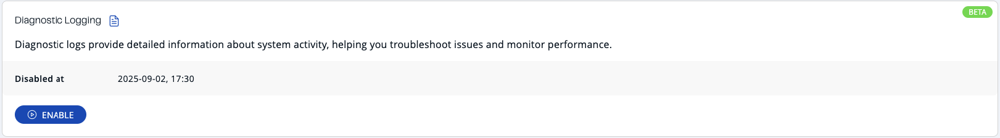

Hazelcast provides diagnostic logging capabilities that help with troubleshooting and monitoring.

An extended set of diagnostics plugins is provided for both Hazelcast members and clients. A dedicated log file is used to write the diagnostics content, and a rolling file approach is used to prevent taking up too much disk space.

You can switch diagnostic logging on and off at runtime (known as *dynamic* configuration) without having to restart the cluster.

To prevent logs from running indefinitely, you can also automatically switch diagnostic logging off after a set period by configuring the auto turn-off feature in Management Center.

:::note

Only admin users can configure diagnostic logging settings, and the feature is only available in version 5.6 or later.

:::

:::tip

Diagnostic logging can also be configured via the REST API — for details, see [Diagnostics Config API](../../integrate/clustered-rest/diagnostics-config.mdx).

:::

## Enable diagnostic logging

To enable diagnostic logging:

1. From the Side Bar, choose Cluster \> Administration \> Cluster State.
2. Click the `Enable` button, configure the auto turn-off settings if desired, confirm the action, and wait until the process is finished.

### Configure auto turn-off

When enabling diagnostic logging, you can configure an automatic turn-off duration to prevent logs from running indefinitely and having a performance impact on the cluster.

- **Auto turn-off enabled**: Select this option to automatically disable diagnostic logging after a specified duration.
- **Duration format**: Specify using the format `1d 23h 45m` (days, hours, minutes). Note that one month is calculated as 30 days.
- **Auto turn-off disabled**: If auto turn-off is disabled, diagnostic logging will run indefinitely until manually disabled.

:::note

When diagnostic logging is enabled with auto turn-off, members that join the cluster later will start their own timers from zero. As a result, earlier members may stop diagnostics before the last joiner, leading to a temporary inconsistency. To keep the reported state accurate, Management Center restarts its diagnostics auto turn-off timer from zero whenever a new member joins while diagnostics is enabled. This ensures Management Center shows diagnostics as enabled as long as at least one member is still logging.

:::

## Prerequisites and limitations

- **Admin only**: Only admin users can configure diagnostic logging settings.
- **Use STDOUT for diagnostic logs in Kubernetes and Docker**: A known limitation prevents dynamic diagnostic logging from being started with file output in Docker and Kubernetes environments. This is due to the default logging directory being read-only. The recommended workaround is to direct diagnostic logs to STDOUT so standard logging systems can collect them, or to preconfigure a writable storage location if file output is required.
- **Dynamic configuration**: If diagnostic logging is configured in Hazelcast Platform via system properties (known as *static* configuration), logging cannot be switched on and off dynamically through the Management Center interface and the following message will appear: 

## Diagnostic logging notifications

To inform you about the status of diagnostic logging, Management Center displays notifications at the top of every page.

### When diagnostic logging is enabled

- A persistent notification banner appears displaying "Diagnostic logging enabled"
- The banner includes a warning: "This may significantly increase the log volume"
- Shows the auto turn-off configuration (if enabled)
- Displays the timestamp when logging was enabled
- The notification remains visible until diagnostic logging is disabled

### When diagnostic logging is disabled

- A dismissible notification appears showing "Diagnostic logging was disabled at \[timestamp\]"
- You can dismiss this notification by clicking the close button
- Once dismissed, the notification won't appear again for the same disable event
- The system remembers your dismissal preference per user and cluster

:::note

Notifications appear only when diagnostic logging is enabled via dynamic configuration.

:::

## Monitor diagnostic logging status

When diagnostic logging is active, the interface displays:

- **Auto turn-off configuration**: Shows the configured automatic turn-off duration
- **Enabled at**: Timestamp when diagnostic logging was last enabled
- **Disabled at**: Timestamp when diagnostic logging was last disabled (shown when logging is currently disabled)

These timestamps help track the logging activity history and are useful for troubleshooting and audit purposes.

## Disable diagnostic logging

To disable diagnostic logging, click the `Disable` button and wait until the process completes.

If auto turn-off is enabled, diagnostic logging will be disabled automatically when the configured duration expires.

For more information about diagnostic logging configuration and available logging options, see <Variable href="/hazelcast/{page-latest-supported-hazelcast}/maintain-cluster/monitoring#diagnostics" text="Diagnostic Logging in Hazelcast Platform"/>.
