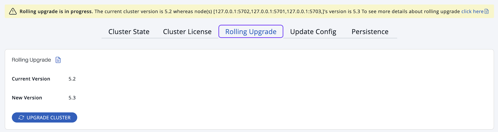

A rolling upgrade allows you to upgrade all running cluster members to a new version of Hazelcast without interrupting the operation of the cluster.

## Before you begin

This page is available only to admin users.

## Trigger a rolling upgrade

1. Upgrade Management Center to the new version.

   :::note

   Management Center is compatible with the previous minor version of Hazelcast. For example, Management Center 5.2 works with both Hazelcast 5.1 and 5.2. To change your cluster version to 5.2, you need Management Center 5.2.

   :::
2. Upgrade the codebase of each Hazelcast member. Follow the steps described in the <Variable href="/hazelcast/{page-latest-supported-hazelcast}/maintain-cluster/rolling-upgrades#rolling-upgrade-procedure" text="Platform documentation" />.
3. Go to **Administration** \> **Rolling Upgrade** and click **Upgrade Cluster**.

   

   :::note

   Management Center can offer the following types of rolling upgrades:

   - From any version 4.0 to 5.x, excluding 4.2, to the next minor version. For example, from version 4.1 to 4.2.
   - From version 4.2 to 5.0.

   :::

When the cluster version is upgraded, you will see the following notification:

