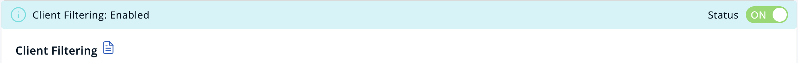
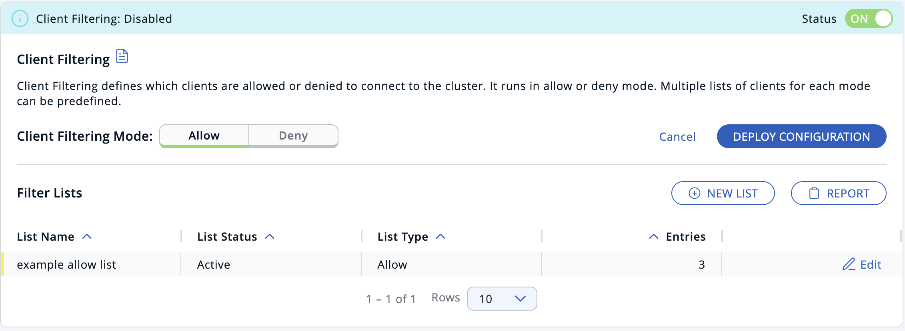
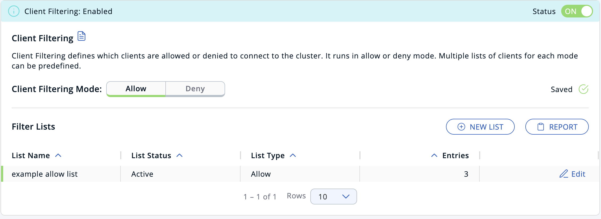
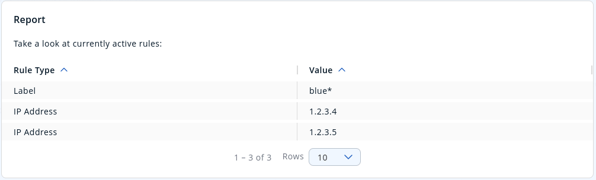
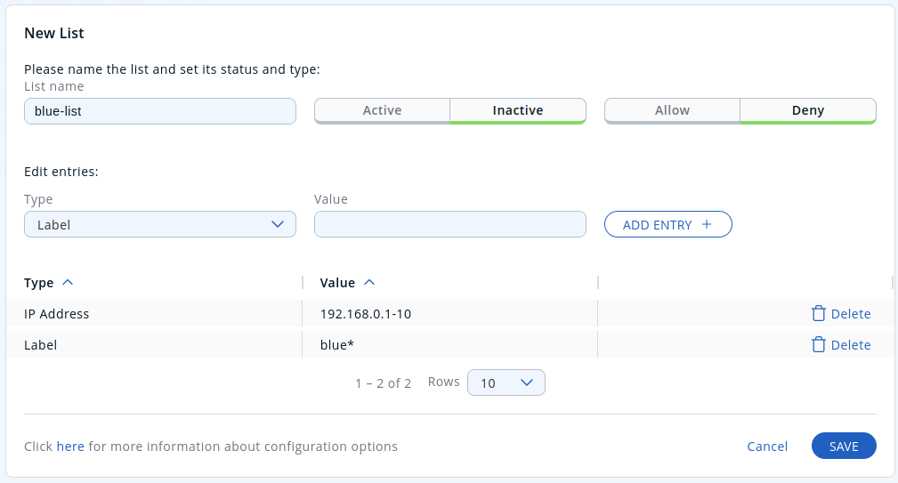

You can define filter lists to allow or disallow client connections to clusters, using the Management Center UI.

## Before you begin

Configure your Hazelcast clients with one or more failover clusters to make sure that disconnected clients can connect to another cluster. For a tutorial, see <Variable href="/hazelcast/{page-latest-supported-hazelcast}/getting-started/deploy-blue-green-tutorial" text="Deploy blue-green clusters"/>.

You can deploy either an allow list or a deny list to a cluster, not both. If you deploy an allow list, the cluster disallows connections from any clients that aren't in the allow list. If you deploy a deny list, the cluster allows connections from any client that isn't in the deny list.

## Create a filter list

1. Enable client filtering on the connected cluster.

   
2. Click **New List**.
3. Give the list a name, a status, and a type.
4. In the entries section of the form, add one or more entries for the list, and click **Add Entry +**.
5. Click **Save**.

   

   The orange status indicator means that the list has not yet been deployed to the cluster.

## Deploy a filter list to a connected cluster

1. If you created an allow list, select the **Allow-list** tab to enter the allow mode. Or, if you created a deny-list, select the **Deny-list** tab to enter the deny mode.
2. Click **Deploy Configuration** to deploy the filter lists in your selected mode.

   
3. Click **Report** to see the list of deployed rules on your cluster.

   

## Edit an existing filter list

1. Click the **Edit** button on a list row.
2. Make your changes.
3. Click **Save and Deploy** to deploy the new list to the cluster.

## Delete an entry

1. Click the **Edit** button on a list row.
2. Click **Delete** next to the entry.
3. Click **Save and Deploy** to deploy the new list to the cluster.

## Disable an existing filter list

To keep a filter list saved in Management Center, but remove it from the cluster:

1. Click the **Edit** button on a list row.
2. Change the **List Type** field to **Inactive**.
3. Click **Save**.

## Delete a filter list

To delete an entire filter list from the cluster:

1. Click the **Edit** button on a list row.
2. Click **Delete this list and deploy** in the top-right corner.

:::note

You can also disable client filtering to delete all filter lists from the cluster.

:::

## Related resources

[Deploy a client filter list with the REST API](./create-filter-lists-rest.mdx).
