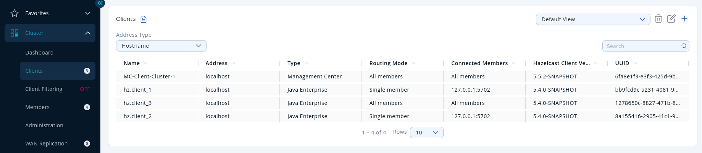
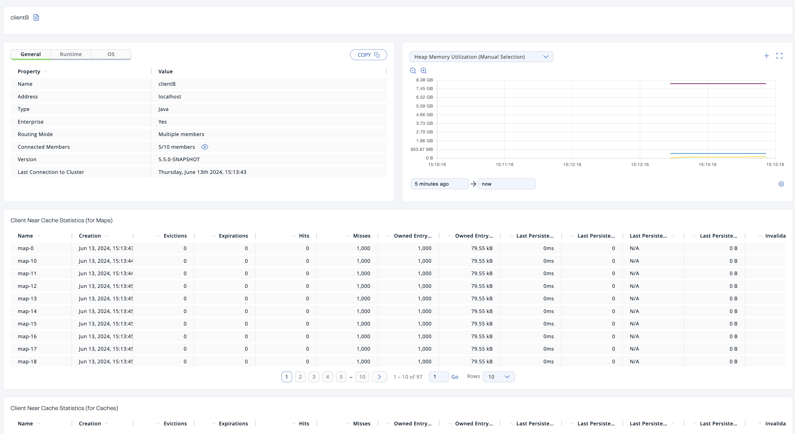

You can use the **Clients** menu item to monitor all the clients that are connected to your Hazelcast cluster.



| Field | Description |
| --- | --- |
| **Name** | Name of the client instance. |
| **Address** | Local IP address, hostname, or canonical hostname of the client, depending on the [client address filter](#client-address-types). |
| **Type** | Type of client. This field typically denotes the client's programming language and indicates whether it is an Enterprise Java client. Although non-Java clients can also connect to Enterprise clusters, the Java client includes Enterprise features that non-Java clients do not. |
| **Routing Mode** | Routing mode of the client. This field shows the routing mode that the client uses to connect to the cluster. **All Members** means a client is configured to allow connections to all members of a cluster, although the client might not be connected to them all. **Single Member** means a client is configured to connect only to a single member of the cluster. **Multiple Members** means that a client is configured to connect to a subset of the cluster members. |
| **Connected Members** | The members that the client is currently connected to. This field might show the address of the member, if the client is currently connected only to a single member, **All Members** if the client is connected to all members of the cluster, and shows **number of currently connected members / total members**, if the client is currently connected to a subset of members. |
| **Hazelcast Client Version** | Version of the client codebase. |
| **UUID** | Universally unique identifier of the client. |
| **Labels** | Any labels given to the client. You can use these labels to create filter lists that allow or deny the client's connections to the cluster. See [Manage client connections](./client-filtering/overview.mdx). |

## Available data

By default, only basic information about connected clients is displayed. The values for other fields are shown as **N/A**.

To see all available information about a connected client in Management Center, the client must have the `hazelcast.client.statistics.enabled` system property set to `true`. See <Variable href="/hazelcast/{page-latest-supported-hazelcast}/clients/java#client-system-properties" text="Client System Properties"/> in the Platform documentation. This property configures clients to send statistics to the cluster, which in turn, sends them to Management Center.

To configure how often client statistics are collected, use the system property `hazelcast.client.statistics.period.seconds`.

## MC-Client

All clusters have an entry for a client called **MC-Client-\<your cluster name\>**. This is the Management Center client that is connected to your cluster. Management Center uses this client to receive data from the cluster as well as send requests to it for operations such as shutting down members.

You cannot view any more details about this client other than what is displayed on the **Clients** page.

:::note

The MC-Client is **not included** in the client count that is displayed in the [left-hand menu](../get-started/user-interface-overview/user-interface.mdx#menu) and the [Cluster Connections page](../deploy-and-manage/cluster-connections/connecting-to-clusters-ui.mdx)

:::

## Client address types

By default, the hostname of the client is displayed in the **Address** column.

To display the client's IP address or the canonical hostname, use the **Address Type** dropdown.

## Filter clients

To filter the displayed clients, use the **Search** bar in the right-hand corner.

To sort the table, click on the column headers.

## View details about a connected client

Click on a client name to open a new page on the right for monitoring that client, as shown below.



### Heap Memory Utilization {/* #client-heap-memory */}

The **Heap Memory Utilization** chart shows the memory usage on the selected client with three different metrics (maximum, used and total memory) represented by different colors. You can open this chart as a separate window using the button to the top right of it .

### General

**General** is a dynamically updated window tab showing general information about the client. Below are brief explanations for each piece of information:

<table>
<thead>
<tr>
<th>Field</th>
<th>Description</th>
</tr>
</thead>
<tbody>
<tr>
<td>**Name**</td>
<td>Name of the client instance.</td>
</tr>
<tr>
<td>**Address**</td>
<td>Local IP address, hostname, or canonical hostname of the client, depending on the [client address filter](#client-address).</td>
</tr>
<tr>
<td>**Type**</td>
<td>Type of client. This field usually contains the client's programming language.</td>
</tr>
<tr>
<td>**Enterprise**</td>
<td>Whether the client is an Enterprise Java client. Although non-Java clients can also connect to Enterprise clusters, the Java client includes Enterprise features that non-Java clients do not.</td>
</tr>
<tr>
<td>**Routing Mode**</td>
<td>Routing mode of the client. This can be **Single Member**, **Multiple Members**, or **All Members**.</td>
</tr>
<tr>
<td>**Connected Members**</td>
<td>

The members that the client is currently connected to. This field might show the address of the member, if the client is currently connected only to a single member, **All Members** if the client is connected to all members of the cluster, and shows **number of currently connected members / total members**, if the client is currently connected to a subset of members.

If the client is connected to a subset of members, select the icon next to the field to see the list of connected members.

</td>
</tr>
<tr>
<td>**Version**</td>
<td>Version of the client codebase.</td>
</tr>
<tr>
<td>**Last Connection to Cluster**</td>
<td>Date and time that the client last connected to the cluster. This field is reset after each reconnection.</td>
</tr>
<tr>
<td>**Last Statistics Collection**</td>
<td>Date and time that statistics were last collected from the client.</td>
</tr>
</tbody>
</table>

### Runtime

Next to the **General** tab, the **Runtime** tab shows the following values, which are collected from the default MXBeans in the Java Virtual Machine (JVM).

:::note

Some of these statistics may not be available for your client's JVM implementation or operating system. **N/A** is shown for these types of statistics. Please refer to your JVM or operating system documentation for further details.

:::

| Field | Description |
| --- | --- |
| **Number of Processors** | Number of processors available to the client. |
| **Uptime** | Uptime of the client. |
| **Maximum Memory** | Maximum amount of memory that the client will attempt to use. |
| **Total Memory** | Amount of total heap memory currently available for current and future objects in the client. |
| **Free Memory** | Amount of free heap memory in the client. |
| **Used Memory** | Amount of used heap memory in the client. |

### OS

Next to the **Runtime** tab, the **OS** tab shows statistics about the operating system of the client. These values are collected from the default MXBeans in the Java Virtual Machine (JVM).

:::note

Some of these statistics may not be available for your client's JVM implementation or operating system. **N/A** is shown for these types of statistics. Please refer to your JVM or operating system documentation for further details.

:::

<table>
<thead>
<tr>
<th>Field</th>
<th>Description</th>
</tr>
</thead>
<tbody>
<tr>
<td>**Free Physical Memory**</td>
<td>Amount of free physical memory on the client device.</td>
</tr>
<tr>
<td>**Committed Virtual Memory**</td>
<td>Amount of virtual memory that is guaranteed to be available to the running process.</td>
</tr>
<tr>
<td>**Total Physical Memory**</td>
<td>Total amount of physical memory on the client device.</td>
</tr>
<tr>
<td>**Free Swap Space**</td>
<td>Amount of free swap space, which is used when the amount of physical memory (RAM) is full. If the system needs more memory resources and the RAM is full, inactive pages in memory are moved to the swap space.</td>
</tr>
<tr>
<td>**Total Swap Space**</td>
<td>Total amount of swap space.</td>
</tr>
<tr>
<td>**Maximum File Descriptor Count**</td>
<td>Maximum number of file descriptors, which is an integer that uniquely represents an opened file in the operating system.</td>
</tr>
<tr>
<td>**Open File Descriptor Count**</td>
<td>Number of open file descriptors.</td>
</tr>
<tr>
<td>**Process CPU Time**</td>
<td>CPU time used by the process on which the member (JVM) is running.</td>
</tr>
<tr>
<td>**System Load Average**</td>
<td>

System load average for the last minute. The system load average is the average over a period of time of this sum:

```none
(the number of runnable entities queued to the
available processors) + (the number of runnable
entities running on the available processors)
```

The way in which the load average is calculated differs, depending on the operating system, but it is typically a damped time-dependent average.

</td>
</tr>
</tbody>
</table>

### Client near cache statistics {/* #client-near-cache */}

The **Client Near Cache Statistics** tables show statistics related to the Near Cache of a client for maps and caches.

For information about Near Cache, see <Variable href="/hazelcast/{page-latest-supported-hazelcast}/cluster-performance/best-practices" text="Best practices"/> in the Platform documentation.

| Field | Description |
| --- | --- |
| **Map/Cache Name** | Name of the map or cache. |
| **Creation Time** | Creation time of this Near Cache on the client. |
| **Evictions** | Number of evictions of Near Cache entries owned by the client. |
| **Expirations** | Number of TTL and max-idle expirations of Near Cache entries owned by the client. |
| **Hits** | Number of hits (reads) of Near Cache entries owned by the client. |
| **Misses** | Number of misses of Near Cache entries owned by the client. |
| **Owned Entry Count** | Number of Near Cache entries owned by the client. |
| **Owned Entry Memory Cost** | Memory cost of Near Cache entries owned by the client. |
| **LP Duration** | Duration of the last Near Cache key persistence (when the pre-load feature is enabled). |
| **LP Key Count** | Number of Near Cache key persistences (when the pre-load feature is enabled). |
| **LP Time** | Time of the last Near Cache key persistence (when the pre-load feature is enabled). |
| **LP Written Bytes** | Written number of bytes of the last Near Cache key persistence (when the pre-load feature is enabled). |
| **LP Failure** | Failure reason of the last Near Cache persistence (when the pre-load feature is enabled). |

## Related resources

See the following topics in the Platform documentation:

- <Variable href="/hazelcast/{page-latest-supported-hazelcast}/clients/java#defining-client-labels" text="Defining Client Labels"/>.
