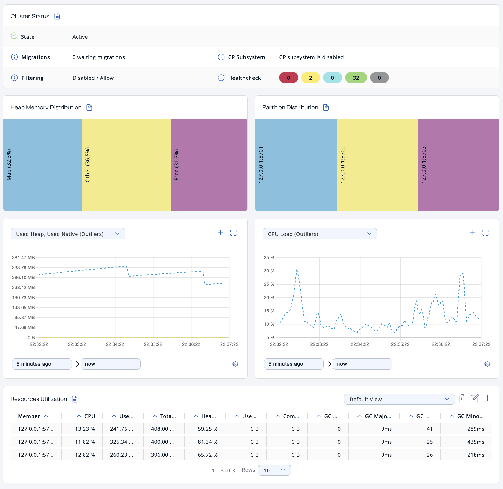
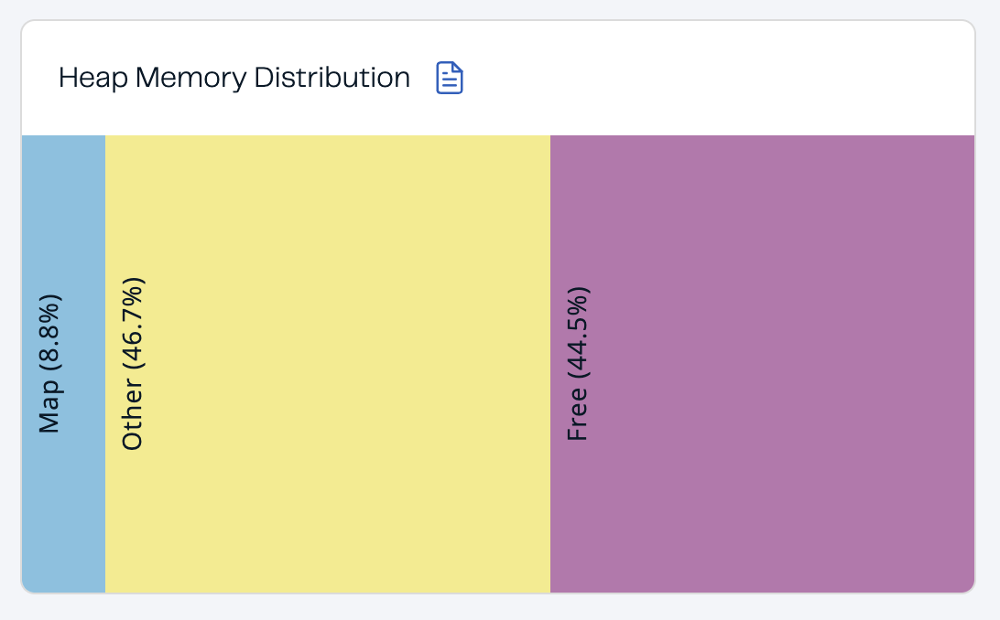
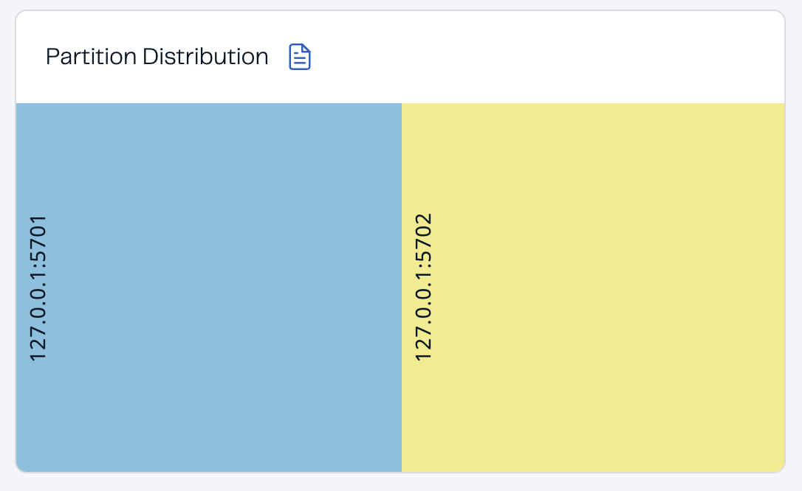

The cluster dashboard provides an overview of the general state and health of a cluster.

## Cluster status {/* #cluster-state-and-health */}

The **Cluster Status** section provides the following details:

| Field | Description |
| --- | --- |
| **State** | Cluster state. For more information about cluster states in Management Center, see [Cluster state](./administration/cluster-states/cluster-state.mdx). |
| **Migrations** | Number of migrations that are taking place in the cluster. Migration of data from one member to another takes place during repartitioning, which usually happens when a member joins or leaves the cluster. |
| **CP Subsystem** | Status of the CP subsystem. For more information about the CP subsystem in Management Center, see [CP Subsystem](../cp-subsystem/dashboard.mdx). |
| **Filtering** | Status of any client filter lists and the list type. For more information about client filtering in Management Center, see [Manage client connections](./client-filtering/overview.mdx). |
| **Healthcheck** | Total number of each status in the Healthcheck results. For more information about Healthcheck in Management Center, see [Healthcheck](./healthcheck.mdx). |

## Heap memory distribution

The **Heap Memory Distribution** section provides a quick view of how much free heap memory is available to the cluster.

Because Hazelcast clusters partition data across members, it's important to monitor how much heap memory is available in the cluster as a whole.

All percentages are of the whole cluster's [total committed heap memory](#committed-heap).

| Field | Description |
| --- | --- |
| **Map** | Percentage of heap memory that contains map data structures, including all backup entries, any near caches, and map Merkle trees. |
| **Other** | Percentage of heap memory that contains other data structures, including Jet jobs. |
| **Free** | Percentage of heap memory that is free compared to the whole cluster's total committed heap memory. |

In the above example, you can see a small amount of the total heap memory is used by Hazelcast maps.

To see the heap memory usage of each member, see [Resources Utilization](#resources-utilization)

## Partition distribution

This chart displays the percentage of partitions that each cluster member owns.

In the above example, you can see that two members share the total partition count (which is 271 by default). See <Variable href="/hazelcast/{page-latest-supported-hazelcast}/architecture/data-partitioning" text="Data Partitioning and Replication"/> in the Platform documentation.

:::note

This chart does not display any information until you create at least one distributed data structure. When you create a new cluster, partitions do not yet exist. Once you connect to your cluster and, for example, create a map, only then will this chart show partition distribution information.

:::

To see the exact number of partitions owned by each member, see the [**Members** page](./members.mdx) in Management Center.

## Graphs

To customize the data displayed in the graphs, see [Graphs](../get-started/user-interface-overview/graphs.mdx).

## Resources utilization {/* #memory-utilization */}

The **Resources Utilization** section provides information about the memory usage and CPU load of each member.

To see more details about a particular member, click on the member's row in the table. See [Members](./members.mdx) for details about the **Members** page.

| Field | Description |
| --- | --- |
| **CPU** | Recent CPU usage for the whole system represented as a percentage value. 0% means that all CPUs were idle during the recent period of time observed, while 100% means that all CPUs were actively running during the recent period being observed. |
| **Used Heap** | Amount of used committed heap memory. |
| **<Anchor id="committed-heap"/> Committed Heap** | Amount of virtual heap memory that is guaranteed to be available to the running process. |
| **Heap Usage** | Percentage of used committed heap memory. |
| **Used Native Memory** | Amount of used heap memory outside of the JVM. |
| **Committed Native Memory** | Amount of virtual heap memory outside of the JVM that is guaranteed to be available to the running process. |
| **GC Major Count** | Number of times this garbage collector (GC) event has been triggered. |
| **GC Major Time** | Amount of time spent by this GC event. |
| **GC Minor Count** | Number of times this GC event has been triggered. |
| **GC Minor Time** | Amount of time spent by this GC event. |

## Related resources

For details about GC events, see [Minor GC vs Major GC](https://plumbr.io/blog/garbage-collection/minor-gc-vs-major-gc-vs-full-gc).
