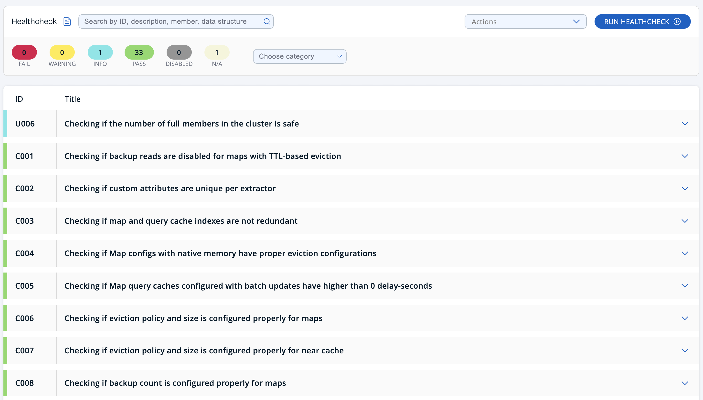
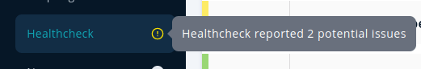
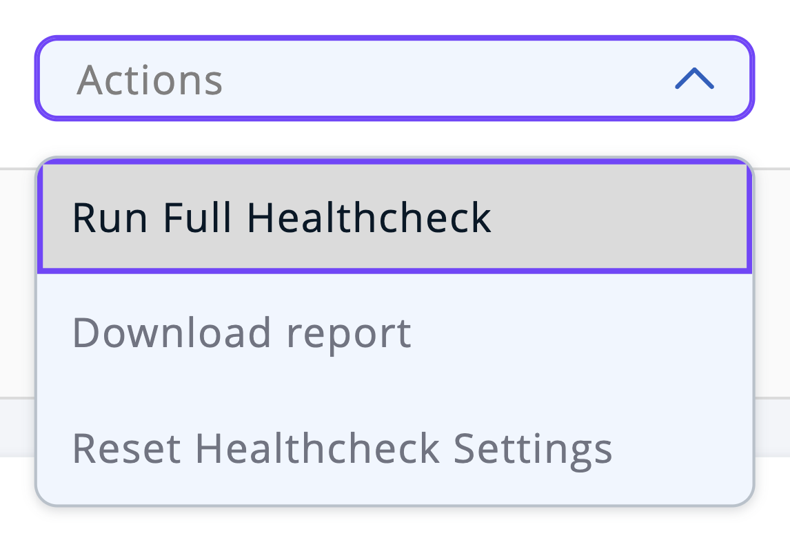
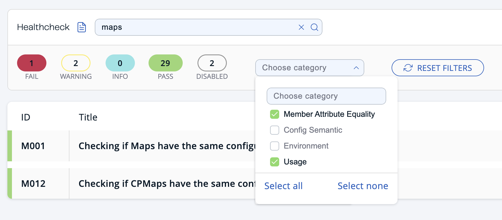
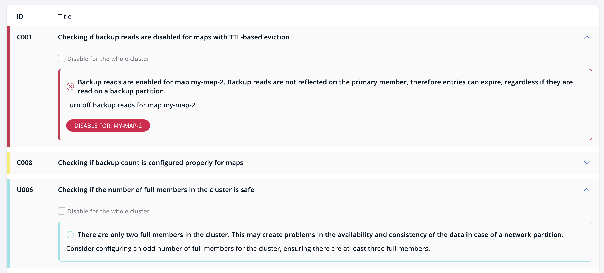
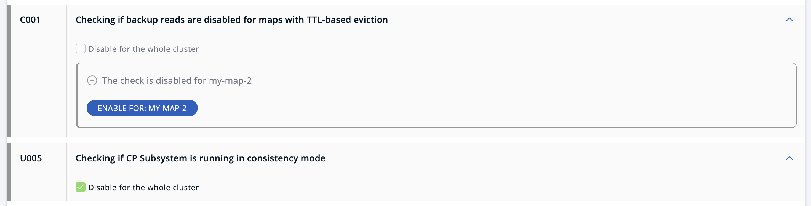

Config Healthcheck provides a comprehensive analysis of member configurations and metrics across your cluster to identify potential issues before they become critical problems, and to help prioritize remediation efforts.

Healthcheck provides various checks related to configuration semantics, environment, member configuration equality, and usage.

A new Healthcheck is performed each time you display the Healthcheck page. You can run all checks again using the `RUN HEALTHCHECK` button in the header.

## Healthcheck status

Healthcheck categorizes the checks with six different statuses:

- **FAIL:** A check has the status `FAIL`, indicated in red, when the cluster exhibits at least one critical problem that may result in unexpected behavior or an issue with the designed functionality.
- **WARNING:** A check has the status `WARNING`, indicated in yellow, when the cluster exhibits at least one non-critical issue or potential concern that requires attention, but does not pose an immediate threat or failure.
- **INFO:** A check has the status `INFO`, indicated in blue, to suggest best practices that can be applied to enhance system performance, availability, or efficiency within the cluster.
- **PASS:** A check has the status `PASS`, indicated in green, if no violations have been found in the cluster.
- **DISABLED:** A check has the status `DISABLED`, indicated in gray, if a check is disabled by the user.
- **N/A**: A check has the status `N/A`, indicated in beige, if a check cannot be performed for the current cluster or member version.

:::note

If Prometheus Exporter is enabled, individual Healthcheck status counts are published via exporter periodically with a prefix of `hz_healthcheck_status_`. For further information on the Prometheus Exporter, see [Prometheus monitoring](../integrate/prometheus-monitoring/overview.mdx).

:::

The sidebar navigation item provides notifications about the most critical reported issues, whether they are failures or warnings. These notifications are symbolized by icons, which are red for failures and yellow for warnings. A tooltip displays the total count of reported potential issues.

 

## Actions

Healthcheck provides several actions to be taken using the Actions dropdown in the header. These actions include the following:

- **Run Full Healthcheck:** Healthcheck typically ignores any checks that have been disabled. Select this option to run a Healthcheck that includes the results of all checks, including those that are disabled.

:::note

After running a Full Healthcheck, preview mode is enabled. In preview mode, you cannot disable any check. Preview mode is disabled when Healthcheck is next run, either manually or on display of the page.

:::

- **Download Report:** Downloads the Healthcheck report in JSON format, for further analysis.
- **Reset Healthcheck Settings:** Enables all disabled checks and data structures. Following a reset, Healthcheck includes all checks and data structures in the analysis.

## Filters

You can filter Healthcheck results using any combination of the following:

- **Search:** Search for check ID, description, problematic member, or data structure to display only matching results.
- **Status Filter:** Select any of the color-coded statuses to hide or display results matching that status.
- **Category Filter:** Select the checkbox to display the results for that category, or deselect it to hide results for that category.

:::note

The ID of a check contains an alphabetic prefix that identifies the related category.

:::

To clear all filters, select the `Reset Filters` button.

## Healthcheck problems

To inspect the result of a specific check, select the report item associated with that check. A report item can contain several problems with different statuses. A problem summary consists of a description and advice on fixing the issue.

## Disable checks

Only disable a check when it is not critical and when omitting that check is viable for a cluster. When a check is disabled, Healthcheck does not perform that check. You can disable a check in either of the following ways:

- **Disable for the whole cluster:** Select the checkbox in the details of a report item to disable the check for the whole cluster. If selected, the check is not performed on any member or data structure in the cluster.
- **Disable for a specific data structure**: Select the **Disable For** button in the problem details to disable the check for a specific data structure.

:::note

Disabling for a specific data structure works only for specific checks. There is no mechanism to disable all checks for a particular data structure.

:::

When a check is disabled, the corresponding report item moves down the list. The details of a disabled check are similar to the following:

A check may be further enabled for the whole cluster, or for a specific data structure from the report details of the disabled check.

- If a check is disabled cluster-wide, deselect the checkbox in the report details to enable the check for the whole cluster.
- If a check is disabled for a specific data structure, select the **Enable For** button in the report details to enable the check for that data structure.

## Exclude checks {/* #excluding-checks */}

You can exclude a check from Healthcheck analysis entirely by adding the check ID (shown in the left column) to the `hazelcast.mc.clusterHealthCheck.exclude` system property. Excluded checks will not be performed on any member in the cluster and will not appear in the Healthcheck report.

See [System Properties and Environment Variables](../deploy-and-manage/configuration/system-properties.mdx#hazelcast-mc-clusterHealthCheck-exclude) for more information.
