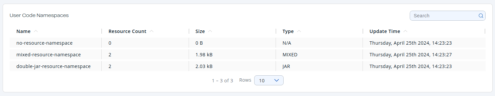

You can use the **Namespaces** menu item to monitor all the user code namespaces that are connected to your Hazelcast cluster.

| Field | Description |
| --- | --- |
| **Name** | Name of the user code namespace. |
| **Resource Count** | Number of resources contained in a namespace. |
| **Size** | Total size in bytes of the resources contained in a namespace. |
| **Type** | Type of the resources contained in a namespace. **N/A** - namespace does not contain any resource yet. **MIXED** - resources contained in a namespace have different types. |
| **Update Time** | Update time of a user code namespace configuration. |

## Filter user code namespaces

To filter the displayed namespaces, use the **Search** bar in the right-hand corner.

To sort the table, click on the column headers.
