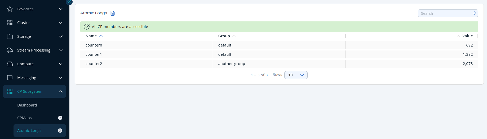

You can see a list of all the <Variable href="/hazelcast/{page-latest-supported-hazelcast}/data-structures/iatomiclong" text="atomic longs"/> in your cluster by clicking on the **Atomic Longs** menu item in the left menu.

An atomic long has only a single metric: The current long value.

Sort the table by clicking on the column headers.
