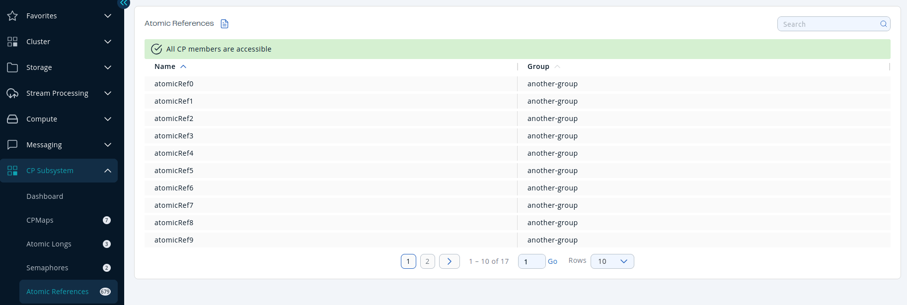

You can see a list of all the <Variable href="/hazelcast/{page-latest-supported-hazelcast}/data-structures/iatomicreference" text="atomic references"/> in your cluster by clicking on the **Atomic References** menu item in the left menu.

Sort the table by clicking on the column headers.
