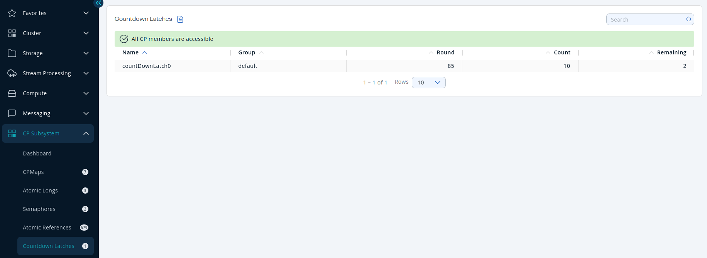

You can see a list of all the <Variable href="/hazelcast/{page-latest-supported-hazelcast}/data-structures/icountdownlatch" text="countdown latches"/> in your cluster by clicking on the **Countdown Latches** menu item in the left menu.

A countdown latch has three metrics:

- **Round**: Number of the current round. This number is incremented when the countdown latch reaches 0 and is initialized with a new count.
- **Count**: Initial countdown.
- **Remaining**: Remaining number of expected countdowns.

Sort the table by clicking on the column headers.
