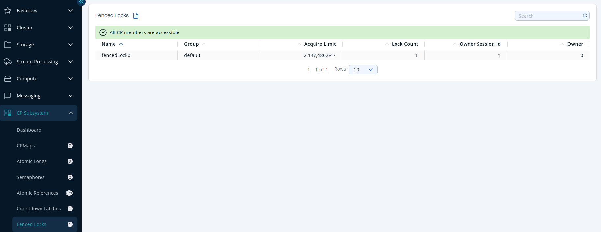

You can see a list of all the <Variable href="/hazelcast/{page-latest-supported-hazelcast}/data-structures/fencedlock" text="fenced locks"/> in your cluster by clicking on the **Fenced Locks** menu item in the left menu.

A fenced lock has two fixed metrics:

- **Acquire Limit**: Maximum number of reentrant acquires, which is configured in the CP member's <Variable href="/hazelcast/{page-latest-supported-hazelcast}/cp-subsystem/configuration#fencedlock-configuration" text="lock-acquire-limit"/> option.
- **Lock Count**: Total number of times the lock has been acquired.

If the lock is held by an endpoint, the following additional metrics are displayed:

- **Owner Session Id**: [Session](./dashboard.mdx#session) ID of the lock owner.
- **Owner**: Address of the lock owner.

Sort the table by clicking on the column headers.
