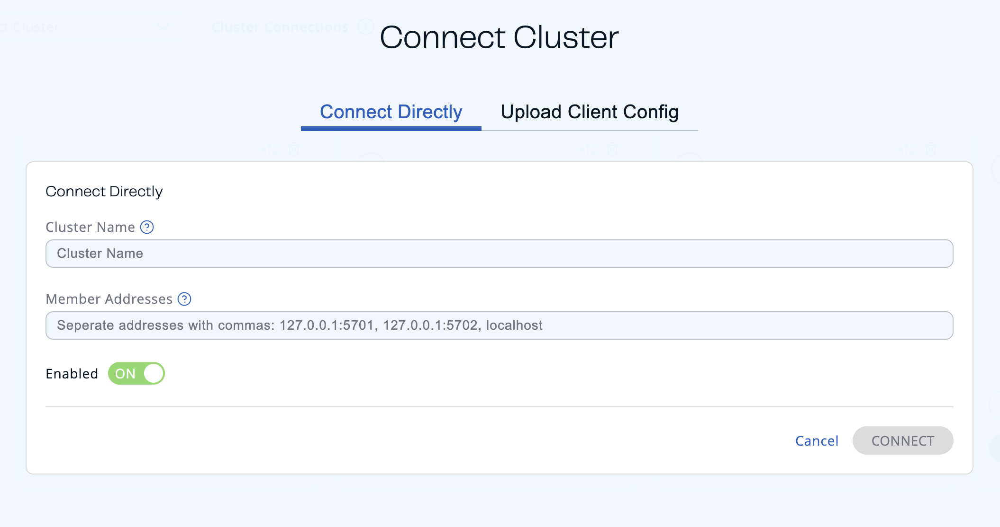
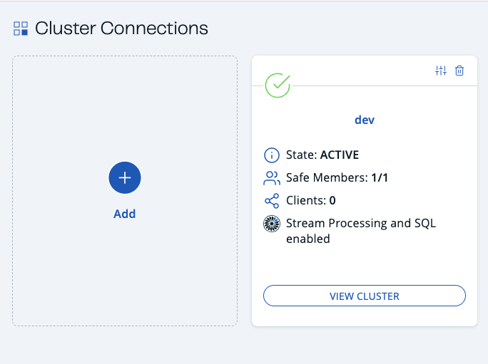
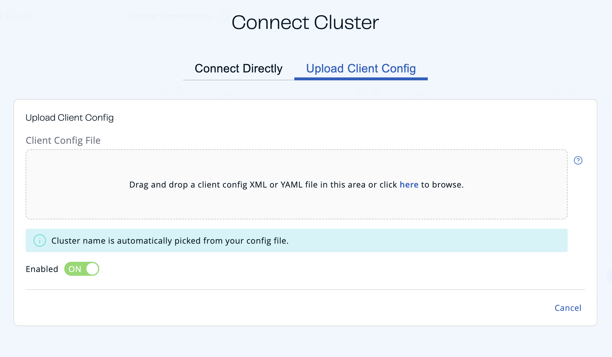
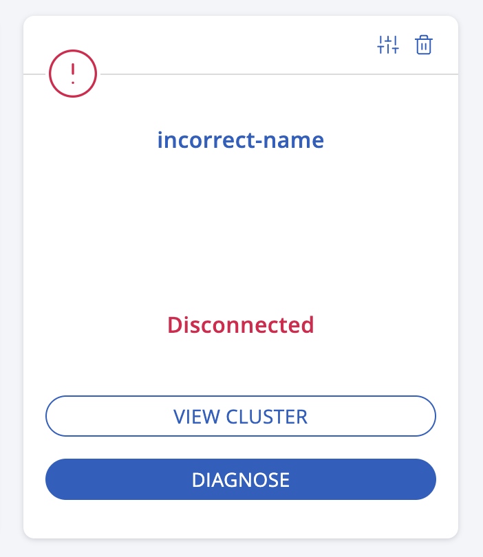
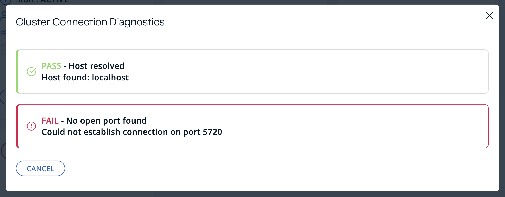
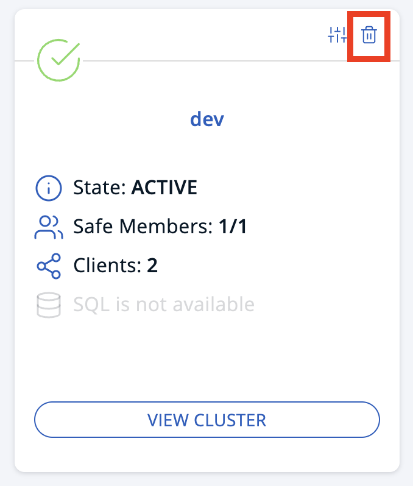
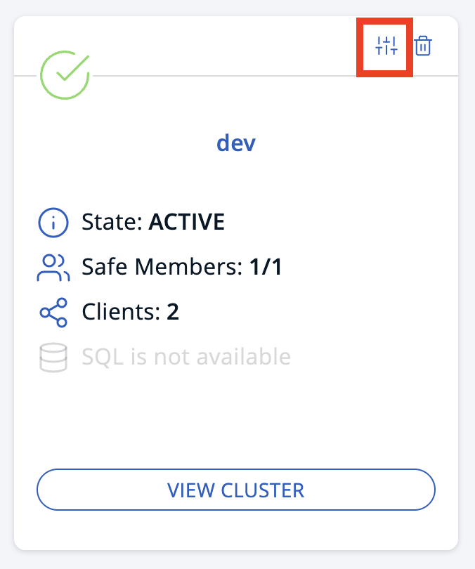

import Tabs from '@theme/Tabs';
import TabItem from '@theme/TabItem';

Management Center starts a Hazelcast client for each cluster that it is connected to. You can configure the Hazelcast client for Management Center, using the UI.

To connect Management Center to a Hazelcast cluster from the UI, you have two options:

- Use the form fields.
- Upload a client configuration file in XML or YAML format. (Recommended for more complex configurations.)

  If you enabled TLS/SSL on a Hazelcast cluster, you must use this option to configure the client TLS settings. For more information about client TLS configuration, see <Variable href="/hazelcast/{page-latest-supported-hazelcast}/security/tls-ssl" text="TLS"/> in the Platform documentation.

:::note

When connecting to multiple clusters from the same instance of Management Center, make sure that the cluster names are unique. Management Center does not support simultaneous connections to more than one cluster with the same cluster name.

:::

## Use the form fields

1. Click **Cluster Connections** in the Top Bar.
2. Click **Add** to configure a new connection.

   
3. Enter the name of the cluster that you want to connect to.
4. Enter the hostnames or IP addresses of cluster members that you want to connect to. Press **Enter** after each address to add it to the list.

   As soon as Management Center connects to one member, it will auto-discover the other members of the cluster. But, for fault-tolerance, it's best to add more than one member's address to the list.
5. Make sure that **Enabled** is **On**.

   If this field is **Off**, Management Center will save the configuration but will not try to connect to the cluster.
6. Click **Connect**.

   

You will see the following:

| Field | Description |
| --- | --- |
| **State** | Current state of the cluster. |
| **Safe Members** | Total number of members in the cluster. |
| **Clients** | Total number of clients currently connected to the cluster, not including the Management Center client. See [Clients](../../cluster/clients.mdx). |

If your cluster has the Jet engine enabled, you will also see that the cluster supports streaming and SQL.

To connect to another cluster, repeat these steps.

## Use a client configuration file

1. Create a client configuration file.

   <Tabs>
   <TabItem value="xml" label="XML">

   For help creating a client configuration file, see the [full example reference on GitHub](https://github.com/hazelcast/hazelcast/blob/master/hazelcast/src/main/resources/hazelcast-client-full-example.xml).

   ```xml title="Example XML file"
   <hazelcast-client xmlns="http://www.hazelcast.com/schema/client-config"
                     xmlns:xsi="http://www.w3.org/2001/XMLSchema-instance"
                     xsi:schemaLocation="http://www.hazelcast.com/schema/client-config
                     http://www.hazelcast.com/schema/client-config/hazelcast-client-config-5.0.xsd">
     <cluster-name>dev</cluster-name>
     <network>
       <cluster-members>
         <address>127.0.0.1:5701</address>
         <address>127.0.0.2:5702</address>
       </cluster-members>
     </network>
   </hazelcast-client>
   ```

   </TabItem>
   <TabItem value="yaml" label="YAML">

   For help creating a client configuration file, see the [full example reference on GitHub](https://github.com/hazelcast/hazelcast/blob/master/hazelcast/src/main/resources/hazelcast-client-full-example.yaml).

   ```yaml title="Example YAML file"
   hazelcast-client:
     cluster-name: dev
     network:
       cluster-members:
         - 127.0.0.1:5701
         - 127.0.0.2:5702
   ```

   </TabItem>
   </Tabs>

   As soon as Management Center connects to one member, it will auto-discover the other members of the cluster. But, for fault-tolerance, it's best to add more than one member's address to the `cluster-members` configuration.
2. Click **Cluster Connections** in the Top Bar.
3. Click **Add** to configure a new connection.

   
4. Go to the **Upload Client Config** tab.

   
5. Either drag and drop your configuration file into the box or click to browse your file system.
6. Make sure that **Enabled** is **On**.

   If this field is **Off**, Management Center will save the configuration but will not try to connect to the cluster.
7. Click **Save Configuration**.

You will see the following:

| Field | Description |
| --- | --- |
| **State** | Current state of the cluster. |
| **Safe Members** | Total number of members in the cluster. |
| **Clients** | Total number of clients currently connected to the cluster, not including the Management Center client. See [Clients](../../cluster/clients.mdx). |

If your cluster has the Jet engine enabled, you will also see that the cluster supports streaming and SQL.

To connect to another cluster, repeat these steps with a different configuration file.

:::note

Management Center requires a connection to every member in order to collect its state, events and metrics so unisocket connections are not supported. An error message appears if the configuration uses a unisocket connection.

:::

## Cluster connection diagnosis

If Management Center cannot connect to a cluster, run the cluster connection diagnostics by clicking **DIAGNOSE**.



Management Center runs various connectivity checks including whether:

- The hostname can be resolved.
- The connection ports are open.
- The configured cluster name matches the one configured on a member.
- Management Center can be authenticated by the members.
- Management Center has permissions to manage the cluster.



The connection diagnostics process may take up to 30 seconds—wait until you receive a `FAIL` check with an explanation or cancel the diagnostics.

## Remove a cluster connection

To remove an existing connection to a cluster, go to **Cluster Connections** in the Top Bar and click the **trash icon** above the name of the cluster that you want to disconnect from Management Center.



## Edit a cluster connection

To edit an existing connection, go to **Cluster Connections** in the Top Bar and click the **configure icon** (next to the **trash icon**) above the name of the cluster.



If you connected to the cluster from the form fields, edit the form.

If you connected to the cluster using a client configuration file, upload a new configuration file.

:::note

To see the existing configuration file, click the **eye icon** above the box.

:::

## Next steps

Explore the [Clusters dashboard](../../cluster/dashboard.mdx).
