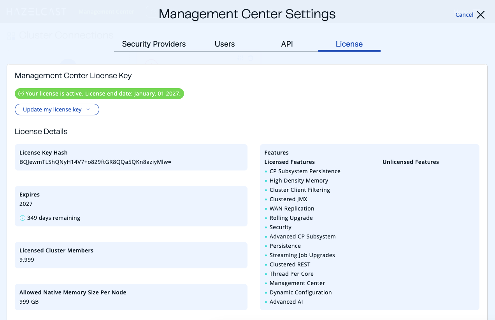

An Enterprise license must be installed on Management Center to access Enterprise features and display metrics for more than three cluster members.

You can use the UI to update an Enterprise license for Management Center.

## Before you begin

You need a valid Enterprise license. You can get a trial license from the [Hazelcast website](http://trialrequest.hazelcast.com/).

Make sure that Management Center was not started with the `hazelcast.mc.license` property. This property takes precedence over any license that is set in the UI.

This feature is available only to admin users.

## Update the license

From the **Settings** menu in the Top Bar, go to the **License** tab.

You'll see the following:

- **License Key Hash**: SHA-256 hash of the key as a Base64 encoded string. The actual key is not displayed for security reasons.
- **Expires**: The date on which the license will expire.
- **Licensed Cluster Members**: The total number of members that the license supports and the current number of members running on the license.
- **Allowed Native Memory Size Per Node**: Allowed size of Native Memory, if the license contains High Density Memory feature.

Warnings are displayed when a license expires within 30 days.

To update your license key:

1. Click **Update my license key**.
2. Enter your license key and click **Update License**.

The information on the page is updated for the new license.

## Next steps

[View the license that's installed on the Hazelcast cluster](../../cluster/administration/cluster-license.mdx).

Use the REST API to [get details about license expiration times](../../integrate/clustered-rest/clustered-rest.mdx#retrieving-management-center-license-expiration-time).

Start Management Center with the [`hazelcast.mc.license` property](../configuration/system-properties.mdx#starting-with-a-license) to override any Enterprise license for Management Center that's already installed.
