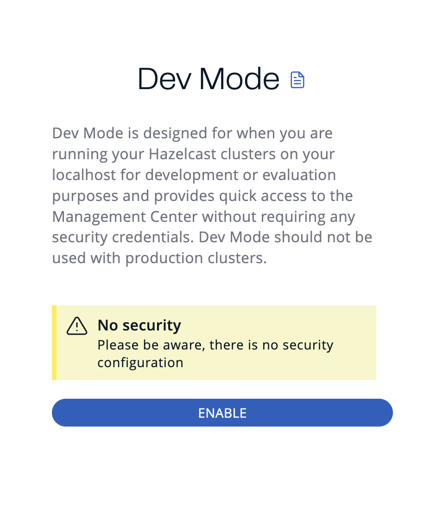

import Tabs from "@theme/Tabs";
import TabItem from "@theme/TabItem";

Dev mode is a development security provider that allows you to evaluate Management Center without needing credentials for logging in or using the REST API.

Once you have enabled dev mode, you are automatically logged into Management Center as an admin user without needing to supply any credentials.

## Set up dev mode

To set up dev mode, you can use the UI, the `hz-mc conf` tool, or a YAML declarative configuration file.

<Tabs groupId="mc-conf--ui--yaml-beta">
<TabItem value="ui" label="UI">

To set up dev mode in the UI, click **Enable Dev Mode** when Management Center starts.



</TabItem>
<TabItem value="mc-conf" label="mc-conf">

To set up dev mode with `hz-mc conf`, use the following command.

You can use this task for various scripting purposes, and automatically configuring Management Center, without using the UI.

```bash title="Linux and Mac"
hz-mc conf dev-mode configure
```

```bash title="Windows"
mc-conf.bat dev-mode configure
```

</TabItem>
<TabItem value="yaml-beta" label="YAML (Beta)">

To set up dev mode with a [YAML declarative configuration file](../../configuration/declarative-configuration/overview.mdx), declare an empty `devMode` block under `securityProvider`:

```yaml
securityProvider:
  devMode: {}
```

</TabItem>
</Tabs>

## Using --force to configure dev mode {/* #using-force-to-configure-dev-mode */}

Use the `-f` / `--force` flag with `dev-mode configure` to make configuration idempotent:

- If dev mode is not yet configured, it is set up.
- If dev mode is already configured, the command succeeds without making any changes.
- If a **different** security provider is currently active, the command fails with an error even when `--force` is used.

## Next steps

For details about the `hz-mc conf` tool, see [Management Center Configuration Tool](../../configuration/mc-conf.mdx). For details about the YAML declarative configuration file, including how to switch from dev mode to another provider without a manual reset step, see [YAML declarative configuration](../../configuration/declarative-configuration/overview.mdx) and [Declarative configuration apply modes](../../configuration/declarative-configuration/declarative-configuration-apply-mode.mdx).
