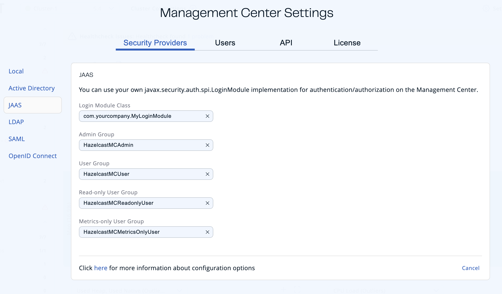

import Tabs from '@theme/Tabs';
import TabItem from '@theme/TabItem';

You can use your own \`javax.security.auth.spi.LoginModule\` implementation for authentication and authorization in Management Center.

## Set up the JAAS security provider

To set up JAAS, you need to configure settings either in the UI or the `hz-mc conf` tool.

<Tabs groupId="mc-config-method">
<TabItem value="ui" label="UI">

You must be an admin user.

To set up the local security provider in the UI, go to **Settings** \> **Security Providers** \> **JAAS**.



</TabItem>
<TabItem value="mc-conf" label="mc-conf">

Use the `jaas configure` task. For help, use the `-h` flag or see [Management Center Configuration Tool](../../configuration/mc-conf.mdx).

```bash title="Linux and Mac"
hz-mc conf jaas configure
```

```bash title="Windows"
mc-conf.bat jaas configure
```

</TabItem>
</Tabs>

- **Login Module Class**: Fully qualified class name of your `javax.security.auth.spi.LoginModule` implementation.
- **Admin Group:** Members of this group have admin privileges on the Management Center.
- **User Group:** Members of this group have read and write privileges on the Management Center.
- **Read-only User Group:** Members of this group have only read privilege on the Management Center.
- **Metrics-only Group:** Members of this group have the privilege to see only the metrics on the Management Center.

## Create and manage users

To create and manage additional users, you must configure them in your JAAS login module.

When creating users, be sure to give them a valid role. See [User management](../../user-management.mdx).

The following is an example implementation. Note that this example returns two `java.security.Principal` instances; one of them is the username and the other one is a group name, which you will use when configuring JAAS security as described above.

```java
import javax.security.auth.Subject;
import javax.security.auth.callback.Callback;
import javax.security.auth.callback.CallbackHandler;
import javax.security.auth.callback.NameCallback;
import javax.security.auth.callback.PasswordCallback;
import javax.security.auth.login.LoginException;
import javax.security.auth.spi.LoginModule;
import java.security.Principal;
import java.util.Map;

public class SampleLoginModule implements LoginModule {
    private Subject subject;
    private String password;
    private String username;

    @Override
    public void initialize(Subject subject, CallbackHandler callbackHandler, Map<String, ?> sharedState, Map<String, ?> options) {
        this.subject = subject;

        try {
            NameCallback nameCallback = new NameCallback("prompt");
            PasswordCallback passwordCallback = new PasswordCallback("prompt", false);

            callbackHandler.handle(new Callback[] {nameCallback, passwordCallback });

            password = new String(passwordCallback.getPassword());
            username = nameCallback.getName();
        } catch (Exception e) {
            throw new RuntimeException(e);
        }
    }

    @Override
    public boolean login() throws LoginException {
        if (!username.equals("emre")) {
            throw new LoginException("Bad User");
        }

        if (!password.equals("pass1234")) {
            throw new LoginException("Bad Password");
        }

        subject.getPrincipals().add(new Principal() {
            public String getName() {
                return "emre";
            }
        });

        subject.getPrincipals().add(new Principal() {
            public String getName() {
                return "HazelcastMCAdmin";
            }
        });

        return true;
    }

    @Override
    public boolean commit() throws LoginException {
        return true;
    }

    @Override
    public boolean abort() throws LoginException {
        return true;
    }

    @Override
    public boolean logout() throws LoginException {
        return true;
    }
}
```

## Using --force to configure JAAS {/* #using-force-to-configure-jaas */}

Use the `-f` / `--force` flag with `jaas configure` to make configuration idempotent:

- If JAAS is not yet configured, it is set up.
- If JAAS is already configured with the same settings, the command succeeds without making any changes.
- If JAAS is already configured with different settings, the existing configuration is overwritten without needing to run `security reset` first.
- If a **different** security provider is currently active, the command fails with an error even when `--force` is used.

## Next steps

For details about the `hz-mc conf` tool, see [Management Center Configuration Tool](../../configuration/mc-conf.mdx).
