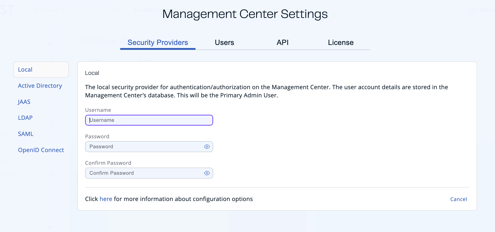

You can use security providers to authenticate users in Management Center and allow them to log into user accounts.

Management Center comes with the following security providers:

- [**Dev mode**](./dev-mode.mdx): No login required. One admin user. No authentication token needed to use the REST API.
- [**Local**](./local-security-provider.mdx): Manage user logins and authentication in Management Center.

  :::tip

  You can create and manage users both in the Management Center UI and with the `hz-mc conf` tool only if you use the local security provider.

  :::
- [**Active Directory**](./active-directory.mdx): Use an existing Active Directory server for user authentication and authorization.
- [**JAAS**](./jaas.mdx): Use your own `javax.security.auth.spi.LoginModule` implementation for user authentication and authorization.
- [**LDAP**](./ldap.mdx): Use an existing Active Directory server for user authentication and authorization.
- [**SAML**](./saml.mdx): Use SAML single sign-on with Management Center.
- [**OpenID Connect**](./openid.mdx): Use OpenID Connect single sign-on with Management Center.

You can select dev mode as a security provider only when you first launch Management Center. To configure all other security providers, go to **Settings** \> **Security Providers**.

If you're looking to switch from one security provider to another, see [Switch to a new security provider](./switching-security-provider.mdx).
