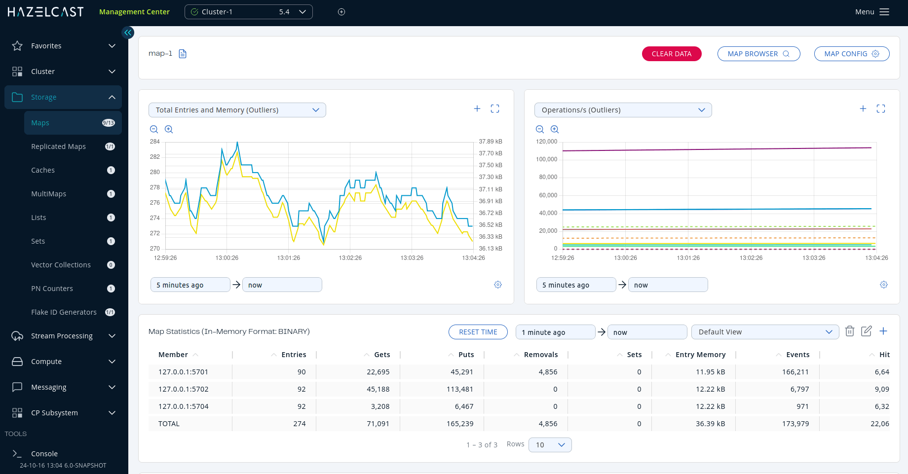

In this tutorial, you'll start up an instance of Management Center that automatically connects to a Hazelcast cluster, using a Docker container. To enable you to get up and running quickly, an example `docker-compose.yml` is provided. No other configuration or dependencies are required.

## Overview

You'll complete the following steps:

- Create a `docker-compose.yml` to run a Hazelcast environment from a Docker container on your local machine.
- Start up Management Center and a Hazelcast cluster, using Docker Compose.
- Launch Management Center from a browser to view cluster details.
- Create a map using the SQL browser.
- Monitor the map.
- Shut down your Hazelcast environment.

## Prerequisites

To complete this tutorial, you need the following:

| Requirements | Useful resources |
| --- | --- |
| Docker Compose | [Install Docker Compose](https://docs.docker.com/compose/install/) |

## Run Hazelcast from a Docker Container

1. Check that Docker Compose is installed correctly.

   ```shell
   docker compose version
   ```

   If you do not see a version number, see the [Docker docs](https://docs.docker.com/get-started/08_using_compose/) for troubleshooting information.
2. Create a new directory on your local machine. In the directory, create a file named `docker-compose.yml` and copy in the following details:

   ```yaml vars
   services:
     hazelcast:
       image: hazelcast/hazelcast:latest
       ports:
       - "5701:5701"
     management-center:
       image: hazelcast/management-center:{full-version}
       ports:
       - "8080:8080"
       environment:
       - MC_DEFAULT_CLUSTER=dev
       - MC_DEFAULT_CLUSTER_MEMBERS=hazelcast
   ```

   You can preconfigure a cluster connection in Management Center by setting the following environment variables:

   - MC\_DEFAULT\_CLUSTER: The cluster name that Management Center connects to.
   - MC\_DEFAULT\_CLUSTER\_MEMBERS: A comma-separated list of the cluster member addresses or host names.
3. In a terminal, change to the directory that you just created.
4. To pull the required images, and to start up a Management Center instance already connected to a Hazelcast cluster, run the following:

   ```shell
   docker compose up
   ```

   Wait until you see the following message in the console:

   `Hazelcast Management Center successfully started at http://localhost:8080`

   Followed by:

   `MC Client connected to cluster dev.`

### Start the compose stack with an Enterprise license

If you have an Enterprise Edition license, you can configure the Docker Compose file with the license as follows (see [`hazelcast.mc.license` property](../deploy-and-manage/configuration/system-properties.mdx#starting-with-a-license) for more details):

```yaml vars
services:
  hazelcast:
    image: hazelcast/hazelcast-enterprise:latest
    ports:
    - "5701:5701"
    environment:
    - HZ_LICENSEKEY={license key}
  management-center:
    image: hazelcast/management-center:{full-version}
    ports:
    - "8080:8080"
    environment:
    - MC_LICENSE={license key}
    - MC_DEFAULT_CLUSTER=dev
    - MC_DEFAULT_CLUSTER_MEMBERS=hazelcast
```

## Launch Management Center

Now that Management Center is connected to a running cluster, you can start to explore.

1. In a web browser, go to `localhost:8080`. Details of the Hazelcast cluster that Management Center connected to during startup are displayed.

   

   Management Center is running in dev mode. This mode is a special security provider that allows you to evaluate Management Center, without needing login credentials or authentication tokens for the REST API. For details about security providers, see [Security Providers](../deploy-and-manage/security/user-authentication/security-providers.mdx).
2. Click **View Cluster** to see the cluster's dashboard.

   

## Create a map

Management Center comes with a variety of tools for communicating with clusters. In this step, you'll use the SQL browser to create a map in the cluster and put some data in it.

1. Click **SQL** in the Side Bar.

   After each of the following SQL queries, click **Execute Query**.
2. Create a map called `my_distributed_map`.

   ```sql
   CREATE MAPPING my_distributed_map TYPE IMap OPTIONS ('keyFormat'='varchar','valueFormat'='varchar');
   ```
3. Put some data into the map.

   ```sql
   SINK INTO my_distributed_map VALUES
      ('1', 'John'),
      ('2', 'Mary'),
      ('3', 'Jane');
   ```
4. Now you can query the data you have written:

   ```
   SELECT * FROM my_distributed_map;
   ```

## Monitor the map

Go back to the cluster's dashboard and select **Storage** \> **Maps**, and then select **my\_distributed\_map** from the list of maps. You can see the statistics of your map:



## Shut down Hazelcast

To shut down your Hazelcast environment gracefully, press <kbd>Ctrl</kbd>+<kbd>C</kbd>.

## Summary

In this tutorial, you learned how to use Docker Compose to start up Management Center and a Hazelcast cluster. You also learned how to create and monitor a map.

## Next steps

If you have an Enterprise license or you want to learn about Enterprise features, see [Enterprise licenses](../deploy-and-manage/license-management/license-management.mdx).

To serve Management Center over HTTPS instead of HTTP, see [Serve Management Center over HTTPS](../deploy-and-manage/security/tls/serve-mc-over-https.mdx).

For information about the options you can provide when starting Management Center, see [System properties and environment variables](../deploy-and-manage/configuration/system-properties.mdx).
