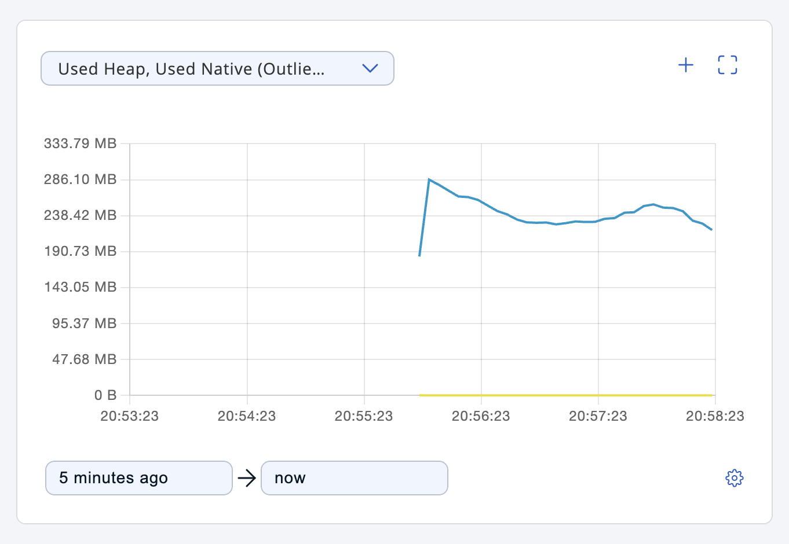
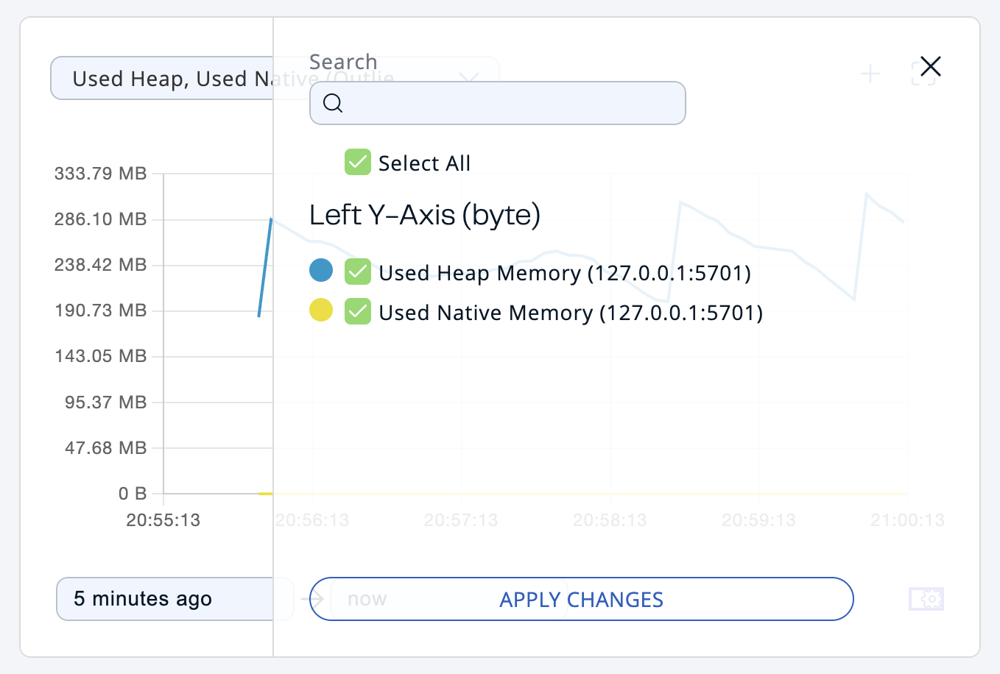
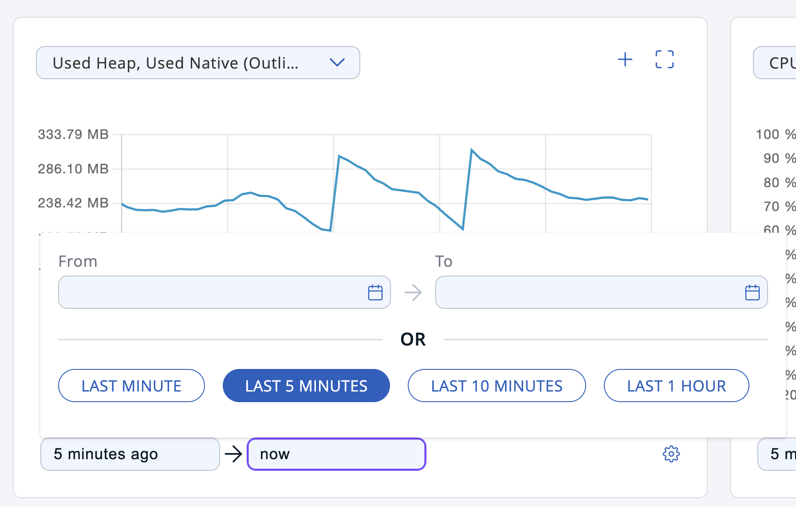
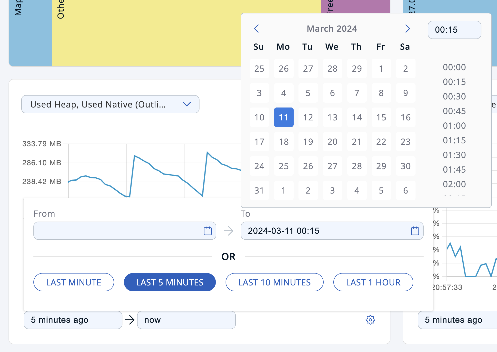
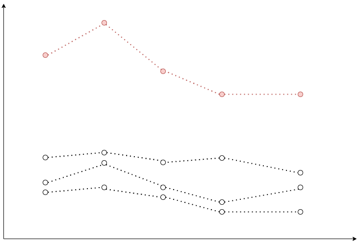
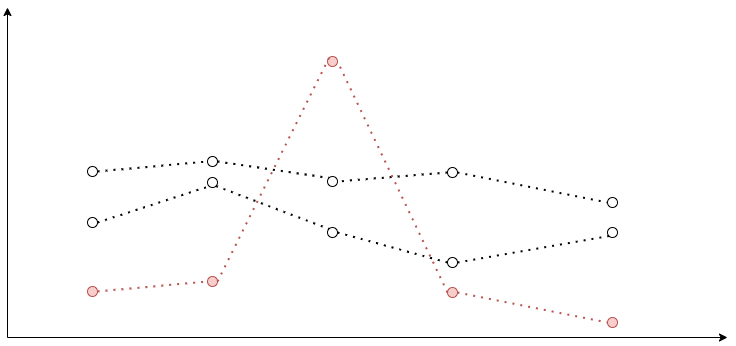
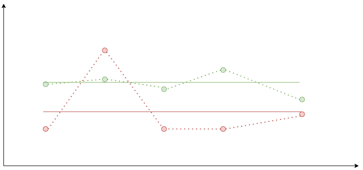
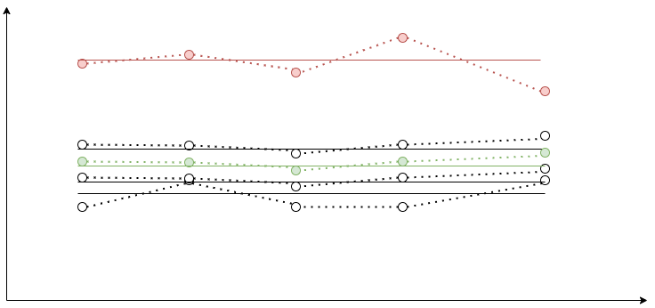

Graphs are displayed on the dashboard and on the details page of any data structure (with a few exceptions). This topic explains how to read graphs and customize their data points.

## Legend

Up to 12 graphs can be displayed at the same time. Legend allows you to adjust which graphs are visible and which ones are not. By default, all graphs are visible. A title of a hidden graph is displayed as struck through.

## Current and historical data

Graphs work in two modes:

- Current mode—this fetches current data.
- Historical mode—this fetches historical data.

The current mode is always available. The historical mode requires [Historical metrics](../../deploy-and-manage/historical-metrics.mdx) to be enabled.

The input on the bottom controls what data is displayed. The input is disabled if only current data is available. You can select any arbitrary point in the past to see the historical data from that period. You can also drag the chart to adjust the time point.

Graphs show up to 5 minutes of data. In the current mode it requests data in chunks every 5 seconds, and concatenates it. In the historical mode, it requests 5 minutes of data up to the selected time point once.

When the historical mode is activated, the bottom input displays the selected time point. You can press **Last 5 Minutes** to switch back to the current mode.

## Presets

Graphs provide access to an extensive list of metrics and use a selection of filters to show only relevant data matching a certain condition on the graph. A preset is a combination of metrics and a filter. You can add/edit new presets and remove the existing ones. Each graph is shipped with at least one default preset. You cannot edit or remove a default preset.

The top dropdown shows the name of the preset and allows you to switch between them. The pencil button next to it opens an edit preset view. The plus button opens a new preset view.

## Metrics

Every member collects its own metrics. Management Center periodically polls the members for their metrics and stores them in dedicated metric storage. Later, it exposes individual member metrics and their aggregates. Aggregated metric is a single value calculated for a metric across all cluster members for a single point in time. It can be a sum of values for all cluster members for a single time point, such as their average/mean, etc.

Here is an example of the sum aggregate (colored in red):

Every metric is measured using some unit of measurement. You can select metrics with up to two different units.

## Filters

Graphs support the following types of filters:

- Outliers (auto)
- Peak Top 3
- Peak Bottom 3
- Average Top 3
- Average Bottom 3
- Manual Selection

### Peak Top 3 and Peak Bottom 3

This works as follows:

1. Graphs fetch individual member metrics for all members.
2. It finds a maximum/minimum (for Top 3 and Bottom 3 correspondingly) value in the list of data points for every member.
3. It shows top 3/bottom 3 graphs based on the maximum/minimum value.

On the image below a graph with the highest peak value is colored in red:

### Average Top 3 and Average Bottom 3

This works as follows:

1. Graphs fetch individual member metrics for all members.
2. It calculates an average value for the list of data points for every member.
3. It shows top 3/bottom 3 graphs based on the average value.

On the image below, green and red graphs are displayed with their corresponding average values. As you can see, the red graph has a higher peak value, but a lower average value.

### Outliers (auto)

This works as follows:

1. Graphs fetch individual member metrics for all members.
2. It calculates an average value for the list of data points for every member.
3. Graphs fetch a median aggregate for the selected metric.
4. It calculates an average value for the median aggregate graph.
5. It shows the median aggregate graph as a dashed line.
6. If the average value for any member is greater than the average value for the median aggregate, it shows the graph for that member. This graph is called an outlier. The graph shows up to 3 outliers with the greatest deviation from the median.

The image below shows 4 member graphs with their corresponding averages. A median aggregate with its average is colored in green. The member graph that is considered an outlier is colored in red.

### Manual selection

This works as follows:

1. You select the members.
2. Graphs fetch individual member metrics for the selected members.
3. It calculates an average value for the list of data points for every member.
4. It shows the graphs for the selected metrics of the selected members.
