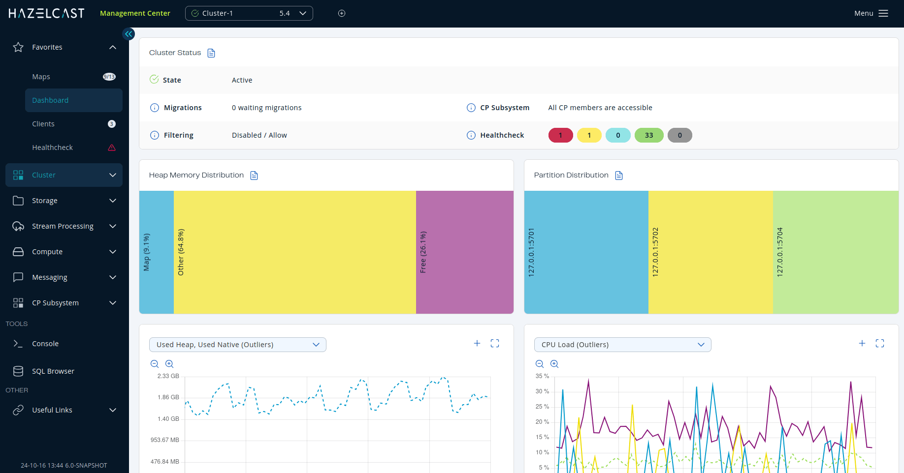
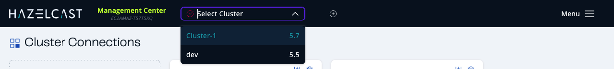
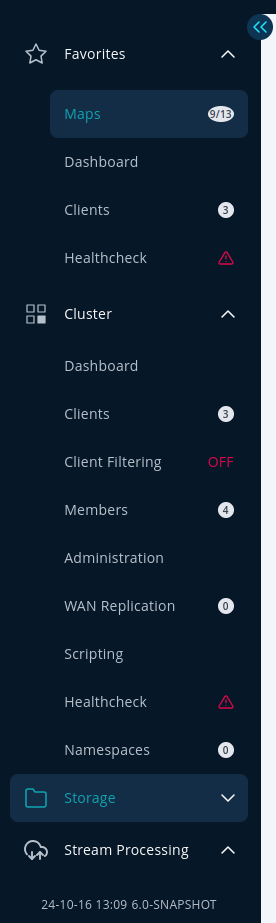

To help you find your way around Management Center, this topic explains the Top Bar and Side Bar elements of the user interface.

The following shows the Management Center user interface:

The user interface has a Top Bar running along the top and a Side Bar on the left.

## Top Bar

The Top Bar has the following elements:

- **Instance Name**. The instance name of the machine Manage Center is deployed on. Can be overridden with [`hazelcast.mc.info.instanceName`](../../deploy-and-manage/configuration/system-properties.mdx#hazelcast-mc-info-instanceName).
- **Cluster dropdown**. Select a connected cluster to manage. Cluster version is shown to the right of each connected cluster.

:::note

During a [rolling upgrade](../../cluster/administration/triggering-rolling-upgrade.mdx), all members can be, for instance, `5.2.z`, but the cluster is still `5.1`; in these cases, the cluster version is displayed as `5.1`. You can find more details on <Variable href="/hazelcast/{page-latest-supported-hazelcast}/maintain-cluster/rolling-upgrades#rolling-upgrade-procedure" text="Performing a Rolling Upgrade" />.

:::

- **Cluster connections**. Navigate to [Cluster connections](../../deploy-and-manage/cluster-connections/connecting-to-clusters-ui.mdx) to add a new cluster connection.
- **Settings**. Configure the Management Center settings such as security providers, users, and licenses. See the **Deploy and manage** section of the documentation.
- **Username** or **\< \> Dev Mode**. If you have configured a security provider, the last element displays the current user's name. You can click this name to sign out. Otherwise, this element displays **\< \> Dev Mode**.

## Side Bar

The Side Bar on the left-hand side contains the following elements:

- **Menu**. Open/close the menu on the left-hand side.
- **Console**. Open/close the in-app console so that you can easily execute commands on your cluster. See [Execute console commands](../../tools/console.mdx).
- **SQL**. Open/close SQL Browser to execute SQL queries on your cluster. See [Execute SQL Queries](../../tools/sql-browser.mdx).
- **Date/Time and Version**. Shows date in YY/MM/DD format, current time, and Management Center version.
- **Docs**. Open the Management Center documentation in a new browser tab.

The menu on the left-hand side lists the data structures and jobs in your clusters, cluster members and clients connected to the cluster (numbers on the right show the instance count for each entity). You can also see the overall state of your cluster, execute commands and scripts, and perform user/license operations using this menu. The menu consists of the following parent menu headings:

- **Favorites**. Includes menu items marked as favorite. You can add an item to Favorites, or remove an item from Favorites by clicking the star icon to the left of the item.
- **Cluster**. Includes menu items for general cluster operations, monitoring clients/cluster members and executing scripts/commands.
- **Storage**. Includes menu items to monitor data structures such as the maps, caches and PN counters in your cluster.
- **Streaming**. Includes menu items to export snapshots and manage streaming jobs.
- **Compute**. Includes the **Executors** menu item to monitor the executor services in your cluster.
- **Messaging**. Includes menu items to monitor queues and topics in your cluster.
- **CP Subsystem**. Includes menu items to monitor CP members and data structures such as Atomic Longs, Semaphores, and Fenced Locks in your cluster.
- **Useful Links**. Includes several external useful links and an information page for the licensed features.

:::tip

You can resize the menu by dragging its right-hand side.

:::
