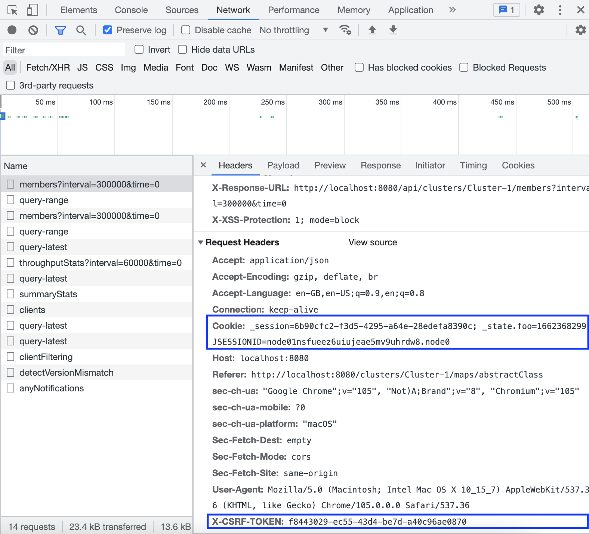
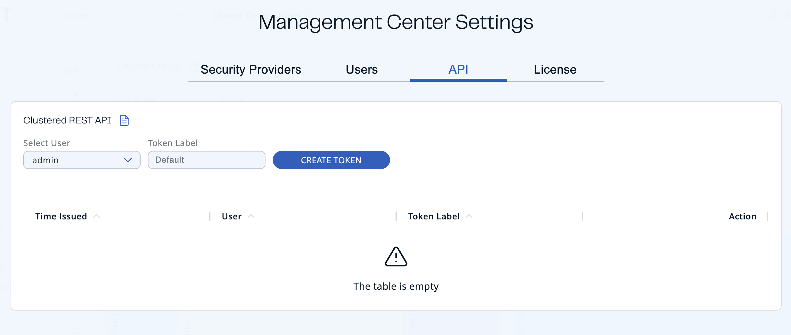
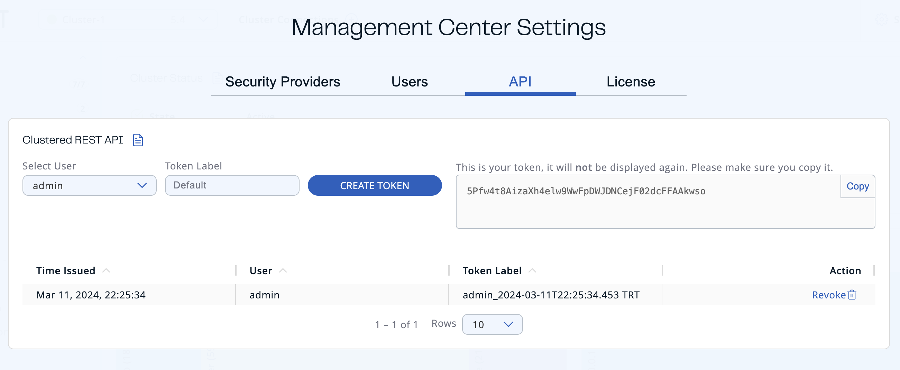
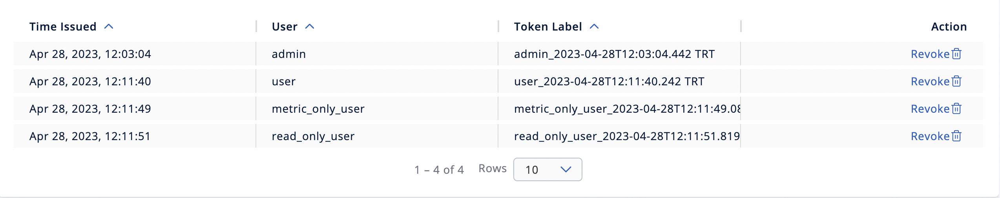

import Tabs from "@theme/Tabs";
import TabItem from "@theme/TabItem";

The clustered REST API can be enabled to allow you to monitor clustered statistics of distributed objects through HTTP endpoints.

## Enable Clustered REST

The REST API is disabled by default.

To enable clustered REST in Management Center, use the [`hazelcast.mc.rest.enabled` property](../../deploy-and-manage/configuration/system-properties.mdx#hazelcast-mc-rest-enabled) at startup.

## Root endpoint

The entry point for the clustered REST API is `/rest`. This resource does not have any attributes.

## Parameters

All parameters that are used in the REST endpoints, such as cluster names and distributed data structure names, must be [URL encoded](https://en.wikipedia.org/wiki/Percent-encoding). Such parameters are marked in braces (`{` and `}`) in the URL description for each endpoint. For example, `name.with/special@chars` parameter value would be encoded as `name.with%2Fspecial%40chars`.

:::important

Encoding does not make every character usable: a name that contains a percent sign (`%`, encoded as `%25`) or a backslash (`\`, encoded as `%5C`) will be rejected with `400 Bad Request`. For guidance on choosing names, see [Naming Data Structures](/hazelcast/latest/data-structures/distributed-data-structures#naming-data-structures).

:::

If no data can be found for an endpoint, that endpoint returns a 404 HTTP status code.

## Authentication

Unless the security provider is set to dev mode, users need an authentication (auth) token to send requests to the REST API.

The auth token must be included in the following header:

- Authorization: Bearer \<user\_auth\_token\>

### Generate auth tokens

The way in which you generate an auth token depends on the security provider that you use. See [Security Providers](../../deploy-and-manage/security/user-authentication/security-providers.mdx).

:::note

All auth tokens inherit roles from the user.

:::

<table>
<colgroup>
<col style={{width:'50%'}} />
<col style={{width:'50%'}} />
</colgroup>
<thead>
<tr>
<th>Security Provider</th>
<th>Method for issuing tokens</th>
</tr>
</thead>
<tbody>
<tr>
<td>Local Security Provider</td>
<td>

Use the `user issue-token` task of the `hz-mc conf` tool.

Send a `POST` request to the `/api/tokens` endpoint.

Use Auth `Settings/API` screen on the UI.

</td>
</tr>
<tr>
<td>All other security providers other than dev mode</td>
<td>

Send a `POST` request to the `/api/tokens` endpoint.

Use Auth `Settings/API` screen on the UI.

</td>
</tr>
</tbody>
</table>

#### Use `api/tokens` endpoint

To use the /api/tokens endpoint for security providers except SAML and OIDC, run the following command. Replace the \<username\> and \<password\> placeholders with the credentials of a user logged in to the Management Center.

```bash
curl -u <username>:<password> -d '{"username":"<username>"}' -H "Content-Type: application/json" -X POST http://localhost:8080/api/tokens
```

To use the /api/tokens endpoint for SAML and OIDC, run the following command.

```bash
curl -d '{"username":"<username>"}' -H "X-CSRF-TOKEN: <x-csrf-token>" -H "Cookie: <cookie>" -H "Content-Type: application/json" -X POST http://localhost:8080/api/tokens
```

Here, replace the `<username>` placeholders with the username of a user logged in to the Management Center, and replace the `<x-csrf-token>` and `<cookie>` with X-CSRF-TOKEN and Cookie headers. You can get the headers from any request on Network tab in Developer Tools when you are logged into Management Center:



#### Use `hz-mc conf` tool

To use the `hz-mc conf` tool, do the following:

<Tabs groupId="os">
<TabItem value="linux-and-mac" label="Linux and Mac">

```bash
hz-mc conf user issue-token -n <username>
```

</TabItem>
<TabItem value="windows" label="Windows">

```bash
mc-conf.bat user issue-token -n <username>
```

</TabItem>
</Tabs>

The created token is displayed in the output:

```none
Successfully issued a token for user 'test_user'.
Token: 'mJMMDfaSWZ1MuqhmGhA8m4erCNZtPi_A4_VyR_y8eH0'
Label: 'test_user_2021-07-07T17:24 EEST'
```

#### Use Auth Token Management UI

1. Click **Settings** in the Top Bar.
2. Navigate to the **API** tab.

   
3. Select the user that you want to create a token for. Only an admin can create tokens for other users.
4. Enter the label of the token that you want to create. Default value has the `username_creationTime` format.
5. Click **Create Token**.

The created token appears on the right-hand side.



You can copy your token to the clipboard.

:::note

The token will not be displayed again, so make sure you note it before leaving the page or creating a new one.

:::

You can see the list of existing tokens in the table, at the bottom of the page.



| Field | Description |
| --- | --- |
| **Time Issued** | Date and time when the token was created. |
| **User** | Username which the token is created for. |
| **Token Label** | Label of the token. |
| **Action** | Action for revoking a token. |

### Revoke all auth tokens

To revoke all auth tokens for a user, use the `user revoke-tokens` task.

<Tabs groupId="os">
<TabItem value="linux-and-mac" label="Linux and Mac">

```bash
hz-mc conf user revoke-tokens -n <username>
```

</TabItem>
<TabItem value="windows" label="Windows">

```bash
mc-conf.bat user revoke-tokens -n <username>
```

</TabItem>
</Tabs>

## OpenAPI definitions

The Clustered REST endpoints are documented in OpenAPI format. See the following:

- [Client Filtering API](./client-filtering.mdx)
- [Cluster Metrics API](./cluster-metrics.mdx)
- [Cluster Connections API](./cluster-connections.mdx)
- [WAN Replication API](./wan-replication.mdx)
- [Diagnostics Config API](./diagnostics-config.mdx)

This documentation is also accessible at the `/swagger-ui/index.html` endpoint of Management Center. For example `http://localhost:8080/swagger-ui/index.html`.
