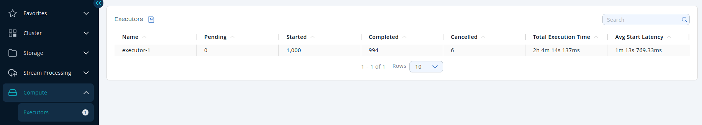
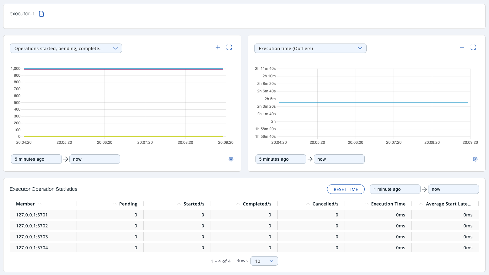

You can see a list of all the Executors in your cluster by clicking on the **Executors** menu item on the left panel. A new page appears on the right, as shown below.

You can filter the Executors shown and you can also sort the table by clicking on the column headers. Click on an Executor name to open a new page for monitoring that Executor instance on the right, as shown below.

At the top of the page are two graphs that show various metrics for the Executor. See the [graph section](../get-started/user-interface-overview/graphs.mdx) for more information.

Under these charts is the <Anchor id="executor-operation-statistics" />**Executor Operation Statistics** table. From left to right, this table lists the IP address and port of members, the counts of pending, started and completed executors per second, and the execution time and average start latency of executors on each member.

To display listings in ascending or descending order, click on the column headings.
