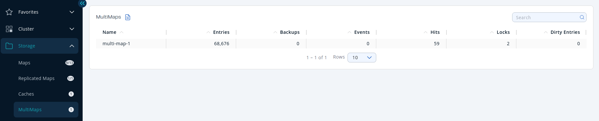

`MultiMap` is a specialized map where you can associate a key with multiple values.

You can see a list of all the `MultiMap`s in your cluster by clicking on the **`MultiMap`s** menu item on the left panel. A new page appears on the right, as shown below.

You can filter the `MultiMap`s shown, and you can also sort the table by clicking on the column headers. Click on a `MultiMap` name to open a new page for monitoring that `MultiMap` instance on the right.

<Anchor id="multimap-statistics" />This monitoring option is similar to the **Maps** option in that the same monitoring charts and data tables monitor `MultiMap`s. The difference is that you cannot browse `MultiMap`s and re-configure them. See the [Managing Maps](./map.mdx).
