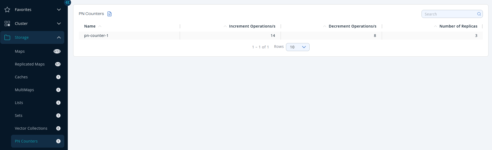
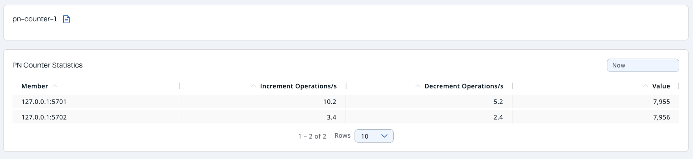

You can see a list of all the PN counters in your cluster by clicking on the **Counters** menu item on the left panel. A new page appears on the right, as shown below.

You can filter the counters shown and you can also sort the table by clicking on the column headers. The monitoring data available are:

- **Increment Operations/s**: Average number of times the counter was incremented per second during the last timeslice.
- **Decrement Operations/s**: Average number of times the counter was decremented per second during the last timeslice.
- **Number of Replicas**: Number of member instances that have a state for the counter.

<Anchor id="counter-details"/>Click on a counter name to open a new page for monitoring that specific counter instance, as shown below.

Likewise, you can sort the table by clicking the column headers. It shows the IP and port of the members that have a state for the specific counter named in the page's title. The monitoring data available are:

- **Increment Operations/s**: Average number of times the counter was incremented on that member per second during the last timeslice
- **Decrement Operations/s**: Average number of times the counter was decremented on that member per second during the last timeslice
- **Value**: Current value of the counter on that member.
