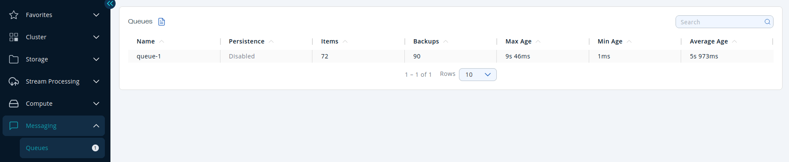
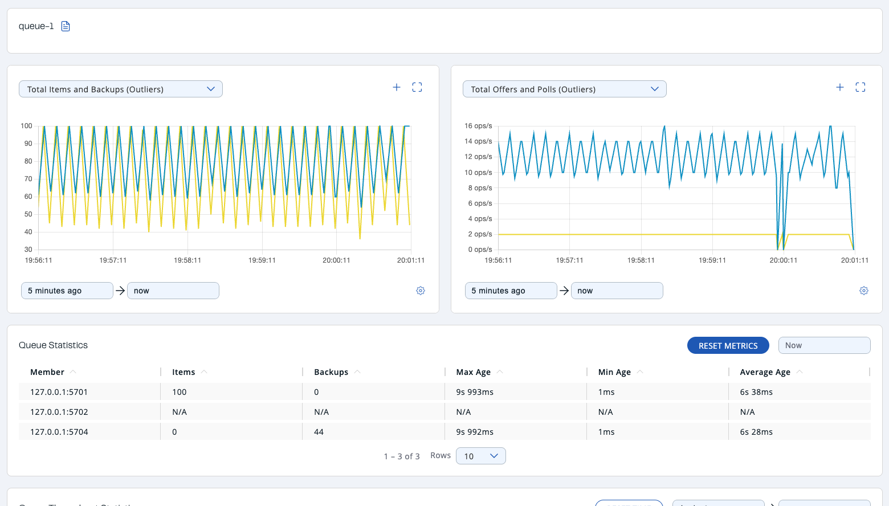
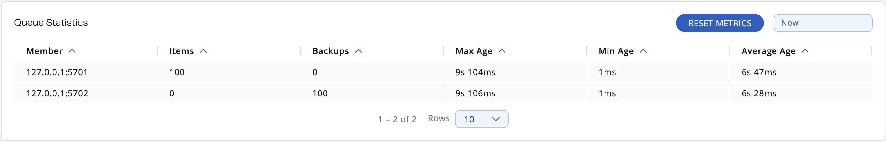
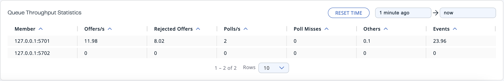

You can see a list of all the queues in your cluster by clicking on the **Queues** menu item on the left panel. A new page appears on the right, as shown below.

You can filter the queues shown and you can also sort the table by clicking on the column headers. Click on a queue name to open a new page for monitoring that queue instance on the right, as shown below.

At the top of the page are two graphs that show various metrics for the queue. See the [the graph section](../get-started/user-interface-overview/graphs.mdx) for more information.

Under these charts are **Queue Statistics** and **Queue Throughput Statistics** tables.

The <Anchor id="queue-statistics" />Queue Statistics table provides item and backup item counts in the queue, and age statistics of items and backup items at each member, as shown below.

From left to right, this table lists the IP address and port, items and backup items on the queue of each member, and maximum, minimum and average age of items in the queue. To list entries in ascending or descending order, click on the column headings.

The <Anchor id="queue-operation-statistics" />Queue Operation Statistics table provides information about the operations (offers, polls, events) performed on the queues, as shown below.

From left to right, this table lists the IP address and port of each member, and counts of offers, rejected offers, polls, poll misses, others and events.

You can set the period using the date-time picker in the top right corner of the window to show the table data. Available built-in values are **Since Beginning**, **Last Minute**, **Last 10 Minutes** and **Last 1 Hour**.

To list entries in ascending or descending order, click on the column headings.
