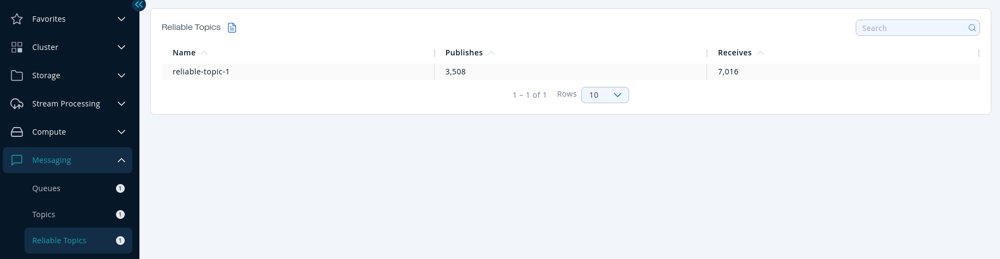
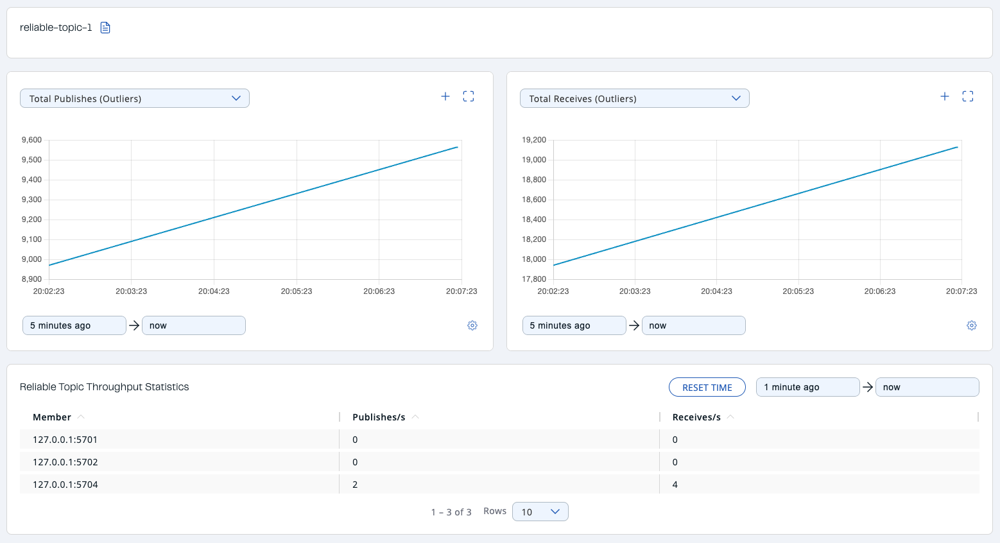

You can see a list of all the Reliable Topics in your cluster by clicking on the **Reliable Topics** menu item on the left panel. A new page appears on the right, as shown below.

You can filter the Reliable Topics shown and you can also sort the table by clicking on the column headers. Clicking on a Reliable Topic name opens a new page for monitoring that Reliable Topic instance on the right, as shown below.

At the top of the page are two graphs that show various metrics for the reliable topic. See the [the graph section](../get-started/user-interface-overview/graphs.mdx) for more information.

Under these charts is the **Reliable Topic Throughput Statistics** table. From left to right, this table lists the IP addresses and ports of each member, and counts of the messages published and received per second in real-time.

To display listings in ascending or descending order, click on the column headings.
