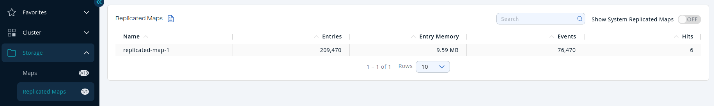
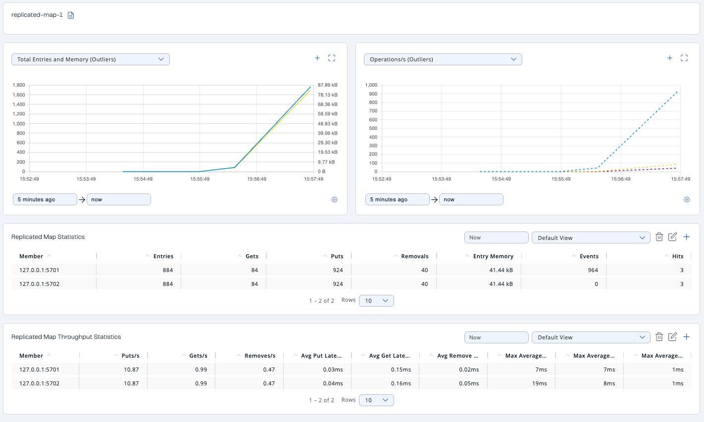
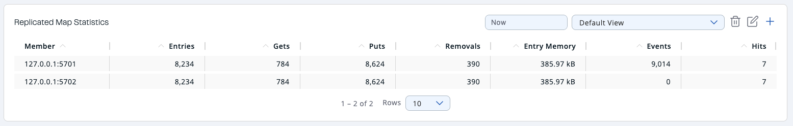
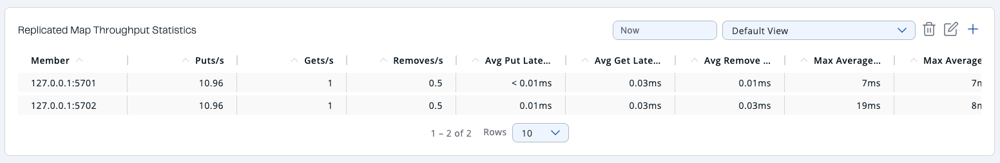

You can see a list of all the Replicated Maps in your cluster by clicking on the **Replicated Maps** menu item on the left panel. A new page appears on the right, as shown below.

You can filter the Replicated Maps shown and also sort the table by clicking on the column headers. Click on a Replicated Map name to open a new page for monitoring that Replicated Map instance on the right, as shown below.

Using this page, you can monitor metrics of the selected Replicated Map. The page shows two graphs that display various metrics for the Replicated Map. See the [the graph section](../get-started/user-interface-overview/graphs.mdx) for more information.

Under these charts are **Replicated Map Statistics** and **Replicated Map Throughput** data tables.

<Anchor id="replicated-map-statistics" />Replicated Map Statistics Table provides statistics distributed over the members, as shown below.

From left to right, this table lists the following:

| Field | Description |
| --- | --- |
| **Members** | IP address and port of the member. |
| **Entries** | Number of entries in this Replicated Map owned by the member. |
| **Gets/Puts/Removals** | Number of the get/put/remove operations for this Replicated Map received by the member. |
| **Entry Memory** | Memory cost of the owned entries in the member. |
| **Events** | Number of replicated map events received by the member. A replicated map event is triggered when a map entry is added, removed, updated, evicted, expired, merged, loaded, invalidated, or included in the "evict all" or "clear all" operations. |
| **Hits** | Number of the reads performed for this Replicated Map's entries. |

The <Anchor id="replicated-map-throughput" />**Replicated Map Throughput Statistics** table provides information about operations (get, put, remove) performed on each member in the selected Replicated Map.

From left to right, this table lists the following:

| Field | Description |
| --- | --- |
| **Member** | IP address and port of each member. |
| **Puts/Gets/Removes** | Put, get, and remove operation counts per second on each member. |
| **Avg. Put/Get/Remove Latencies** | Average put, get, and remove latencies in milliseconds. |
| **Max. Avg. Put/Get/Remove Latencies** | Maximum average put, get, and remove latencies on each member in milliseconds. |

Select the period from the combo box located in the top right corner of the window, in which the table data is shown. Available values are **Since Beginning**, **Last Minute**, **Last 10 Minutes** and **Last 1 Hour**.

To display listings in ascending or descending order, click on the column headings.
