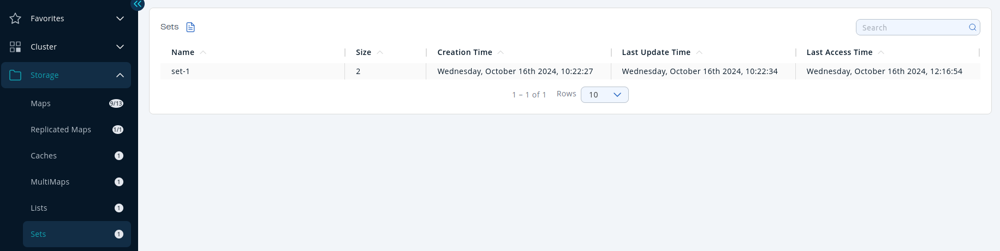

You can see a list of all the sets in your cluster by clicking on the **Sets** menu item on the left panel. A new page appears on the right, as shown below.

To sort the table, click on the column headers.

Set is a distributed and concurrent implementation of `java.util.Set`.
