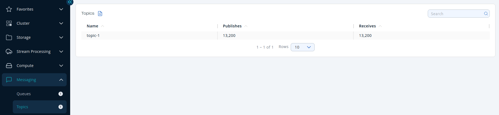
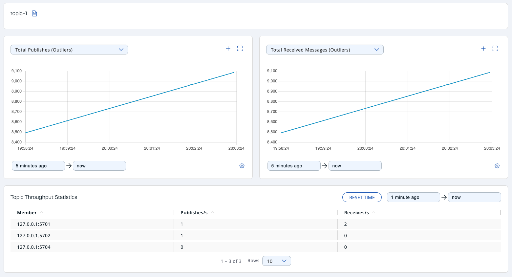

You can see a list of all the topics in your cluster by clicking on the **Topics** menu item on the left panel. A new page appears on the right, as shown below.

You can filter the topics shown and you can also sort the table by clicking on the column headers. Click on a topic name to open a new page for monitoring that topic instance on the right, as shown below.

At the top of the page are two graphs that show various metrics for the topic. See the [the graph section](../get-started/user-interface-overview/graphs.mdx) for more information.

Under these charts is the <Anchor id="topic-throughput-statistics"/>**Topic Throughput Statistics** table. From left to right, this table lists the IP addresses and ports of each member, and counts of the messages published and received per second in real-time.

To display listings in ascending or descending order, click on the column headings.
