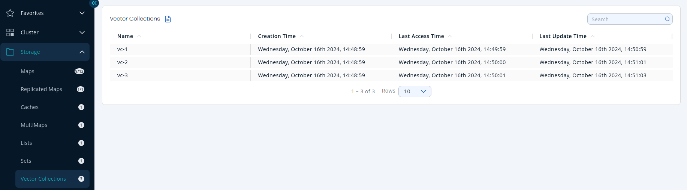
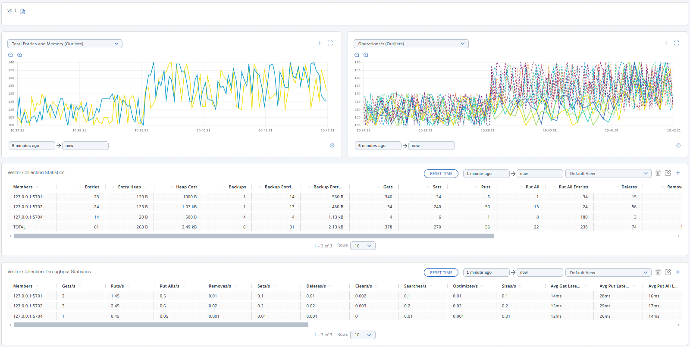
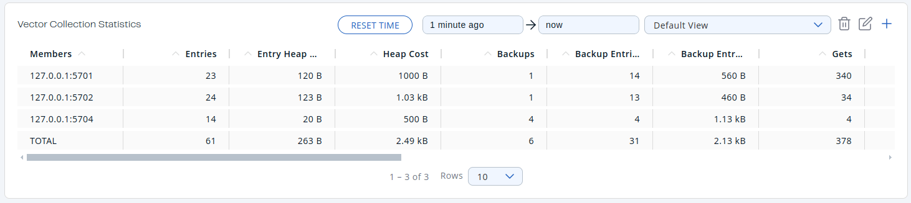
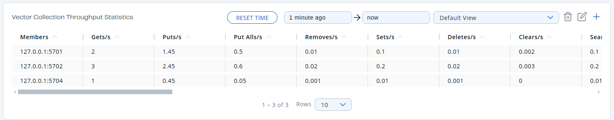

You can see a list of all the vector collections in your cluster by clicking on the **Vector Collections** menu item on the left panel. A new page appears on the right, as shown below.

| Field | Description |
| --- | --- |
| **Name** | Name of vector collection. |
| **Creation Time** | First time the key was put. |
| **Last Access Time** | Last time the clients read the key's value. |
| **Last Update Time** | Last time the key's value was updated. |

You can filter and sort the displayed vector collections by clicking on the column headers. Click on a vector collection name to open a new page for monitoring that vector collection instance on the right, as shown below.

## Monitor a vector collection {/* #vector-collection-monitoring */}

The vector collection monitoring page shows two graphs that display various metrics for the vector collection. For more information, see [Graphs](../get-started/user-interface-overview/graphs.mdx).

Under these charts are **Vector Collection Statistics** and **Vector Collection Throughput** data tables.

<Anchor id="vector-collection-statistics" />**Vector Collection Statistic Table** provides statistics distributed over the members, as shown below.

From left to right, this table lists the following:

| Field | Description |
| --- | --- |
| **Members** | IP address and port of the member. |
| **Entries** | Number of entries owned by the member. |
| **Entry Heap Memory** | Memory heap cost of owned entries in the member. |
| **Heap Cost** | Memory cost of owned entries in the member. |
| **Backups** | Number of backup operations held by the member. |
| **Backup Entries** | Number of backup entries held by the member. |
| **Backup Entry Heap Memory Cost** | Memory heap cost of owned entries in the backup. |
| **Gets** | Number of get operations received by the member. |
| **Sets** | Number of set operations received by the member. |
| **Puts** | Number of put operations received by the member. |
| **Put All** | Number of put all operations received by the member. |
| **Put All Entries** | Number of put all entries received by the member. |
| **Deletes** | Number of delete operations received by the member. |
| **Removes** | Number of remove operations received by the member. |
| **Clears** | Number of clear operations received by the member. |
| **Optimizes** | Number of optimize operations received by the member. |
| **Sizes** | Number of size operations received by the member. |
| **Searches** | Number of search operations received by the member. |
| **Search Results** | Number of search results. |

To display the list in ascending or descending order, click on the column headings.

<Anchor id="vector-collection-throughput" />**Vector Collection Throughput Table** provides information about the operations (get, put, remove) performed on each member in the vector collection, as shown below.

From left to right, this table lists the following:

| Field | Description |
| --- | --- |
| **Members** | IP address and port of the member. |
| **Gets/s** | Number of get operations per second on the member. |
| **Puts/s** | Number of put operations per second on the member. |
| **Put Alls/s** | Number of put all operations per second on the member. |
| **Removes/s** | Number of remove operations per second on the member. |
| **Sets/s** | Number of local set operations per second on the member. |
| **Deletes/s** | Number of delete operations per second on the member. |
| **Clears/s** | Number of clear operations per second on the member. |
| **Searches/s** | Number of search operations per second on the member. |
| **Optimizes/s** | Number of optimize operations per second on the member. |
| **Sizes/s** | Number of size operations per second on the member. |
| **Avg Get Latency** | Average latency of get operations on the member. |
| **Avg Put Latency** | Average latency of put operations on the member. |
| **Avg Put All Latency** | Average latency of put all operations on the member. |
| **Avg Remove Latency** | Average latency of remove operations on the member. |
| **Avg Set Latency** | Average latency of set operations on the member. |
| **Avg Delete Latency** | Average latency of delete operations on the member. |
| **Avg Clear Latency** | Average latency of clear operations on the member. |
| **Avg Search Latency** | Average latency of search operations on the member. |
| **Avg Optimize Latency** | Average latency of optimize operations on the member. |
| **Avg Size Latency** | Average latency of size operations on the member. |
| **Max Avg Get Latency** | Maximum Average latency of get operations on the member. |
| **Max Avg Put Latency** | Maximum Average latency of put operations on the member. |
| **Max Avg Put All Latency** | Maximum Average latency of put all operations on the member. |
| **Max Avg Remove Latency** | Maximum Average latency of remove operations on the member. |
| **Max Avg Set Latency** | Maximum Average latency of set operations on the member. |
| **Max Avg Delete Latency** | Maximum Average latency of delete operations on the member. |
| **Max Avg Clear Latency** | Maximum Average latency of clear operations on the member. |
| **Max Avg Search Latency** | Maximum Average latency of search operations on the member. |
| **Max Avg Optimize Latency** | Maximum Average latency of optimize operations on the member. |
| **Max Avg Size Latency** | Maximum Average latency of size operations on the member. |

Select the time period for the table using the combo box in the top right corner of the window:

- Since Beginning
- Last Minute
- Last 10 Minutes
- Last 1 Hour

To display entries in ascending or descending order, click on the appropriate column heading.
