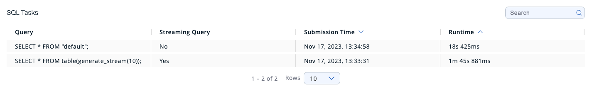
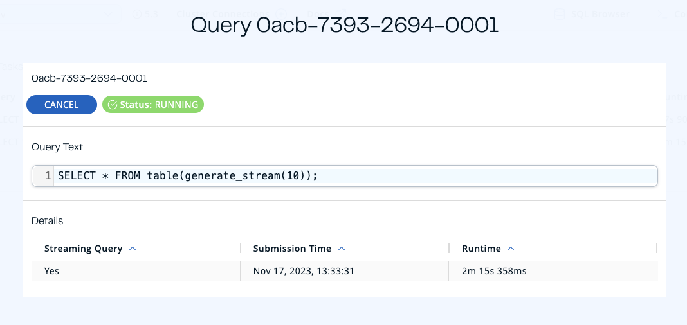

This page displays the list of actively running SQL queries in the cluster:

The following describes the columns shown:

- **Query:** SQL text of the query
- **Streaming Query:** False for batch queries and true for streaming queries
- **Submission Time:** The timestamp of the submission
- **Runtime:** The total execution time of the query

:::note

A query appears in this page only after the runtime exceeds three seconds.

:::

Click on a row to see detailed information about a query.

## Query details

This page displays the available information about the SQL query. To cancel a query, click the Cancel button on the details overlay.

