You can use Management Center to execute SQL queries on a Hazelcast cluster.

## Before you begin

If a map contains domain objects, the classes for those objects must be on the classpath of Management Center before you can query them. See the [Providing an Extra Classpath](../install-and-upgrade/install.mdx#starting-with-an-extra-classpath).

## Use the SQL Browser

Click **SQL** in the Side Bar.

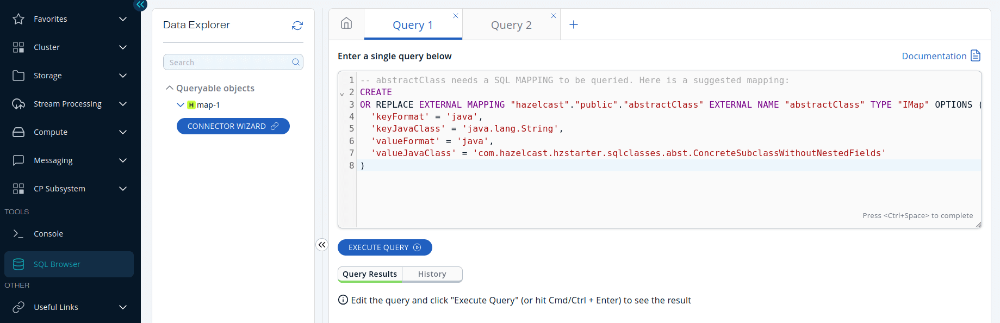

Before you can query an existing map in a cluster, you must create a mapping to it by executing the `CREATE MAPPING` SQL statement. This statement maps the data structure to a table that can be queried with Hazelcast SQL. You can type this statement into the editor, or you can generate it automatically.

You can generate `CREATE MAPPING` statements automatically using Management Center's connector wizard. Using this wizard, you can create mappings with the connectors for Hazelcast Platform maps, Kafka, and other file systems. Launch the wizard by clicking the **Connector Wizard** button and then select the type of the mapping that you want to create from the dropdown.

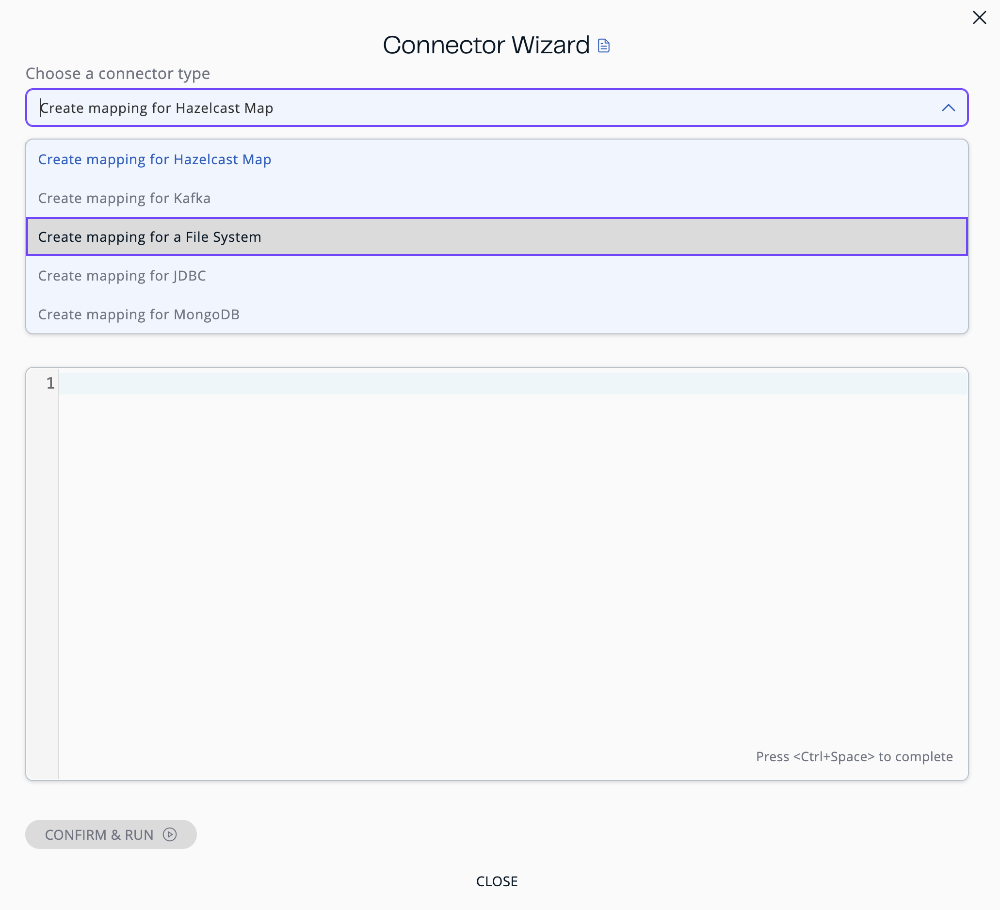

See the following sections for each connector type.

### Create mapping for Hazelcast map

1. Select the connector type as `Create Mapping for Hazelcast Map`.
2. Select the name of an existing map from the dropdown; only maps that don't have any mappings are shown.

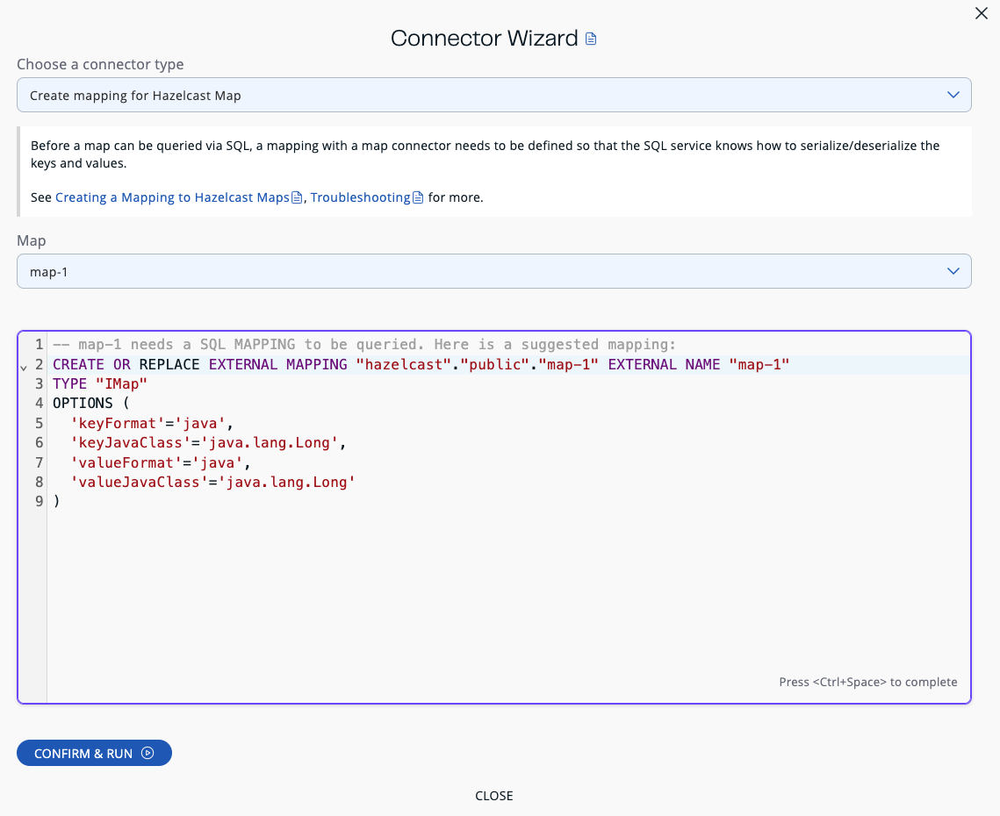

If you need to change the generated statement, you can use the editor.

:::note

You cannot generate a `CREATE MAPPING` statement for empty maps or maps that store entries in the `NATIVE` format without indexes.

:::

Click **Confirm & Run**.

### Create mapping for Kafka

1. Select the connector type as `Create Mapping for Kafka`.
2. Fill out the newly opened form. While you are filling this form, the editor should be updated appropriately.

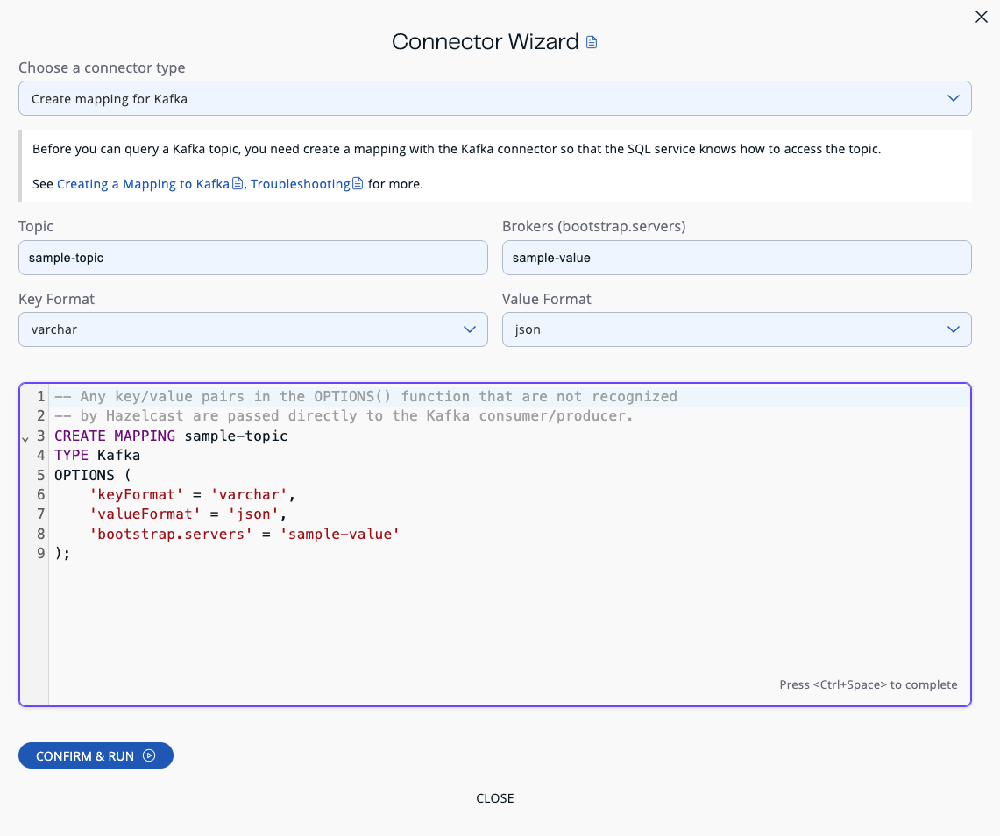

If you need to change the generated statement, you can use the editor.

Click **Confirm & Run**.

### Create mapping for a file system

1. Select the connector type as `Create Mapping for a File System`.
2. Fill out the newly opened form. While you are filling this form, the editor should be updated appropriately.

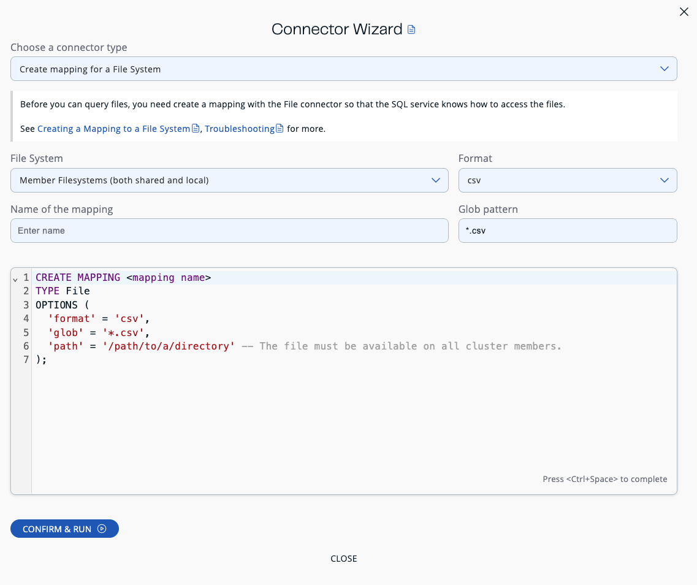

If you need to change the generated statement, you can use the editor.

Click **Confirm & Run**.

### Create mapping for JDBC

1. Select the connector type as `Create Mapping for JDBC`.
2. Fill out the newly opened form. While you are filling this form, the editor should be updated appropriately.

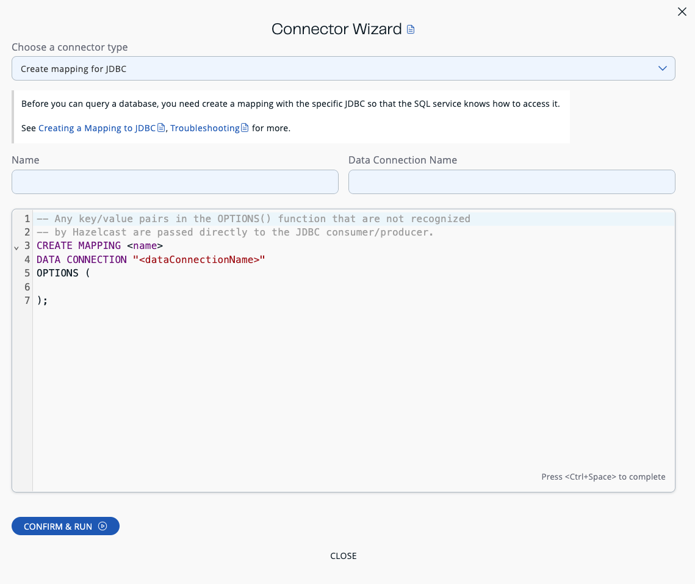

If you need to change the generated statement, you can use the editor.

Click **Confirm & Run**.

### Create mapping for MongoDB

1. Select the connector type as `Create Mapping for MongoDB`.
2. Fill out the newly opened form. While you are filling this form, the editor should be updated appropriately.

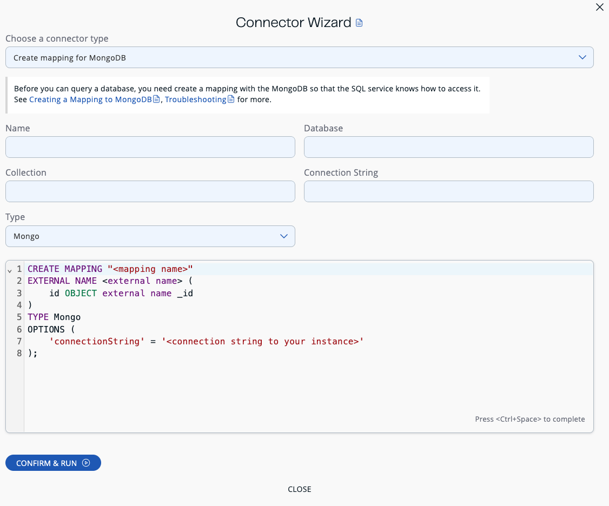

If you need to change the generated statement, you can use the editor.

Click **Confirm & Run**.

After executing the `CREATE MAPPING` statement, you should see your mapping in the **Queryable objects** tree view:

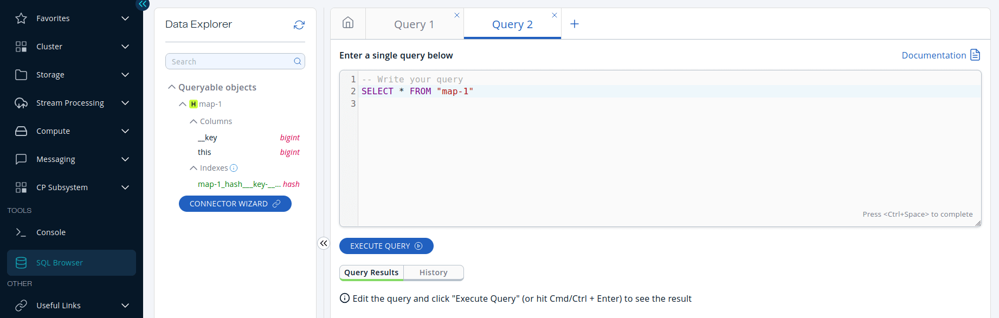

Under the mapping name, you can find columns and indexes with their types.

## Execute queries

To execute a query, click **Execute Query**.

When the query is executed, the results are displayed under **Query Results**:

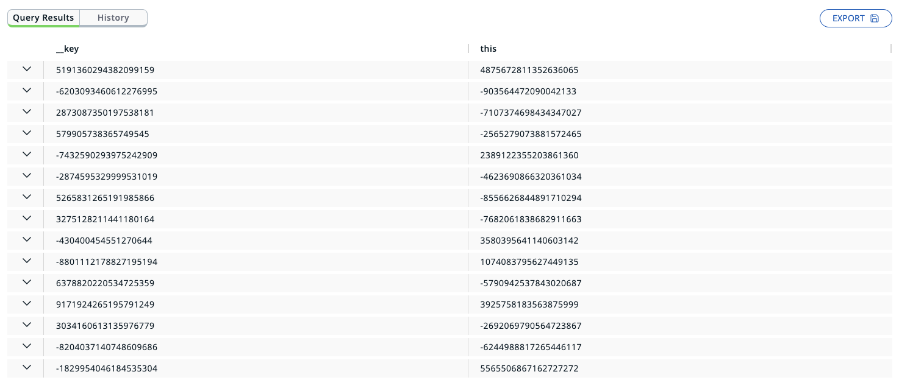

## Truncate displayed query results

To reduce the time it takes for Management Center to display query results in the browser, the size of each table cell is limited. If a query returns too much data to fit into a cell, the result is truncated. You can adjust this limit by editing the [`hazelcast.mc.sql.max-cell-length`](../deploy-and-manage/configuration/system-properties.mdx#hazelcast-mc-sql-max-cell-length) property.

## View map metadata

If you run simple `SELECT` queries without joins or aggregations over maps, you can view [metadata](../storage-compute-messaging/map.mdx#map-browser) for each entry that is returned by the query.


To view an entry's metadata, click the chevron (**⌄**) button next to a map entry in the query results.

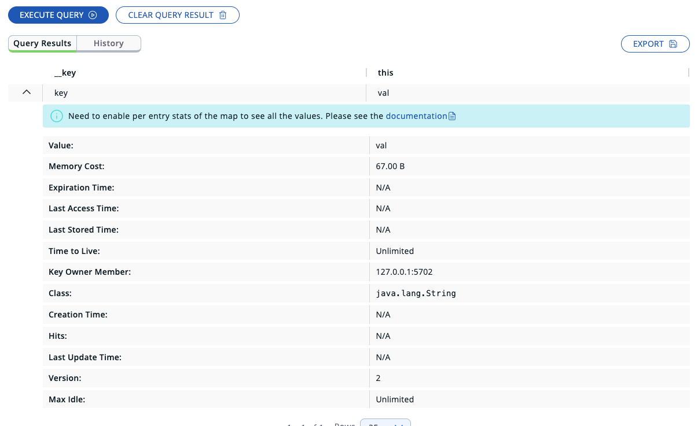

## Autocompletion support

The SQL editor supports autocompletion to suggest SQL keywords and identifiers for you while you type. To use autocompletion, start typing a query in the SQL editor and press <kbd>Ctrl</kbd>+<kbd>Space</kbd>. The SQL editor supports the following suggestions:

- Table and column names
- SQL keywords such as `SELECT`, `INSERT`, `WHERE` and `JOIN`
- SQL functions such as `COUNT`, `AVG` and `SUM`

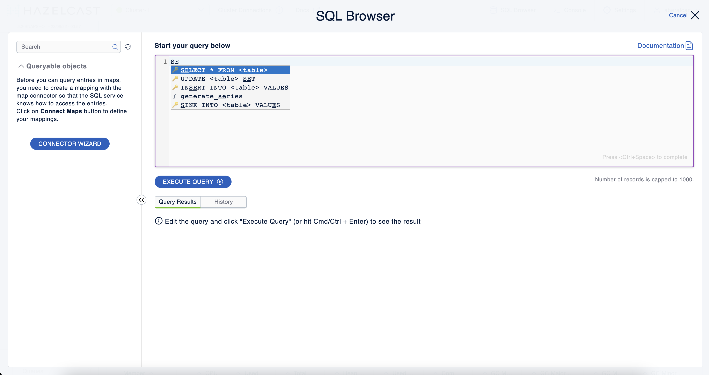

## Export query results

You can use **Export** to export the query result as a CSV file in the [RFC 4180 format](https://tools.ietf.org/html/rfc4180) or as a JSON file.

## View executed SQL queries

In the **History** tab, you can see the history of query execution. The history holds the last one hundred executed queries. You can re-execute any query from the history by pushing a button in the **Execute** column.

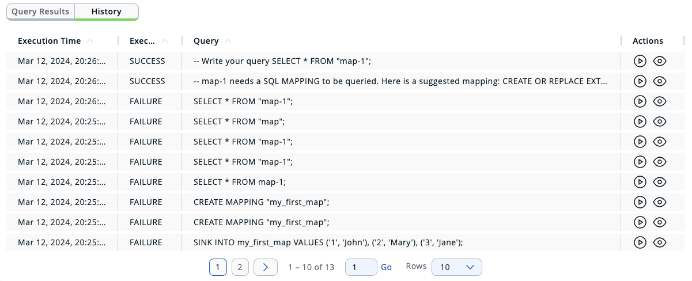

To remove the query results, click **Clear Query Result**.

## Create a map

1. Open the SQL browser and execute the following SQL statement to create a map called `my_first_map`.

   ```sql
   CREATE MAPPING my_first_map TYPE IMap OPTIONS ('keyFormat'='varchar','valueFormat'='varchar');
   ```
2. Delete the above statement and now execute the following.

   ```sql
   SINK INTO my_first_map VALUES
   ('1', 'John'),
   ('2', 'Mary'),
   ('3', 'Jane');
   ```
3. Close the SQL browser and go to **Storage** \> **Maps** to verify that `my_first_map` is created.

   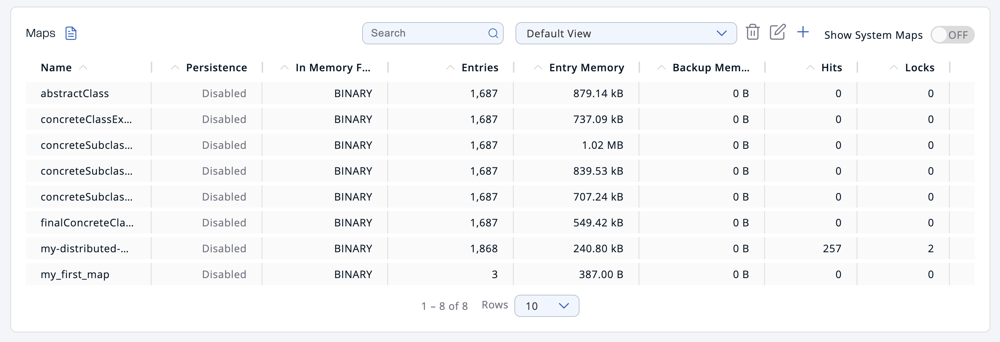

:::note

Management Center allows you to access contents of Hazelcast data structures (for instance map entries) via SQL Browser or Map Browser. It may be useful to restrict data access for Management Center if sensitive financial or personal information is stored in the cluster. Management Center cannot access the data if at least one member has the data access disabled. You can disable data access for Management Center in the member configuration file. See the [Managing Data Access](/hazelcast/latest/maintain-cluster/monitoring#managing-data-access) section.

:::

## Next steps

If you're interested in learning more about SQL in Hazelcast, see the [SQL reference](/hazelcast/latest/sql/sql-statements) in the Platform documentation.
