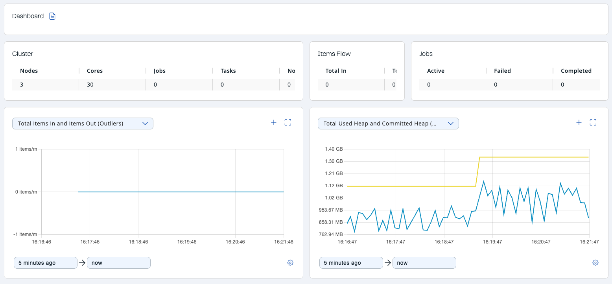

The **Streaming** dashboard gives you an overview of a connected cluster, which has Jet enabled.

The following subsections describe each section of the page.

## Cluster

Shows a summary of the cluster by providing the following metrics:

- **Nodes:** Number of cluster members.
- **Cores:** Number of available CPU cores in the cluster reported by the JVM.
- **Jobs:** Number of jobs in the cluster.
- **Tasks:** Number of cooperative tasks in the cluster. See <Variable href="/hazelcast/{page-latest-supported-hazelcast}/architecture/distributed-computing#tasks-concurrency-is-cooperative" text="5.6@hazelcast:architecture:distributed-computing.adoc#tasks-concurrency-is-cooperative" /> for more detailed explanation.
- **Non-cooperative Tasks:** Number of non-cooperative tasks in the cluster. See <Variable href="/hazelcast/{page-latest-supported-hazelcast}/architecture/distributed-computing#tasks-concurrency-is-cooperative" text="5.6@hazelcast:architecture:distributed-computing.adoc#tasks-concurrency-is-cooperative" /> for more detailed explanation.

## Items Flow

- **Total In:** Total number of items read from the sources of all jobs.
- **Total Out:** Total number of items written to the sinks of all jobs.

## Jobs

- **Active:** Number of active jobs in the cluster.
- **Failed:** Number of failed jobs in the cluster.
- **Completed:** Number of completed jobs in the cluster.
