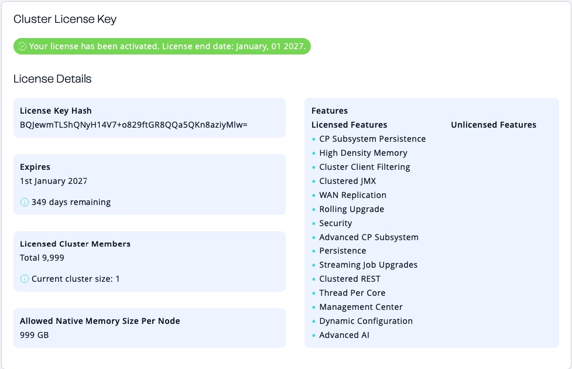

You can use the **Cluster License** tab of the **Administration** menu item to see details about your cluster's license.

This page is available only to admin users.

- **License Key Hash**: SHA-256 hash of the key as a Base64 encoded string. The actual key is not displayed for security reasons.
- **Expires**: The date on which the license will expire.
- **Licensed Cluster Members**: The total number of members that the license supports and the current number of members running on the license.
- **Allowed Native Memory Size Per Node**: Allowed size of Native Memory, if the license includes High Density Memory feature.

Warnings are displayed when a license expires within 30 days.

## Related resources

Even if members are installed with a license, you cannot use Enterprise features in Management Center until you install the license on Management Center as well. See [Enterprise licenses](../../deploy-and-manage/license-management/license-management.mdx).

For information about cluster licenses, see [Manage Enterprise Edition license keys](/hazelcast/latest/deploy/enterprise-licenses) in the Platform documentation.
