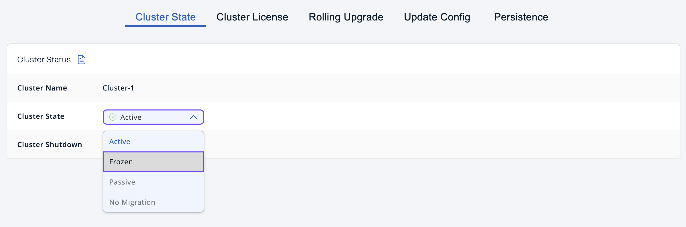

You can trigger a hot backup to save a snapshot of the persistence store. Hot backups are useful when you wish to bring up a new cluster with the same data or parts of the data. The new cluster can then be used to share load with the original cluster, perform testing, or reproduce an issue, using production data.

## Before you begin

Clusters must have a directory set in the `backup-dir` configuration option. See [Backing Up the Persistence Store](/hazelcast/latest/storage/backing-up-persistence) in the Platform documentation.

This page is available only to admin users.

## Trigger a hot backup

1. Go to **Administration** \> **Cluster State** and select `PASSIVE` from the dropdown menu.

   

   Backups may be initiated during membership changes, partition table changes, or during normal data updates. As a result, some members may have outdated versions of the persistence store before they start the backup process. By putting your cluster in a `PASSIVE` state, you can stop the cluster from making changes to the persistence store.
2. Go to the **Persistence** tab and click **Hot Backup**.

   The backup process will start asynchronously in the background.
3. Go to the **Cluster State** tab select `ACTIVE` from the dropdown menu.
4. Monitor the backup process in the **Last Hot Backup Task Status** field.

   When the **Status** field of each member is **Success**, the backup process completed successfully.

## Next steps

To learn more about changing cluster states, see [Change the cluster state](../cluster-states/changing-cluster-state.mdx).
