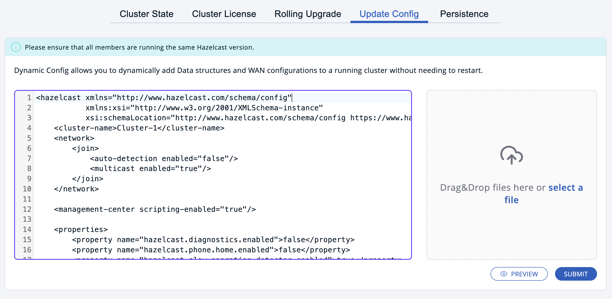
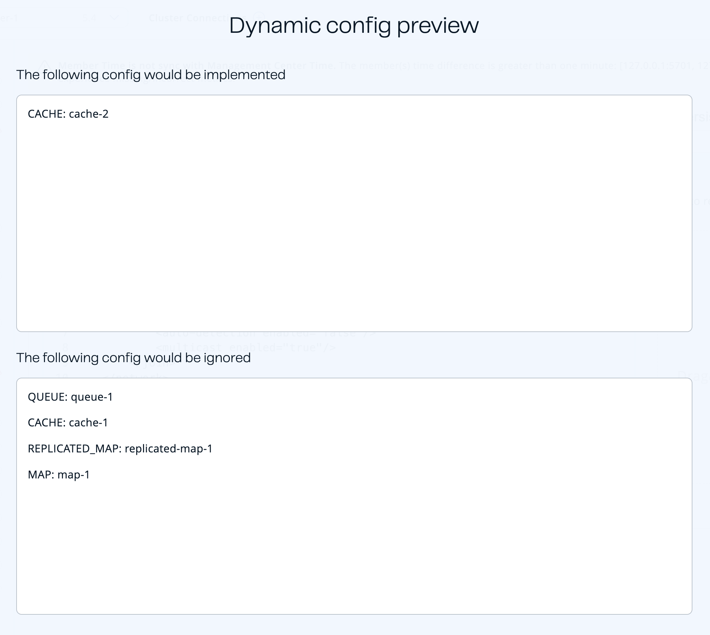
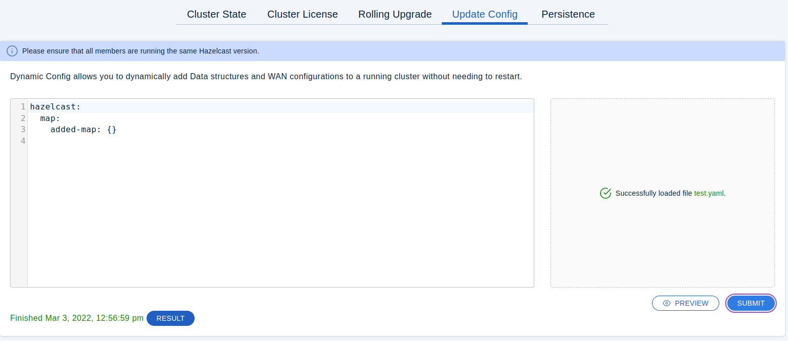
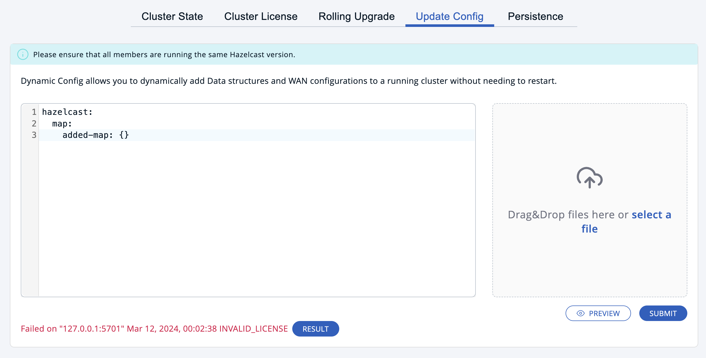

You can add YAML or XML configuration blocks to your running cluster, without needing to restart it.

Go to **Administration** \> **Update Config**.

## Supported configuration

Management Center allows you to add configuration for the following at runtime.

:::tip

A configuration block is one that is a direct child of `hazelcast`.

:::

- New data structure blocks

  :::note

  You cannot add map indexes using the **Update Config** page. To add map indexes, use the [`CREATE INDEX`](/hazelcast/latest/sql/create-index) statement in the [SQL browser](../../tools/sql-browser.mdx).

  :::
- New WAN Replication blocks
- New or updated Enterprise licenses

For examples of YAML and XML configuration, see the Hazelcast GitHub repository:

<IfSnapshot>

- [XML example](https://github.com/hazelcast/hazelcast/blob/master/hazelcast/src/main/resources/hazelcast-full-example.xml)
- [YAML example](https://github.com/hazelcast/hazelcast/blob/master/hazelcast/src/main/resources/hazelcast-full-example.yaml)

</IfSnapshot>

<IfNotSnapshot>

- <Variable href="https://github.com/hazelcast/hazelcast/tree/v{page-latest-supported-hazelcast}.0/hazelcast/src/main/resources/hazelcast-full-example.xml" text="XML example"/>
- <Variable href="https://github.com/hazelcast/hazelcast/tree/v{page-latest-supported-hazelcast}.0/hazelcast/src/main/resources/hazelcast-full-example.yaml" text="YAML example"/>

</IfNotSnapshot>

## Submit new configuration to the cluster

You can add configuration blocks to the text field or you can upload a YAML or XML configuration file.

:::note

If you submit an existing configuration block, other than `license`, that already exists, the cluster ignores that configuration block and applies only the new ones.

:::

Update Config page



To check which configuration blocks will be applied, click the **Preview** button.

Preview



To apply the new configuration, click the **Submit** button.

When the configuration is submitted to the cluster, the cluster sends back one of the following results:

<table>
<thead>
<tr>
<th>Status</th>
<th>Description</th>
</tr>
</thead>
<tbody>
<tr>
<td>**Started**</td>
<td>Management Center successfully uploaded the configuration to the cluster.</td>
</tr>
<tr>
<td>**In Progress**</td>
<td>Management Center is uploading the configuration to the cluster. This is an intermediate result for large configuration blocks. You may not see this status if you submit small configuration blocks.</td>
</tr>
<tr>
<td>**Failed**</td>
<td>

Some or all configuration blocks were not applied to the cluster.

Possible errors: PARSING\_FAILURE, SCHEMA\_VALIDATION\_FAILURE, GENERIC\_FAILURE, INVALID\_LICENSE

</td>
</tr>
<tr>
<td>**Finished**</td>
<td>The configuration was successfully applied to the cluster.</td>
</tr>
</tbody>
</table>

Success result



Failure result



To view the applied changes or errors, click the **Result** button.

## Troubleshooting

Use this section to find suggestions for resolving errors that may occur with dynamic configuration.

### Failed results

Configuration updates are not atomic. For example if you submit a new configuration block for a map and a queue, the map configuration block may be successfully applied, but the queue configuration block may fail. In this case the map configuration block is not reverted, but you will see a **Failed** result.

Click on the **Results** button to see which configuration blocks were applied and which were ignored.

To apply the configuration blocks that failed, submit the same configuration blocks.

:::note

If you submit an existing configuration block, other than `license`, that already exists, the cluster ignores that configuration block and applies only the new ones.

:::

### Server request error

If you see the following error after submitting a configuration, make sure that you are submitting valid XML or YAML:

```none
Server request error: An exception occurred: expected type: JSONObject, found: String.
```
