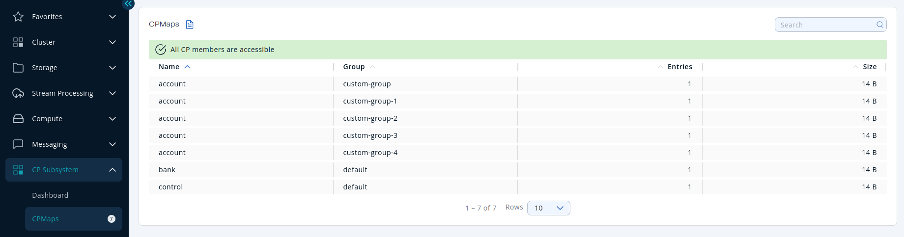

You can see a list of all the [CPMaps](/hazelcast/latest/data-structures/cpmap) in your cluster by clicking on the **CPMaps** menu item in the left menu.

A CPMap has two metrics:

- **Entries**: The number of entries in the map
- **Size**: The size of the map in memory

Sort the table by clicking on the column headers.
