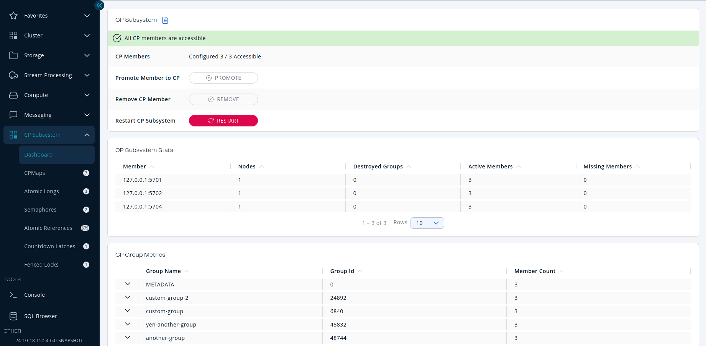
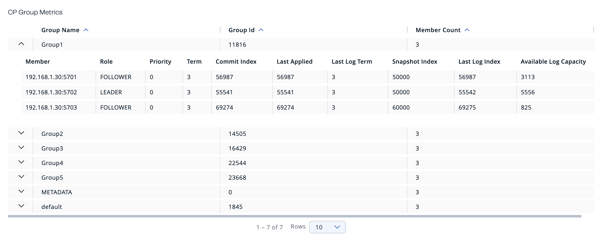
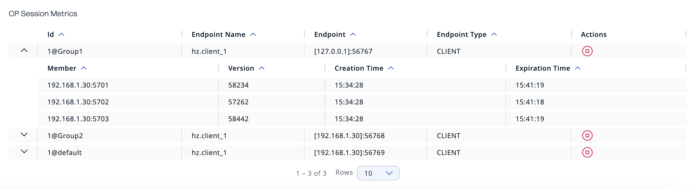
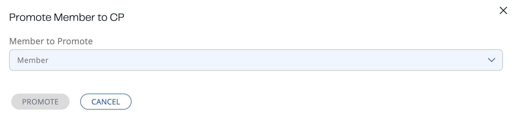
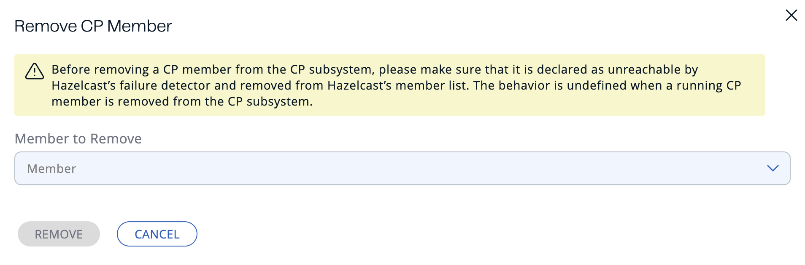
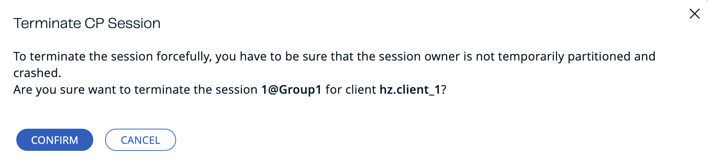

You can use the **CP Subsystem** menu item to manage and monitor the [CP Subsystem](/hazelcast/latest/cp-subsystem/cp-subsystem) in a cluster.

## Data and metrics

The CP Subsystem dashboard displays the following tables:

| Field | Description |
| --- | --- |
| **CP Members** | The number of accessible CP members and the CP member count that's configured on the cluster. |
| **[Promote Member to CP](#promote)** | This button is available only to admin users. |
| **[Remove CP Member](#remove)** | This button is available only to admin users. |
| **[Restart CP Subsystem](#restart)** | This button is available only to admin users. |

| Field | Description |
| --- | --- |
| **Member** | Address of the CP member. |
| **Nodes** | Number of Raft nodes that the member is running. |
| **Destroyed Groups** | Total number of Raft groups that have been destroyed. |
| **Active Members** | Total number of active CP members. |
| **Missing Members** | Total number of missing CP members. |

| Field | Description |
| --- | --- |
| **Group Name** | Name of the Raft group. |
| **Group Id** | Group identifier. |
| **Member Count** | Total number of members in the group. |

To see more details about a particular group, click on the down arrow next to the group name.

| Field | Description |
| --- | --- |
| **Id** | [Session](/hazelcast/latest/cp-subsystem/cp-subsystem) ID. |
| **Endpoint Name** | The name of the client that initiated the session (only if the name is set by the client). |
| **Endpoint** | The address of the client that initiated the session. |
| **Endpoint Type** | The type of the client that initiated the session. |
| **Actions** | Related actions that can be applied to the session. |

To see more details about a particular session, click on the down arrow next to the Id.

## Status banner

A banner is always displayed at the top of the page with a message about the current CP Subsystem status.

This banner may display one of the following messages:

- **CP Subsystem is not enabled**: The cluster is not configured with a CP member count of at least 3.
- **All CP members are accessible**: Number of accessible CP members is at least the same as the configured CP member count.
- **One CP member is not accessible**: One CP member is missing and the minority count in the CP Subsystem is greater than 1. For example, this value is shown when 6 accessible CP members are available and the configured count is 7. In this example, the minority count is 3 members and the majority count is 4 members.
- **Multiple CP members are not accessible:** Multiple CP members are missing, but their count is less than the minority.
- **Minority of the CP members are not accessible:** The minority of CP members are missing.
- **Majority of the CP members are not accessible:** The majority of CP members are missing.

## Promote members to CP members {/* #promote */}

You can promote any existing member that is not part of the CP Subsystem to a CP member.

This action is available only to admin users.

1. Go to **CP Subsystem** \> **Dashboard**, and click **Promote**.
2. Select an AP member (one of the members that do not participate in the CP Subsystem) from the dropdown.

   :::note

   Lite members are not displayed in the dropdown list because they do not store data and cannot be promoted to CP members.

   :::

If everything goes well, a success message is displayed.

If an exception occurs, an error notification is displayed.

## Remove CP members {/* #remove */}

You can manually remove a disconnected CP member from the CP Subsystem, using Management Center.

If a CP member loses connection with the rest of the cluster, the CP Subsystem will wait for 4 hours by default before connecting to a new CP member. You can configure this time in the `missing-cp-member-auto-removal-seconds` option. See [Configure the CP Subsystem](/hazelcast/latest/cp-subsystem/configuration) in the Platform documentation.

This action is available only to admin users.

1. Go to **CP Subsystem** \> **Dashboard**, and click **Remove**.
2. Select a CP member from the dropdown.

   Although this member is not connected to the Management Center, it is known by the cluster's CP Subsystem.

If everything goes well, a success message is displayed.

If an exception occurs, an error notification is displayed.

## Restart CP Subsystem {/* #restart */}

If the majority of CP members crash, you can restart the CP Subsystem to delete all CP data and trigger a new round of the discovery process.

This action is available only to admin users.

Go to **CP Subsystem** \> **Dashboard**, and click **Restart**.

If everything goes well, a success message is displayed.

If an exception occurs, an error notification is displayed.

## Force a session to close {/* #terminate */}

If a session owner is not temporarily partitioned and crashed, an admin user can manually close the session to release its resources immediately.

To manually close the session, complete the following steps:

1. Select **CP Subsystem** \> **Dashboard**.
2. In the CP Session Metrics Table, find the CP session that you want to close.
3. Select the **Terminate** button in the Actions column for the related session.

If the session is successfully closed, a confirmation message displays.

If an exception occurs, an error displays.
