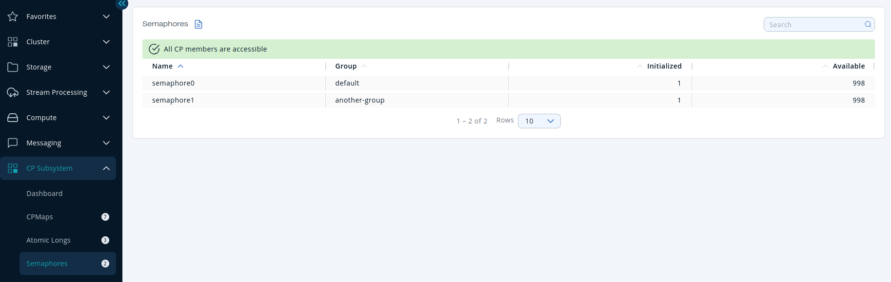

You can see a list of all the [semaphores](/hazelcast/latest/data-structures/isemaphore) in your cluster by clicking on the **Semaphores** menu item in the left menu.

A semaphore has two metrics;

- **Initialized**: Whether the semaphore is initialized with a value.
- **Available**: Number of remaining permits.

Sort the table by clicking on the column headers.
