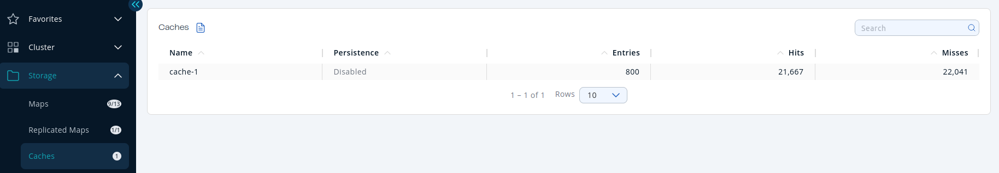
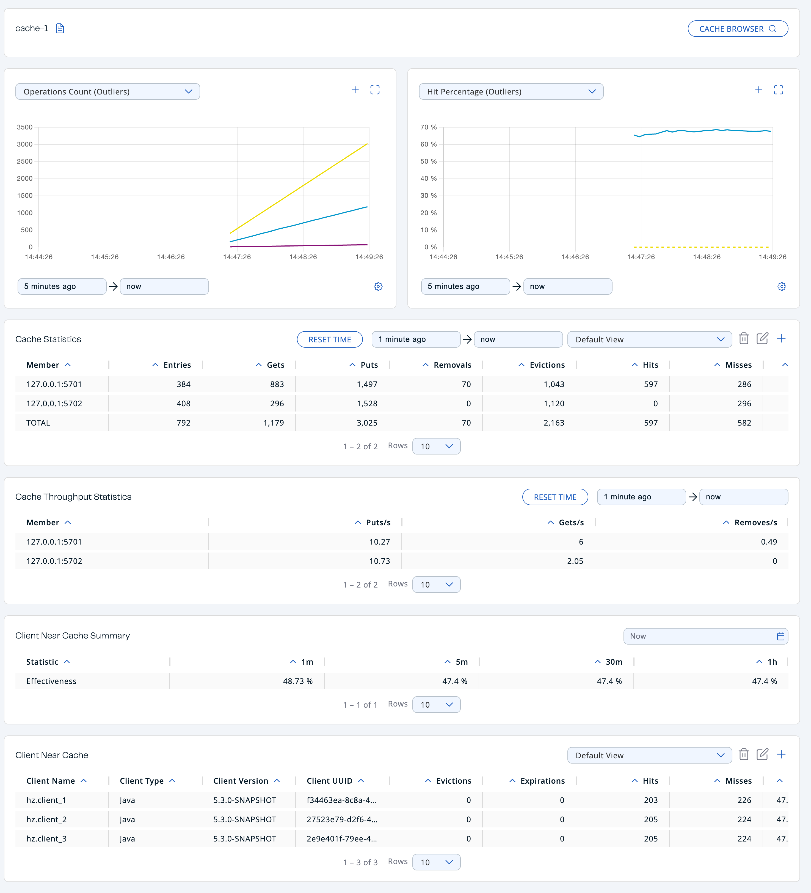
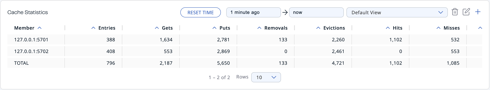
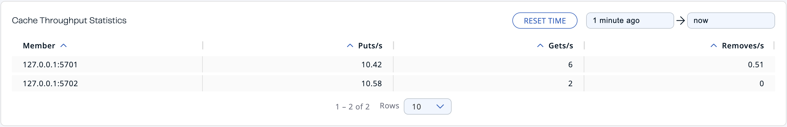
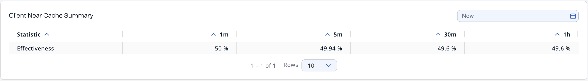
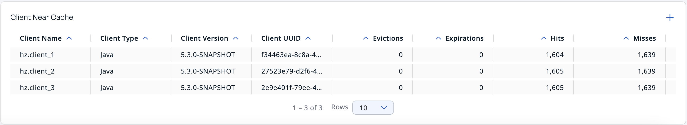

You can see a list of all the caches in your cluster by clicking on the **Caches** menu item on the left panel. A new page appears on the right, as shown below.

You can filter the caches shown and sort the table by clicking on the column headers. Click on the cache name to open a new page for monitoring that cache instance on the right, as shown below.

At the top of the page are two graphs that show various metrics for the cache. See the [graph section](../get-started/user-interface-overview/graphs.mdx) for more information.

Under these charts are **Cache Statistics**, **Cache Throughput**, and **Client Near Cache** data tables.

<Anchor id="cache-statistics"/>**Cache Statistics Table** provides the selected cache's statistics distributed over the members, as shown below.

From left to right, this table lists the following in real time:

| Field | Description |
| --- | --- |
| **Members** | IP address and port of the member. |
| **Entries** | Number of entries in this cache owned by the member. |
| **Gets/Puts/Removals** | Number of the get/put/remove operations for this cache received by the member. |
| **Evictions** | Number of evictions of Cache entries owned by the member. |
| **Hits** | Number of the reads performed for this cache's entries. |
| **Misses** | Number of the entries which cannot be found in the cache when requested to read. |
| **Avg Get/Put/Removal Time** | Average elapsed time for the get/put/removal operations for the cache on each member. |

To list entries in ascending or descending order, click on the column headings.

The <Anchor id="cache-throughput"/>**Cache Throughput Statistics** table provides information about the operations (get, put, remove) performed on each member for the selected cache.

From left to right, this table lists the following:

- IP address and port of each member.
- Put, get and remove operation rates on each member for this cache.

You can set the period in the date-time picker placed in the top right corner of the window, for which the table data will be shown. Available built-in values are **Since Beginning**, **Last Minute**, **Last 10 Minutes** and **Last 1 Hour**.

To list entries in ascending or descending order, click on the column headings.

**Client Near Cache Summary** provides summary information related to the Near Cache statistics aggregated for all the clients that have Near Cache enabled for this cache. Aggregated statistics are shown for the following periods: **1 minute**, **5 minutes**, **30 minutes** and **60 minutes**. Currently, the table shows overall Near Cache effectiveness, calculated as hits/total reads ratio.

:::note

You need to enable the statistics for clients to see them here. See the [Monitoring Clients section](../cluster/clients.mdx) for details.

:::

The **Client Near Cache** table provides information about the Near Caches statistics, if available, on each client that has Near Cache enabled for this cache, as shown below.

:::note

You need to enable the statistics for clients to see them here. See the [Monitoring Clients section](../cluster/clients.mdx) for details.

:::

From left to right, this table lists the following:

| Field | Description |
| --- | --- |
| **Client Name** | Name of the client instance which has Near Cache enabled for the map. |
| **Client Type** | Type of the client. |
| **Client Version** | Version of the client. |
| **Client UUID** | Client unique identifier. |
| **Evictions** | Number of evictions of Near Cache entries owned by the client. |
| **Expirations** | Number of TTL and max-idle expirations of Near Cache entries owned by the client. |
| **Hits** | Number of hits (reads) of Near Cache entries owned by the client. |
| **Misses** | Number of misses of Near Cache entries owned by the client. |
| **Effectiveness** | Hits/total reads ratio. |
| **Owned Entry Count** | Number of Near Cache entries owned by the client. |
| **Owned Entry Memory Cost** | Memory cost of Near Cache entries owned by the client. |

To list entries in ascending or descending order, click on the column headings.

:::note

You need to enable the statistics for caches to monitor them in the Management Center. Use the `<statistics-enabled>` element or `setStatisticsEnabled()` method in declarative or programmatic configuration, respectively, to enable the statistics. Refer to the [JCache Declarative Configuration](/hazelcast/latest/jcache/setup#jcache-declarative-configuration) section for more information.

:::
