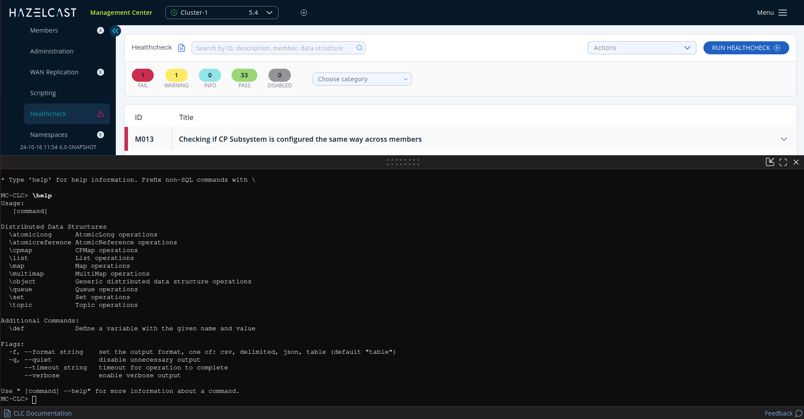
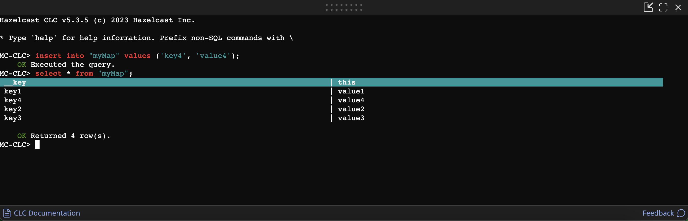
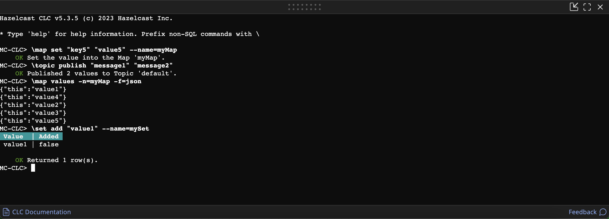

The console feature allows you to execute client operations using the built-in Hazelcast Command-Line Client (CLC).

Management Center includes an interactive version of Hazelcast's Command-Line Client (CLC). CLC functions as a client and adheres to any Security ACLs configured for it.

CLC supports a wide range of data structures and the ability to run SQL queries from a text terminal. It also provides flexible output options, such as table, CSV, and JSON formats.

For further information on these features, refer to the [Overview^](/clc/latest/overview) topic of the CLC documentation.

:::important

When the console is enabled, it grants full access to the cluster through the Command-Line Client. Console commands are **not** limited by the permissions assigned to the Management Center user or principal that runs them, so any user who can access the console can perform any client operation on the cluster.

The console is not recommended for production use. If granular access control is critical, consider leaving the console disabled. See [Toggle Console Support](/hazelcast/latest/maintain-cluster/monitoring#managing-console-support) to enable or disable it.

:::

Console is disabled by default, and you need to enable it in your cluster's configuration. See [Toggle Console Support](/hazelcast/latest/maintain-cluster/monitoring#managing-console-support) for details. The member list shows whether the console is enabled or disabled for each member.

1. Open a console window by clicking on the **Console** button located on the Side Bar.

   
2. Execute any SQL query in the terminal. Do not prefix SQL queries.

   
3. Prefix CLC commands with `\`. For example, `\atomic-long`.

   

To get help or a list of all possible commands, enter `\help` in the console. You can use the `--help` option with any command to view the help for that command.

:::tip

The console container is resizable; to change the height, drag the bar on the top of the console. You can maximize or minimize the console container using the icons in its top-right corner.

:::
