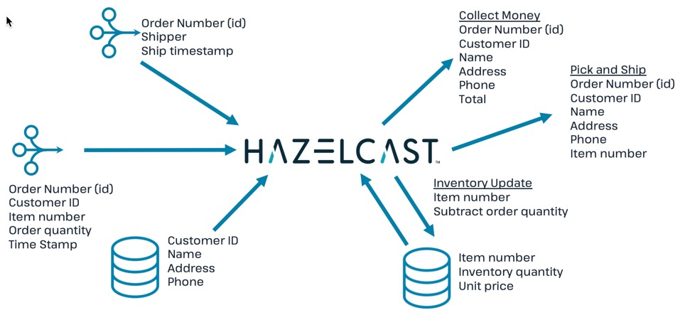
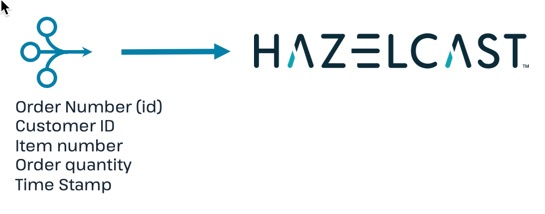
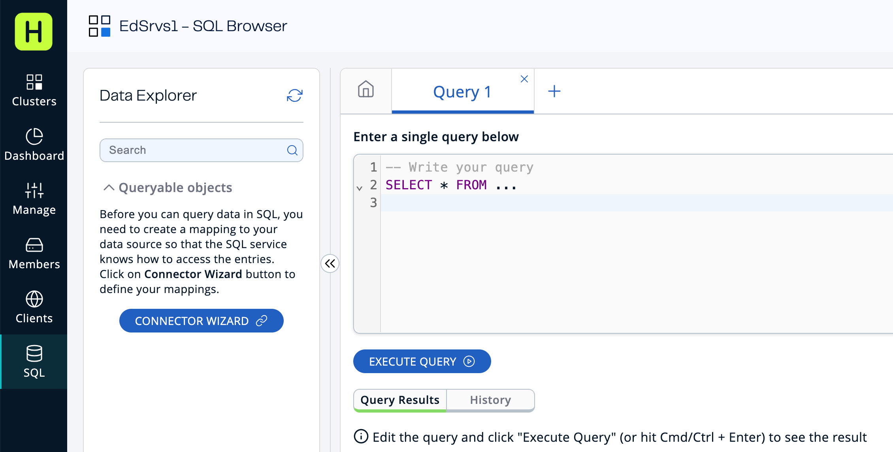
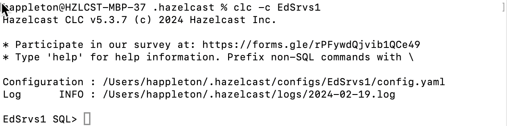
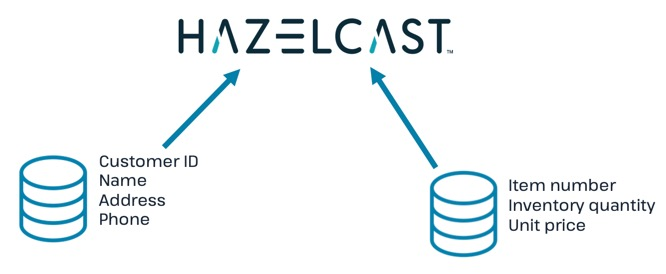
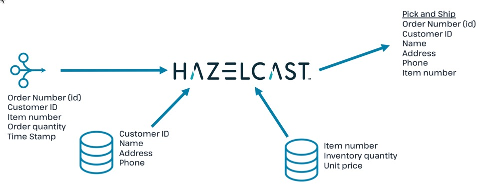
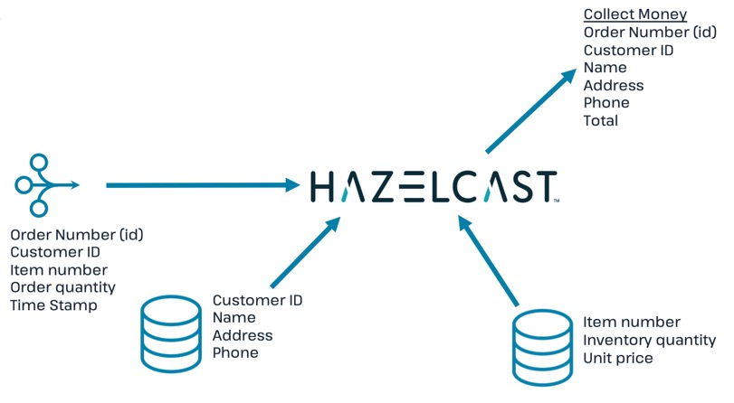

Use Hazelcast Cloud to process streaming data, enrich streaming data with data in fast storage, store output in fast storage, and use an entry processor to update inventory.

## Context



In this tutorial, you will build, step by step, a simple e-commerce order processing application.

Step 1: Connect to a streaming source. Step 2: Import customer and inventory databases. Step 3: Generate pick-and-ship order Step 4: Generate info for money collection Step 5: Generate shipping confirmation Step 6: Update inventory count

## Before you Begin

This tutorial is designed to be completed in conjunction with the Hazelcast Platform Essentials course. Although you can complete this tutorial independently, the course provides operational context and additional information on Hazelcast.

Before starting this tutorial, make sure that you meet the following prerequisites:

- [Set up a Hazelcast Cloud cluster](/cloud/get-started)
- [Connect the Command Line Client](/clc/latest/get-started) or open the SQL tab for your cluster
- Download the repository at [https://github.com/hazelcast-guides/Stream-Processing-Intro](https://github.com/hazelcast-guides/Stream-Processing-Intro)

## Step 1. Connect to Streaming Source

In this step, you will set up connections to an external streaming source and an external database.



1. If you are using the cloud dashboard, open an SQL tab. If you are using the Command Line Client (CLC), open the CLC connection to your cloud cluster.

   Cloud: 

   CLC: 

   :::note

   Your screen or prompt will display your cluster name where the examples above say "EdSrvs1".

   :::

2. Paste the following code to establish a connection to the streaming data source.

   ```sql
   CREATE OR REPLACE DATA CONNECTION TrainingKafkaConnection
        TYPE Kafka
        NOT SHARED
        OPTIONS
             ('bootstrap.servers'='35.88.250.10:9092',
             'security.protocol'='SASL_PLAINTEXT',
             'client.dns.lookup'='use_all_dns_ips',
             'sasl.mechanism'='SCRAM-SHA-512',
             'sasl.jaas.config'='org.apache.kafka.common.security.scram.ScramLoginModule required
             username="training_ro" password="h@zelcast!";',
             'session.timeout.ms'='45000'
             );
   ```

3. Paste the following code to subscribe to the streaming topic for sales data.

   ```sql
   CREATE OR REPLACE MAPPING "orders_topic"
   EXTERNAL NAME "stream_processing_intro.orders" (
       id bigint,
       order_time timestamp with time zone,
       cust_id varchar,
       item_num varchar,
       quantity int
   )
   DATA CONNECTION "TrainingKafkaConnection"
   OPTIONS (
       'keyFormat' = 'varchar',
       'valueFormat' = 'json-flat'
        );
   ```

4. Verify that you are receiving streaming data from the topic `orders_topic`.

   ```sql
   SELECT * from orders_topic;
   ```

   If you are using the query tab, press Execute Query. If you are using CLC, press enter to start the query.

5. Stop the query. If you are using the query tab press Stop Query. If you are using CLC, press CTRL-C.

## Step 2. Load Fast Data Store



In this step, you'll load the in-memory data stores that will be used for stream enrichment and for inventory tracking. The data is currently stored in an external Postgres database, and we need to move it to local memory for fast access.

1. Connect to the Postgres server.

   ```sql
   CREATE OR REPLACE DATA CONNECTION TrainingPostgresConnection
        TYPE JDBC
        SHARED
        OPTIONS
             ('jdbcUrl'='jdbc:postgresql://training.cpgq0s6mse2z.us-west-2.rds.amazonaws.com:5432/postgres',
             'user'='training_ro',
             'password'='h@zelcast!'
             );
   ```

2. Create the mapping for the customer database stored in the Postgres server.

   ```sql
   CREATE OR REPLACE MAPPING "external_customers"
   EXTERNAL NAME "stream_processing_intro"."customers" (
        cust_id VARCHAR,
        last_name VARCHAR,
        first_name VARCHAR,
        address1 VARCHAR,
        address2 VARCHAR,
        phone VARCHAR
   )
   DATA CONNECTION "TrainingPostgresConnection";
   ```

3. Create the mapping for the IMap that will store the local copy of the customer database. Note that the data fields are identical.

   ```sql
   CREATE OR REPLACE MAPPING "customers"(
        cust_id VARCHAR,
        last_name VARCHAR,
        first_name VARCHAR,
        address1 VARCHAR,
        address2 VARCHAR,
        phone VARCHAR
        )
   Type IMap
   OPTIONS (
       'keyFormat' = 'varchar',
       'valueFormat' = 'json-flat'
   );
   ```

4. Verify that the local IMap is currently empty.

   ```sql
   SELECT * from customers;
   ```

5. Copy the data from the external database to the local IMap.

   ```sql
   INSERT INTO customers(__key, cust_id, last_name, first_name, address1, address2, phone)
   -- use cust_id for __key as well as first field in value
   SELECT cust_id, cust_id, last_name, first_name, address1, address2, phone
   FROM external_customers;
   ```

6. Verify that the data has been added to the `customers` map.

   ```sql
   SELECT * FROM customers;
   ```

   You should see the complete list of customers.

7. Create the mapping for the external inventory database.

   ```sql
   CREATE OR REPLACE MAPPING "external_inventory"
   EXTERNAL NAME "stream_processing_intro"."inventory" (
       item_num VARCHAR,
       unit_price DECIMAL,
       quantity SMALLINT
   )
   DATA CONNECTION "TrainingPostgresConnection";
   ```

8. Create the mapping for the IMap that will store the local copy of the inventory.

   ```sql
   CREATE or REPLACE MAPPING "inventory" (
        __key VARCHAR,
        item_num VARCHAR,
        unit_price DECIMAL,
        quantity SMALLINT)
   TYPE IMap
   OPTIONS (
        'keyFormat'='varchar',
        'valueFormat'='json-flat');
   ```

9. Copy the inventory data from the external database into the IMap

   ```sql
   INSERT INTO inventory(__key, item_num, unit_price, quantity)
   -- use item_num as key as well as first field in value
   SELECT item_num, item_num, unit_price, quantity
   FROM external_inventory;
   ```

10. Verify that the data has been added to the `inventory` database.

    ```sql
    SELECT * from inventory;
    ```

## Step 3: Generate Warehouse Pick Order



In this step, you will join the streaming order information with the customer shipping data to generate a pick and ship order for the inventory warehouse.

1. Create an IMap to store pick order data.

   ```sql
   CREATE OR REPLACE MAPPING PickOrder (
        __key BIGINT,
        ts TIMESTAMP,
        item_num VARCHAR,
        quantity SMALLINT,
        cust_id VARCHAR,
        last_name VARCHAR,
        first_name VARCHAR,
        address1 VARCHAR,
        address2 VARCHAR,
        phone VARCHAR)
   TYPE IMap
   OPTIONS (
   'keyFormat'='bigint',
   'valueFormat'='json-flat');
   ```

2. Verify that the IMap has been created, but holds no data.

   ```sql
   SELECT * FROM PickOrder;
   ```

3. Join the streaming order data with the customer database to produce records to be added to the `PickOrder` IMap. Only add records if there are sufficient items in inventory.

   The following fields will come from the `orders_topic` stream
   - Order ID (Use as \_\_key for the IMap)
   - Order timestamp
   - Order item number
   - Order quantity
   - Customer ID

     The following fields will come from the `customers` data store.

   - Customer last name
   - Customer first name
   - Customer address line 1
   - Customer address line 2
   - Customer phone number

     The common data field between `orders` and `customers` is `cust_id`.

     The common data field between `orders` and `inventory` is `item_num`.

   ```sql
   SELECT
        ord.id AS __key,
        ord.order_time AS ts,
        ord.item_num AS item_num,
        ord.quantity AS quantity,
        ord.cust_id AS cust_id,
        cust.last_name AS last_name,
        cust.first_name AS first_name,
        cust.address1 AS address1,
        cust.address2 AS address2,
        cust.phone AS phone
   FROM orders_topic AS ord
   JOIN customers AS cust ON ord.cust_id = cust.cust_id
   JOIN inventory ON ord.item_num = inventory.item_num
   WHERE ord.quantity < inventory.quantity;
   ```

4. Press CTRL-C to stop the join.
5. Create a job that generates the PickOrder. Creating a job places the process into the background so it is running continuously without user intervention.

   ```sql
   CREATE JOB PickOrder AS
   SINK INTO PickOrder
        SELECT
             ord.id AS __key,
             ord.order_time AS ts,
             ord.item_num AS item_num,
             ord.quantity AS quantity,
             ord.cust_id AS cust_id,
             cust.last_name AS last_name,
             cust.first_name AS first_name,
             cust.address1 AS address1,
             cust.address2 AS address2,
             cust.phone AS phone
        FROM orders_topic AS ord
        JOIN customers AS cust ON ord.cust_id = cust.cust_id
        JOIN inventory ON ord.item_num = inventory.item_num
        WHERE ord.quantity < inventory.quantity;
   ```

6. Verify that the `PickOrder` IMap now contains data.

   ```sql
   SELECT * FROM PickOrder;
   ```

7. From your cloud console, monitor memory utilization. You should see it increasing.
8. From Management Center, under Storage, select Maps. You should see the PickOrder map entries increasing.
9. From Management Center, under Streaming, select Jobs. You should see the PickOrder job running. Select the job, then click the Suspend button to pause the job.

## Step 4: Generate Order Total



In this step, you will perform a three-way join with the streaming order information, the customer database, and the inventory database. The output includes a calculation of the amount due for the order, and is passed to an IMap. This map can then be read by a payment processing system.

1. Create a new IMap called `amount_due`.

   ```sql
   CREATE OR REPLACE MAPPING amount_due(
        __key BIGINT,
       cust_id VARCHAR,
        last_name VARCHAR,
        first_name VARCHAR,
        address1 VARCHAR,
        address2 VARCHAR,
        phone VARCHAR,
        total DECIMAL)
   TYPE IMap
   OPTIONS (
       'keyFormat' = 'bigint',
       'valueFormat' = 'json-flat');
   ```

2. Join the order stream and the customer database to generate the amount due information and publish it to the `amount_due` topic you just created.

   ```sql
   CREATE JOB amount_due AS
   SINK INTO amount_due
        SELECT
             ord.id AS __key,
             ord.cust_id AS cust_id,
             cust.last_name AS last_name,
             cust.first_name AS first_name,
             cust.address1 AS address1,
             cust.address2 AS address2,
             cust.phone AS phone,
             (ord.quantity*inv.unit_price) AS total
        FROM orders_topic AS ord
        JOIN customers AS cust ON ord.cust_id = cust.cust_id
        JOIN inventory AS inv ON ord.item_num = inv.item_num;
   ```

3. Verify that data is being published to the `amount_due` map.

   ```sql
   SELECT * FROM amount_due;
   ```

## Step 5 (Optional): Examine Java Pipelines

Download the entire repository from GitHub: [https://github.com/hazelcast-guides/Stream-Processing-Intro](https://github.com/hazelcast-guides/Stream-Processing-Intro). Under the Sample Pipelines directory, you will find sample code that performs the same functions as the two pipelines you created in SQL. The supporting classes are also included.

## Summary

In this tutorial, you learned to:

- Generate data using SQL
- Perform basic SQL queries of both streaming data and data in Fast Storage
- Join stored data to streaming data to generate enriched output
- Use SQL to submit a job to the stream processing engine

## See Also

- [Documentation on pipeline concepts](/hazelcast/latest/pipelines/building-pipelines)
- [Documentation on Hazelcast's implementation of SQL](/hazelcast/latest/sql/sql-overview)
